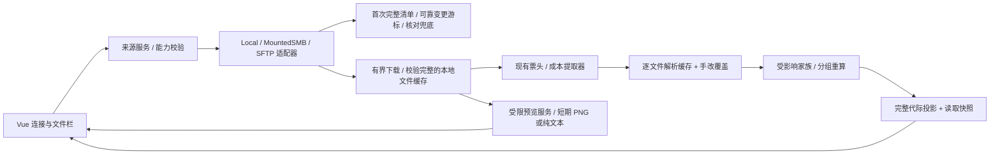

# 服务器链接（试验版）与目录增量汇总设计

状态：2026-11-16 设计提案与合成交互原型，尚无生产连接器或增量汇总实现。对应 [WS-08](PRODUCT_BACKLOG.md#ws-08)、[WS-09](PRODUCT_BACKLOG.md#ws-09)。本轮任务 `server-cache-design-20261116`，起点 `codex/cost-select-all-transitions@ab9d4b8`；仅补充设计和现有原型，保留已有未提交开发成果。

## 1. 需求与当前事实

用户需要读取局域网共享文件夹或远程服务器中的发票，在右侧文件浏览栏定位、预览并汇总；连接或解析耗时要可见，断连不能丢失上次结果。刷新已汇总目录应先显示缓存，只处理增删改，完整重建作为单独修复入口。

当前源码核对：

- `monitoring/state.py::detect_source_changes` 已按路径、mtime、size 检测增删改；`monitoring/sync.py` 无变化可跳过，但发生变化后调用 `build_summary`，后者仍对目录所有支持文件调用提取器。不能把“有变化检测”当作“逐文件增量解析”。
- `storage/read_views.py` 已有完整快照与首次临时批次；`services/document_index.py` 已有单据缓存。新方案优先复用，不新增一套发票主存储。
- `services/company_views.py` 非监控目录读取上次汇总并有界检查新鲜度，不自动做远程连接；现有预览/打印严格绑定活动目录。
- 本轮不改变生产 API、单活动 monitor、成本三件套位置或本地预览权限；以下模型、路由和缓存布局均为拟议。

## 2. SSH 是什么，怎样使用

SSH 是加密连接远程电脑的协议，常见用途是登录终端、执行命令、文件传输和端口转发。SFTP 是运行在 SSH 上的文件访问协议，可以列目录、下载文件；它不是 FTP/FTPS。**本功能首版只使用 SFTP，不提供任意远程命令或终端。** 用户无需懂命令行。

使用步骤：服务器管理员启用 SSH/SFTP，创建只能读取指定资料目录的账号；提供主机名、端口（常见 22，但以管理员配置为准）、用户名、可访问根目录和主机密钥指纹。用户在“服务器链接（试验版）→ SSH / SFTP → 添加”填写，选择 SSH Agent / 系统密钥或密码认证，核对指纹后连接，再选资料目录。Mac 的“远程登录”可提供 SSH 服务；Windows 需要配置 OpenSSH Server 或其它 SFTP 服务，NAS 依型号设置。

主机指纹用于确认“连接的是哪台服务器”，账户密钥/密码用于证明“你是谁”。首次连接显示指纹并要求核对，后续变化硬阻断，不自动接受。私钥口令不是服务器密码；私钥不上传，密码不放 URL、浏览器存储或日志。实际产品由 Keychain / Windows Credential Manager 保存凭据引用，优先 SSH Agent；Agent 不可用或密钥锁定时回到可诊断认证状态。

SSH 端口转发只转发网络连接，不会自动把远端目录变成本地文件夹。跳板机（ProxyJump）和 VPN 可解决网络可达性，文件权限仍由服务器控制。不承诺能连接没有开放服务、处于 CGNAT 后且无 VPN/中继的机器。

## 3. 协议与网络路线

| 场景 | 建议路线 | 本功能边界 |
|---|---|---|
| 办公室局域网、NAS/Windows 共享 | SMB 3，经操作系统挂载后选择共享根 | 首阶段候选；系统负责 SMB 凭据与协议，应用仍须识别掉线和挂载身份变化 |
| 外网服务器有可达 SSH 端口 | SFTP，允许自定义端口、密钥认证 | 第二阶段候选；连接仅由本机后端发起，不把 InvoiceHub localhost 暴露公网 |
| 远程办公且不希望公开文件服务 | VPN / 组网后使用 SMB 或 SFTP | 推荐；VPN 由系统管理，应用显示连接诊断 |
| 多层网络 / 堡垒机 | SSH 跳板机 | 后续扩展，独立验证每跳指纹；首版不执行任意 ProxyCommand |
| WebDAV over HTTPS、只读 HTTPS 文件服务 | 后续独立适配器 | 不假定普通网页支持目录枚举，证书错误拒绝 |
| 截图中的 AFP | 仅借鉴交互，不列为新协议实现 | 旧协议兼容优先交给系统；不得宣传跨平台 AFP 支持 |

外网开放端口需要管理员配置防火墙、路由/NAT与访问范围；不建议把 SMB 445 直接公开到互联网，优先 VPN 或 SFTP。更换端口不等于安全。连接超时、DNS、端口不可达、认证失败、无目录权限必须分开提示，不能统称“连接失败”。

## 4. 页面与原型

入口名称固定为 **服务器链接（试验版）**，位于现有侧栏“添加公司资料夹”下方。入口使用参考 macOS 的显示器与网络节点轮廓图标，以 20px 内联 SVG 绘制并继承文字颜色，不依赖系统字体或截图资源。配置弹窗参考 macOS：地址框、个人收藏服务器、添加/移除、浏览、连接；SSH 分页参考图二：已有连接卡片和“添加”，展开主机、端口、用户名、认证、根目录、指纹核对。截图仅作为布局参考，不复制其中服务器地址、用户路径或资产。

页面右上角仅保留两个控件：展开/收起文件标签页、放大/还原文件面板；移除网页全屏及其调用。“打开服务器文件列表”按钮只展开右侧面板，不切换左侧栏或当前模块。普通宽度不超过 560px，放大最多填满原有标签页/主内容区，到左侧公司栏右边界为止；窗口变化和拖动侧栏时重新测量边界，两种宽度均不能覆盖模块列与公司栏。

右侧“服务器文件”内原“目录汇总”标签改为当前目录名称（初始为连接根目录），旁边设置下拉按钮，显示当前目录的直接子目录与返回上级入口；路径面包屑可返回任一祖先。选择后更新标签名称、文件列表与该目录含子目录的缓存统计，切换范围不重新解析未变文件。原型用合成公司/目录作样例，左侧仍为原有本机公司栏，不再创建独立服务器公司树。空文件夹、只有不支持格式或当前无可读取内容均显示“无可读取的文件”；筛选无匹配另行显示，尚无完整缓存提示先连接，不能把网络/权限失败当空目录。

连接成功打开文件面板，保留连接状态、路径、筛选、文件标签页、列表与预览；连接/浏览不切换活动监控目录。目录选择是已登记来源根内的视图范围，不修改 SourceProfile 根或自动建立公司归属。远程路径只作展示，后端操作使用不透明 source_id/entry_id，不能接受页面传任意路径；服务器同名公司不自动关联本机，未归属文件不进入公司计算。

蓝色加载条置于文件标签页底部：未知总量只显示活动条与阶段；已知总量显示已完成项/总项及真实字节或计数，不能用定时器伪造生产百分比。切换标签只改变可见任务，不重启后台任务；取消停止该任务，保留已完成缓存。

[现有原型](design/workspace-sidebar-prototype.html) 增加独立脚本 `server-connection-prototype.js`，样式与内容在 Shadow DOM 内隔离，入口单独挂载。原有公司、成本、做账、比较、模块和原型说明保留。合成演示包含 SMB/SSH 配置、收藏、目录浏览、文件标签、预览、增量刷新、断连/重连、崩溃恢复；不请求网络、不读取凭据、不连接真实服务器，刷新演示明确标注模拟。本轮按用户修订去掉独立服务器工作区和模块拦截，原型仅在右侧按目录演示文件与统计，原有模块内容保留；跨模块接入继续以 §12 的未来设计为准。固定三个示例来源的合成缓存可保存在 localStorage 并经严格样本校验恢复；自填地址与账号仅留在会话内，不持久化。模拟崩溃和真实页面重载均不代表后端持久恢复已实现。

## 5. 后端架构与文件身份

拟议独立职责：`services/sources.py` 管理来源；`storage/source_adapters/` 实现 list/stat/read/cancel/capabilities；`services/source_sync.py` 做清单差分与任务恢复；新路由在 `api/routes/`，不堆入 AppState。这里不表示这些文件已存在，正式开工再同步工程文件地图。

- `SourceProfile`：随机 source_id、协议、连接配置引用、服务器身份、认证主体、规范化根、来源 revision、只读能力与本地缓存预算。与 TargetProfile 显式关联，不能把 `sftp://...` 当 `Path`，也不能用同一本地暂存目录碰撞现有 target_id。
- `SourceEntry`：source_id、entry_id、相对路径、类型、字节数、远端文件 ID/版本（若支持）、mtime精度、内容哈希和最后验证时间。Linux 路径区分大小写，SMB 规则由适配器报告；不沿用所有来源统一 casefold。
- 连接改根、改账户或主机密钥变化均使旧授权与身份失效；校验根包含关系，拒绝越根符号链接、`..`、NUL、设备名和非法路径。服务器返回的文件名只作文本展示。
- 适配器能力区分“可枚举、可读取、可稳定版本、可续传、可监控、可持久续接变更”；网络共享事件不可靠，使用有界周期对账，保持单活动监控来源。其它目录仅显式单次刷新，不暗启多目录 daemon。
- 远程请求从本机受信页面经同源保护进入后端；只允许登记的协议/主机/端口/根，不提供任意 URL 代理，不自动发现公网或执行 shell。现有本地 API 权限不扩大。

## 6. 预读取、缓存及投影位置

| 层 | 存什么 | 复用 / 失效 / 清理 |
|---|---|---|
| 目录元数据 | 按来源和根隔离的完整清单、扫描完成标记 | 首屏先读最近清单；后台分页对账，不递归下载全部目录 |
| 原始文件缓存 | 下载完成并校验的源文件副本，内容哈希命名 | 按需下载；当前页与相邻少量文件低优先级预取；活动下载/预览加租约，LRU 不清理使用中副本 |
| 解析缓存 | 原始提取字段、成本明细、错误与解析版本 | 键含 source_id、文件身份/内容哈希、解析器/字段/OCR配置版本；失败单独记录，不当作空票成功 |
| 完整读取快照 | 已发布代际的行、索引、统计与时间 | 即时显示上次完整结果；新代际完成后原子切换；SQLite仅作可重建缓存 |
| 预览 | PNG 页、纯文本、短期 job | 保持现有进程内有界/闲置续租；不持久化渲染页，不将浏览器缓存当源文件有效证据 |

默认建议：连接并发 2、预取相邻 2 个文件；原文件缓存预算 1 GiB，单文件下载上限 64 MiB（不同渲染格式仍取现有更严格限制）；元数据分页 200 项；超大文件单独提示。这些为待实测调优的初值，不是当前产品配置。暂停/离线不清除完整快照；重连前暂停预取。磁盘不足停止新增下载，保留最后完整投影与诊断，不循环驱逐再重下。

原文件缓存位于应用私有运行目录、按来源隔离；用户可查看占用、设置预算、显式“清除离线副本”。默认退出保留副本，提供关闭后清理选项；清缓存不删远端源文件和人工修订。权限使用当前系统用户私有目录，系统磁盘加密之外的应用级加密列为后续评估；不能暗示默认加密。手改覆盖/标签等用户输入不是可丢弃缓存，继续用独立 JSON 并备份；SQLite 损坏可重建，不能丢手改。

**位置决策：** 本地来源仍保持 workspace 普通汇总、watch_dir 成本三件套不变。远程只读首版将普通/成本投影放入本机该 SourceProfile 的独立 workspace，并在页面明确“服务器源目录”和“本机汇总位置”，不在服务器写三件套，也不假冒缓存目录为 watch_dir。该例外须在正式开发前获评审并同步 AGENTS 的路径规则、TargetProfile 与成本 API；未完成适配前远程只开放浏览/预览，汇总能力显示未接入。后续远程写回另立项，不在首版自动上传。

## 7. WS-08：刷新只更新增删改

“打开标签/刷新列表”立即读当前完整快照；“刷新目录”保留旧表并后台做差分；“完整重建”显式诊断入口，展示耗时与原因，不再作为默认刷新。无需用户手动清缓存。

1. 取得来源/根身份和扫描 generation，读取上次完整清单；不持有全局写锁进行网络 I/O。
2. 首次完整分页枚举，记录每页和每个子树是否成功；后续优先续接可靠变更游标（见 §11），只读取增删改事件。无该能力或游标过期才完整轻量核对目录，未变项仍不重解析。只有根仍为同一来源、扫描完整且权限/连接未变，或连续授权事件提供明确删除证据时，才计算删除；超时、403、挂载消失、页遗漏和取消是 unknown，不是空目录。
3. 新增/签名变更项进入下载和解析队列；元数据未变的复用解析缓存。只有 mtime+size 的弱签名不能保证发现“等长同时间替换”：优先远端稳定版本/变更令牌，事件提示脏项则哈希；弱版本来源定期有界内容核验并提供“校验全部内容”。显示上次内容核验时间，不能声称轻量刷新已证明全部内容未变。
4. 下载到独立 `.part`，校验前后版本、长度与内容哈希后原子入缓存。源在下载时变化则丢弃本次候选、有界重试；无稳定版本时不能保证远程原子快照，必须标记验证级别，持续变化则保留旧代际。SFTP 不假定提供服务器内容哈希；需要时客户端计算，强一致需服务端快照/不可变版本支持。
5. 变化项更新逐文件原始解析结果；删除只退出派生记录。以变化前后的发票号家族扩展受影响集合，重算同票格式补齐、分类冲突、去重和勾选合计；手改覆盖按稳定来源映射保护，改名不可靠匹配时列为待核对，不乱继承。
6. 成本按受影响品目重算；库存/加权与公司月度比较可能影响后续月份，需沿依赖传播到所有受影响期，不能只改当前行金额。更改解析器/OCR/规则/公司税务设置按依赖版本使对应层失效；只变筛选排序不得触发重新解析。
7. 下载/解析在锁外；提交在来源级写锁中复核 source revision、旧 generation、手改 revision，再写候选代际并原子发布 manifest 指针。页面行、统计、成本和分页均读同一 generation；迟到任务不能覆盖新结果。
8. CSV/XLSX 可从缓存重导出完整文件（XLSX 本就通常需要整体写出），但不再次读取全部源票。跨多个投影不能只逐文件 replace 后宣称事务；以 manifest 发布代际，现有直接读固定文件的消费者必须一起适配，兼容文件只作为带版本的导出副本。

例：10,000 文件中新增 3、修改 2、删除 1，解析调用应只针对 5 个变化文件（以及明确失效的依赖），删除不触发正文解析；家族与统计可以利用缓存重算。无变化刷新解析/正文下载调用为 0，弱签名定期内容核验另计并向用户说明。完整目录枚举仍可能 O(N)，没有服务器变更日志时不能承诺网络检查 O(变化数)。

## 8. 远程文件提取、汇总与预览是否可用

能设计为可用，但不能仅“连接成功”就宣称已兼容。源适配器先提供可验证的本地完整副本，现有票头/成本提取器读取该副本，结果保留远程来源身份与版本；不在服务器安装整套 InvoiceHub，不通过 SSH 执行解析命令。OCR 仍遵循单独配置与传输授权，连接服务器不等于允许把票上传给第三方 OCR。

PDF/OFD/图片沿用 PNG 渲染、XML 安全文本；OFD 组件缺失或字体异常仍按现有规则报错。未支持的文件仅显示元信息。离线且完整副本存在：标“离线副本，最后核验于…”，允许独立只读浏览；没有副本：显示“连接后下载”，不展示伪造票面。重连确认源已变/删除则撤销当前原票身份，旧快照只能在明确历史视图显示，不能当作现行原票。

远程预览需要独立 source-bound 会话，再复用底层 renderer；不能放宽当前 `invoice_key + source_path + active target` 校验来接受任意网络路径。原文件持久缓存与渲染页短期缓存分开。首版离线禁用正式打印、业务导出、删除、移动、开票参考保存；汇总历史可查看，复制须带“截至时间/过期”提示且不与现行数据混写。系统打开需单独准备受控只读副本并重验版本；“打开终端/编辑服务器文件”不照抄图三。

## 9. 断连、崩溃与恢复

| 情况 | 用户看到 | 后端动作 |
|---|---|---|
| 首次连接失败 / 尚无缓存 | 明确失败阶段、重试入口，无汇总 | 不创建成功状态、不造空表 |
| 扫描中断 / 目录无权限 / 共享被卸载 | 上次完整结果 + 未核验 | 丢弃不完整删除集合；保留清单与快照 |
| 下载中断 | 已完成项保留，未完成待恢复 | `.part` 不进入解析；仅在支持续传且版本相同才续，否则重新下载该文件 |
| 单文件解析失败 | 失败项及旧版标识 | 保留上次完整代际；可展示单独临时候选，不能混入正式总计 |
| 应用/worker崩溃 | 重启立即显示上次完整结果 | 查持久任务日志与 manifest；未提交候选回收，完成缓存复用，再重新对账 |
| 发布后事件/SSE丢失 | 重连后对齐当前代际 | GET 状态恢复，不重新提交同一刷新任务 |
| 主机指纹变化 / 账户撤权 | 身份需核对 / 访问被拒 | 停止自动重试并禁用旧授权预览；保留私有缓存供显式清理，不继续向外暴露 |
| 缓存损坏 / 磁盘满 | 可诊断提示，保持旧快照 | 校验失败项隔离；可从来源重建，不触碰源文件与手改真值 |

任务状态分离：connection=`connecting/online/offline/auth_required/host_key_changed`；sync=`idle/scanning/downloading/parsing/publishing/failed/cancelled`；snapshot=`none/current/stale/unknown`。每个响应带 source_id、task_id、generation、last_complete_at、last_verified_at、scan_complete、coverage、失败计数。连接在线不等于汇总最新；页脚蓝条必须与同一任务状态一致。

连接超时建议 10 秒、读取空闲超时 30 秒；仅可重试的网络错误指数退避加抖动，最多 3 次后转手动重连。认证/指纹错误不自动重试；关闭连接取消任务并使 session epoch 失效，迟到结果不发布。健康/取消 API 不等待网络读锁；SMB 阻塞 I/O 使用独立可终止 worker，实测操作系统挂载超时后再承诺终止时限。

## 10. 分期与验收门槛

1. WS-08 先在本地完成逐文件缓存、增量解析、家族/成本依赖更新和完整代际提交；保留完整重建兜底。
2. WS-09-A 完成 UI 与 SourceProfile、已挂载 SMB 只读浏览及断连识别；原型评审通过后再改生产 Vue。
3. WS-09-B 接入 SFTP、指纹/凭据、按需下载、本地预览；远程输出路径例外和 source-bound 权限经评审后再接汇总。
4. 跳板机/WebDAV、远程写回、远程终端、多来源同时监控另行排期；当前不做。

最低验收（尚未执行）：

- 10,000 合成文件无变化解析数 0；3增2改1删解析数5；同票多格式新增/删除、用户手改、OCR/算法升级、改名、等长同时间变更强校验；与完整重建逐字段/总计一致。
- 测首屏缓存时延、元数据扫描耗时、网络请求数/字节、解析调用、峰值内存/磁盘；同机同数据冷/热各跑，建议热缓存首屏 p95 ≤500ms（本地合成基准目标，非性能承诺），远程注明 RTT/带宽；不以原型延时作为性能证据。
- 分页扫描遗漏、目录权限变化、SMB 卸载后空挂载点、断连重连、源下载时变化、每个发布阶段注入崩溃、磁盘满、损坏缓存、重复任务/旧 generation、两来源同路径隔离；保证不误删、不混代、不丢手改。
- 远程非活动来源不可调用旧本地预览/打印；遍历越界、符号链接、主机密钥变化、凭据泄漏、恶意文件名/主动 XML、超大压缩包负向验证；缓存清理与活动租约互斥。
- 原型先验配置、收藏、SSH、右栏开关/边界内放大还原、当前目录名/下拉子目录/面包屑、目录统计隔离、空目录/不支持格式提示、文件标签/蓝条、本机公司栏和模块保留、同来源缓存复用/异来源隔离、游标与核对模式、离线预览及崩溃恢复；另验真实桌面/窄屏、键盘与减少动画。
- 实现后双平台桌面/浏览器、真实只读 SMB/SFTP 测试服务器、默认配置、正式 Windows BAT、原生选择器/凭据界面、OFD 组件与打包成品分别验收；本轮只覆盖合成原型与文档。

## 11. 二次连接不遍历的条件与增量协议

用户的性能目标分两层：不重复提取未变文件，可由 WS-08 的本机解析缓存实现；不枚举远程目录，需要服务器提供完整、可持久续接且权限范围明确的变更日志。标准 SFTP 没有通用增量日志协议；SMB change notify 是在线提示，不保证离线期间不丢事件。客户端不能仅靠记住“最后一次连接时间”证明目录没有修改或删除。

| 来源能力 | 首次连接 | 二次连接 | 变化文件读取 |
|---|---|---|---|
| 可靠 change cursor / delta token | 完整清单，取得配套基准游标 | 按游标拉连续事件，不枚举目录 | 只下载新增/修改；明确删除仅移出投影 |
| 标准 SMB / SFTP | 完整清单与文件版本 | 轻量核对目录元数据，可能 O(N) | 只下载/解析新增与修改，弱签名另需内容核验 |
| 游标失效、日志截断、权限/根变化 | 保留旧完整快照 | 明确提示需重新核对，不能伪称仍为纯增量 | 尽量复用匹配的文件与解析缓存 |

若必须满足“离线后重连也绝不遍历”，需要管理员提供服务器侧增量服务/现成支持 delta 的 API，或由服务端维护稳定快照与变更清单；这是可选后续适配器，不强制安装整套 InvoiceHub，也不经 SSH 任意执行脚本。服务端仍需维护事件来源，首次建索引或日志失效时也可能需要扫描，不能承诺整个系统永不遍历。

拟议 `changes(cursor, scope)` 返回有序事件、稳定 file_id、before/after version、move 的旧新路径、tombstone、continuation、terminal_cursor、journal_id 和授权 scope revision。首次枚举必须与基准游标闭合：使用服务端一致快照，或先取游标再枚举并重放期间事件，不能留下枚举/监听间隙。日志必须说明保留期与连续性；权限撤销不是 delete，跨授权范围移动须先检查可见性。

客户端先持久记录事件候选和幂等标识 `(source_id, journal_id, sequence)`，按文件折叠重复变化，再下载/解析并发布新完整代际；只有对应代际成功提交才推进已提交游标。事件分页末页、投影和 cursor 一起经 manifest 发布，不能先存游标再写汇总。崩溃重放同一事件不重复入库；旧 epoch / revision 结果拒绝。发生序号断档、服务器恢复导致 journal_id 变化、scope 变化、版本不一致或 token 失效时停止增量，保留旧快照并核对完整清单；核对完成前不推断删除。

“仅更新没录入过的内容”落实为：新增才录入，已有文件修改更新同一身份及其依赖，明确删除退出当前投影；同票跨格式仍按既有家族规则聚合，不能把改名/修改当另一张新票。所有模块复用同一份变更结果，各自不再扫描一次。界面分别显示枚举数、下载数、解析数、缓存复用数及游标/核对模式；演示数据不能作为真实耗时或网络请求量。

## 12. 各模块关联服务器资料的接入边界

以下均为未来接入设计，当前原型只提供右侧目录视图，未连接现有业务模块。

建立 `SourceBinding(source_id, company_id, directory_role, root_entry_id, binding_revision)`，由用户确认公司归属及目录角色，不根据文件夹名称猜税务身份。服务端把来源适配为只读可验证本地副本，下游仍调用已有领域服务，不能让每个页面单独下载和计算。来源、公司、目录、期间、规则版本及完整 generation 必须随请求/缓存键传播；标签页及后台任务按该上下文隔离。不同来源的同名公司先独立，显式关联时验证公司身份和重复票证据。

| 模块 | 关联资料与计算 | 正式接入要求 |
|---|---|---|
| 首页 / 公司 / 项目 | 目录投影、公司期间统计、项目归属 | 同代际后端聚合，未归属单列，不把右侧目录金额直接套到本机公司 |
| 成本分析 | 成本票明细、开具票对照、税务设置 | 复用现有成本公式/人工已开快照，不用缓存票头冒充明细 |
| 单据 | 已识别票与成本行作为入出库候选 | 沿用候选/完整索引和导出前来源复核 |
| 做账 / 银行 / 工资社保 | 银行、进销、勾选、工资及账套资料 | 适配已有解析与校验，缺科目/申报证据阻断，不能绕过可执行凭证校验 |
| 一致性 / 比较 | 同期同版本各类投影及来源证据 | 服务端既有校验/勾稽，缺资料明确待核对 |
| OCR / 临时识别 | 授权读取选定文件完整副本 | OCR 能力和传输授权独立，临时解析不得回写正式公司投影 |
| 设置 / 标签 / 人工修订 | 来源配置、目录绑定、手改覆盖、缓存预算 | 密钥走系统安全存储；业务人工字段独立备份及 CAS，不作为可丢弃缓存 |

全部模块读取 manifest 指向的同一完整代际；某个必需领域适配尚未就绪时显示“未接入/待更新”，不能用旧模块结果配新首页总计。解析结果缓存与领域投影缓存分别按版本失效：改展示筛选不解析票，改税务设置只失效受影响成本/做账依赖，改解析规则重建所需原始字段。大批更新可分阶段显示候选进度，但候选不与正式总计混合。

只读服务器不能直接套用现有公司资料夹写入流程。远程源文件、现行做账真值与本地人工覆盖层须分别标位置；标签/项目/所属期/已开状态等后续按绑定保存本机受保护覆盖层，应用前校验来源及人工 revision，不默默写回服务器。本提案不迁移现有 `凭证/` 真值，不开放远程审批、导出或账套操作；若要支持这些能力需逐模块完成写入位置、备份、冲突和来源实时复核评审。

分期先贯通来源绑定、文件浏览与各模块只读计算，再按原有业务保护逐项开放本机人工状态；不以“服务器连接成功”使所有按钮同时可用。新增最低验收：两个来源同路径不串数据，未归属不进入公司统计；全部模块同代际且结果与本地同内容基线一致；重连连续游标不枚举、无变化不下载/解析，新增/修改/删除与全量结果一致；游标过期/日志断档/权限变化/首次枚举间隙/提交游标前后崩溃不丢变化；模块切换无重复扫描，人工状态与已审批资料不被缓存重建覆盖。
