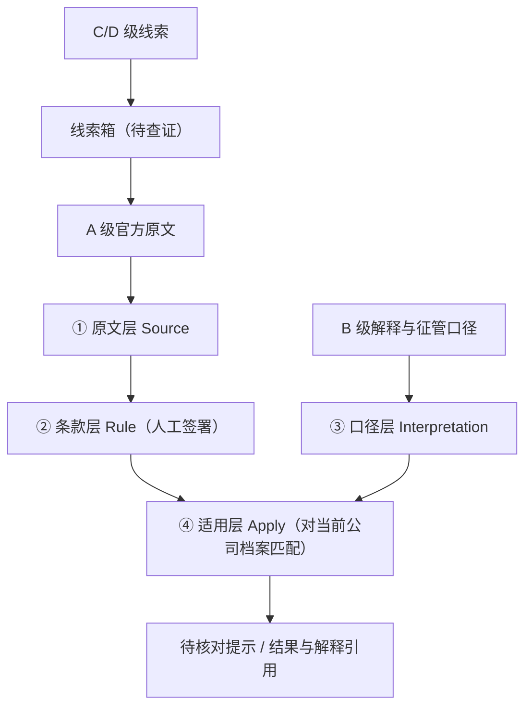

# 税务政策来源、核验流程与政策中心设计

> 2026-09-12 · 配套[工作台设计](TAX_WORKBENCH_DESIGN.md)、[算法与政策规格](TAX_ALGORITHMS_AND_POLICY.md)与[价值评估与就绪度](TAX_WORKBENCH_VALUE_AND_READINESS.md)。本文是待实现的采集、核验与治理规格，**不是**已接入运行产品的能力：本轮没有新增抓取任务、定时轮询、外部请求或政策缓存。
>
> 时效声明：本文引用的政策事实核对日期为 2026-09-11，文号与结论以算法文档第 11 节的 S1—S13 为准。本文**不新增**任何未经核验的文号、比例、期限或地方口径。

## 1. 目标与非目标

目标：让"当前适用什么规则"成为**可追溯、可复核、可回放**的事实，而不是模型记忆或自媒体印象。

非目标：

- 不做政策全文镜像。只保存文号、官方链接、条款定位、摘要与核验记录。
- 不做自动改规则。任何政策变化都必须经过人工复核签署才能进入计算链。
- 不代替用户与主管税务机关的确认，也不判断某项优惠对具体纳税人是否成立。

## 2. 来源分级

只有 A 级可以进入规则包；B 级只能产生待核对提示；C、D 级只能产生线索。

| 级别 | 来源类别 | 具体渠道（示例） | 允许用途 |
|---|---|---|---|
| **A 法定与规范性文件原文** | 法律、行政法规、部门规章、总局与财政部公告及规范性文件 | 国家法律法规数据库、国务院政策文件库、财政部官网、国家税务总局政策法规库（`fgk.chinatax.gov.cn`） | 规则包唯一依据，且须签署后才生效 |
| **B 权威解释与征管口径** | 政策解读、答记者问、纳税服务问答、税费种认定与申报期限提示、省级税务机关口径、主管税务机关书面答复 | 总局解读栏目、12366、电子税务局提示、各省市税务局官网与公众号 | 生成待核对提示与解释引用，**不得自动升级为规则** |
| **C 专业线索** | 咨询机构税务快讯、律所评论、会计与税务社区整理 | 四大与咨询机构中国税务快讯、专业媒体 | 只用于发现"可能需要查证"，须回溯 A 级原文 |
| **D 视频号与自媒体** | 微信视频号、短视频平台、个人公众号 | 官方账号与个人账号 | 只进线索箱（第 7 节），永不进入计算链 |

优先级规则：**对具体纳税人，主管税务机关的税费种认定、申报期限和系统提示高于任何通用资料**；但这类信息只对该纳税人、该期间成立，不能当作通用规则包内容。

## 3. 获取难度实测评估

| 环节 | 难度 | 说明 |
|---|---|---|
| 获取文件原文 | 低 | 免费公开、链接稳定、有列表页；单个文件的采集成本几乎为零 |
| 检测"有没有新文件" | 中 | 无统一接口或推送，只能轮询列表页做差异比对；发布节奏不规律，政策常在季末、年末、年初集中出台 |
| 结构化到条款与要素级 | 高 | 原文是自然语言；一份文件可能同时修改多个条款，并带生效日、过渡期甚至追溯适用 |
| 地方口径 | 高 | 分散在各省市局与电子税务局，不集中；同一事项各地不同；只能按实际所在地逐个采集 |
| 征期与顺延安排 | 中 | 由年度申报期限安排、地方征期提醒与节假日安排共同决定，需要拼装而非单一来源 |
| **判断对某公司、某期间、某笔业务是否适用** | **最高** | 依赖主体身份、地区、行业、期间与业务实质，是整条链路中最难也最有价值的一环 |

结论：**难点不在"拿到文件"，而在"判断文件对这一笔业务是否适用"。** 前半段可以自动化，后半段必须由税务内容复核者签署——这正是 `review_status` 只能由人签发、AI 只能起草的原因。

## 4. 四层政策中心

| 层 | 内容 | 关键字段 | 写入权限 |
|---|---|---|---|
| ① 原文层 | 官方来源定位与抓取记录 | `source_id / 文号 / 标题 / 机关 / 发布日期 / URL / 抓取时间 / 内容 SHA256 / 摘要 / 修订或废止关系` | 采集可自动，登记须人工确认 |
| ② 条款层 | 可计算规则 | `rule_id / 文号与条款定位 / 税种 / 地区 / 纳税人资格 / 行业 / 业务类型 / effective_from / effective_to / 公式或参数 / coverage_through / review_status / reviewer / reviewed_at` | **仅人工签署** |
| ③ 口径层 | 解释、答问、地方口径、主管机关答复 | `interpretation_id / 类型 / 关联文号 / 适用范围 / 采集时间` | 采集可自动，默认只作提示 |
| ④ 适用层 | 与当前公司档案的匹配结果 | `applicable / needs_confirmation / not_applicable` + 逐条原因 | 只产提示，不自动改结果 |

硬约束：

- ③ 层内容**不得**被自动提升为 ② 层；界面必须分别标示"这是法条"与"这是解读"。
- ② 层规则必须能回答"这条规则的依据文号、条款、生效期间和核验人分别是什么"，否则拒绝入包。
- ④ 层只产生待核对提示；不得因为匹配到一条口径就改变已经算出的税额。

## 5. 变更流水线与发布纪律

流水线：

1. **采集**：按已登记来源做有界轮询，只取列表页与元数据，尊重站点条款与访问频率，不复制全文。
2. **比对**：产生新增 / 修订 / 废止三类差异，并给出"可能受影响的 `rule_id` 清单"。
3. **工单**：生成待复核工单，包含差异原文定位、影响面和需要的判断。
4. **判定**：税务内容复核者确认适用范围、文号、条款、有效期、公式与解释模板后签署，或标记拒绝并说明原因。
5. **发布**：生成新的规则包版本（单调 revision），内容 hash 进入结果指纹。
6. **重算**：受影响的既有测算标记 `stale`，旧结果与旧解释同时失效并退出小计；**历史归档不重算、不覆写**。

发布纪律：

- **不允许静默更新**：用户必须能看到本次结果使用的规则包版本与核验覆盖期间。
- 有效期重叠、地区不明、条款无法核验、解释模板缺失时**整包拒绝**，不退化为"选最近年份"。
- 联网失败或政策中心不可用时，已发布的规则包必须继续可用；离线不阻断计算。
- 规则包只含固定 JSON 与解释模板，不执行代码、不加载远程资源。

## 6. 从治理到交付：通知、差异与运营

前五节回答“信息怎么管”，本节回答“怎么让会计知道”。会计不会每天读政策，所以不做资讯流：政策中心以**场景驱动**交付——在计算、测算与归档的现场提示“你用的规则变了”，而不是首页推一条条新政。

### 6.1 订阅与待办

- 订阅维度：税种、地区、纳税人身份、业务类型；默认只呈现“与当前公司档案有关”的变化。
- 待办形态：进入用户可见的待办列表，可回溯到文号与条款；不使用打断式弹窗，也不要求每日打开。
- 无关不推：宁可少推，不可噪音。每条提示必须能解释“为什么这条和你有关”；无法解释的条目只留在政策库，不进入待办。
- 未签署的变化只能显示“待核对”，不得表述为“新政策要求你……”。

### 6.2 覆盖声明与漏报保障

漏报是这类功能的致命失败，且用户无法自行察觉，因此“没漏”必须可证而不是可声称：

- 必须能随时回答：覆盖了哪些来源、各源上次成功采集时间、哪些源当前不可达、核对到哪个日期。
- 未覆盖的地区或税种显示“未覆盖”，而不是沉默；沉默会被读成“没有变化”。
- 采集失败必须对用户可见（例如某源连续多次不可达、本轮覆盖不完整），不得静默降级为“无更新”。
- 覆盖范围是产品承诺的一部分，须与第 9 节的首轮范围一致，不因演示效果临时扩大。

### 6.3 版本差异展示

用差异替代“自己写解读”：

- 允许的三种展示：新旧条款并列（diff）、生效日与衔接说明、影响面（涉及税种、资格、地区）。
- 不允许自行撰写税法结论；引用官方解读时必须标注来源、日期与适用范围。
- 差异必须能定位到文号与条款；定位不到时只报“该文件已更新”，不猜测改了什么。
- 差异属于提示层，不进入规则包，也不改变已有测算结果；只有签署后的新规则包才会让结果 `stale`。

### 6.4 运营成本与复核人力

这个功能的成本结构是**运营型**而非开发型：采集可以自动化，签署必须由人持续完成。

- 必须明确：谁复核、多久复核一次、缺席时如何降级（继续使用已发布规则包并显示“覆盖已过期”）。
- 复核工作量与覆盖范围成正比；首轮覆盖范围按实际人力裁剪，不按理想设计裁剪。
- **没有固定复核人力时，只允许最小形态**：不解读、只提示、只覆盖 A 级来源。这比上线一个会过期的“政策库”更安全。

## 7. 核验签署与时效管理

- `review_status` 取值 `draft / reviewed / superseded / rejected`；只有 `reviewed` 能放行需要该规则的自动能力。
- 每条规则记录 `reviewer`、`reviewed_at`、`coverage_through`：`coverage_through` 表示"已核验到哪个期间/版本"，不是"永久有效"。
- 法律没有明确终止日**不等于**无限期已核验；超过 `coverage_through` 的期间必须重新核对或返回未核验。
- AI 可以起草差异摘要、影响面和候选公式，**不得**自行签发 `reviewed`，也不得把"未发现变化"当作已核验。
- 核验记录包含：依据文号与条款、适用范围、生效期间、公式与舍入节点、正例/边界例/反例的独立预期值。

## 8. 视频号与自媒体的线索箱

短视频与自媒体**没有文号、没有条款定位、没有有效期、没有版本**，无法在解释中引用，也无法在政策变更时判定失效，因此：

- 只允许写入线索箱：`线索原文位置 / 描述 / 采集时间 / 待查证事项 / 状态`。
- 线索必须在回溯到 A 级原文并完成签署后，才可能进入 ② 条款层。
- 线索不得出现在计算结果、解释模板、规则包或包产物中。
- 线索箱是短周期工作区，可定期清理；不作为长期事实保存。
- 官方账号的提醒同样只作提醒，不因"账号权威"而跳过原文核验。

已有的教训直接适用：算法文档 S10 正是"把旧材料日期当作法律事实"的反例。

## 9. 首轮范围与 D5 衔接

- 首轮只做 **A 级来源的人工登记 + B 级提示标注**，不做自动抓取。自动化的价值取决于复核能力，先建立签署纪律再自动化。
- 地方口径只覆盖用户实际所在地；未采集地区返回 `needs_confirmation` 或 `unsupported`，**不得用其他地区口径代替**。
- 政策中心属于 D5；本文的来源分级、四层模型与签署要求是 D5 的前置约束，D0—D4 不得绕过它直接引入未核验规则。
- 线索箱、差异工单与核验记录属于运行态与私有资料，不得进入公开工作树、测试夹具或包产物。
- 交付形态按第 6 节：只做订阅提示、覆盖声明与差异展示，不写结论、不做解读；没有固定复核人力时按 6.4 的最小形态执行。是否投入开发、以及投入哪个版本，按[价值评估与就绪度](TAX_WORKBENCH_VALUE_AND_READINESS.md)的决策清单重新评估。

## 10. 未覆盖项

- 本轮未执行任何抓取，未验证目标站点的可达性、访问条款与频率限制。
- 未取得主管税务机关的书面答复，未覆盖任何地区的实际地方口径样本。
- 未覆盖政策文本的历史版本回溯、废止关系完整性和跨年度衔接。
- 未评估采集与人工复核的实际工作量与周期，D5 实施前必须重新确认。

## 2026-11-17 B8.1 候选来源与独立样例（未签署）

本轮仅完成列、完整合计门禁与候选目录，未发布可计算政策包。人工复核者、verified_at、coverage_through均为空，review_status=needs_review；下列原文在本轮读取，不代表已确认其对具体公司/属期适用。实时 API 不调用候选算术。教育费附加3%所需原文、地区口径、资格证据、生效覆盖、计税阶段与申报舍入仍缺复核，不能把本节当作 reviewed。

| 官方原文 | 待复核条款定位与用途 |
|---|---|
| [城市维护建设税法](https://fgk.chinatax.gov.cn/zcfgk/c100009/c5193055/content.html) | 第二—四条：计税依据、扣除范围和所在地税率；不得从VAT测算值直接认定已缴纳计税依据 |
| [城建税等计税依据公告](https://fgk.chinatax.gov.cn/zcfgk/c102416/c5194989/content.html) | 2021年第28号：两税实际缴纳、减免/留抵退税等调整及附加口径，须按证据确认 |
| [财税〔2016〕12号](https://fgk.chinatax.gov.cn/zcfgk/c102416/c5194616/content.html) | 第一条：月10万元/季30万元以内的教育费附加、地方教育附加免征边界；须核对申报期间与收入范围 |
| [财综〔2010〕98号](https://fgk.chinatax.gov.cn/zcfgk/c102416/c5194201/content.html) | 第二条：地方教育附加2%框架；实际适用仍待所在地复核 |
| [2023年第12号六税两费公告](https://www.gov.cn/zhengce/zhengceku/202308/content_6896379.htm) | 第二条：2023—2027期间主体资格、减半与叠加；不能只凭一般/小规模身份替用户确认全部资格 |
| [印花税法](https://fgk.chinatax.gov.cn/zcfgk/c100009/c5193058/content.html) | 第五条第三项、第十一条及税目税率表：营业账簿资本与资本公积、已税增量；不是按本贴花，也不是当月余额增量 |

独立算术预期（显式假设，仅验证候选 Decimal 数学，未核验申报系统舍入）：

| 输入假设 | 独立预期 |
|---|---|
| 已调整依据3000，费率7%/3%/2%，明确减半，无教育免征 | 105.00 / 45.00 / 30.00 |
| 月销售额100000，明确教育免征，已调整依据1000、明确减半 | 城建35.00，教育/地方教育0.00；100000.01不得沿用该免征假设 |
| 依据0.10、7%、减半，所有系数相乘后再到分舍入 | 0.0035 → 0.00，不能先把全额0.007舍入成0.01再减半 |
| 资本合计120万，累计已税100万，显式税率0.025%、明确减半 | 增量20万 × 0.00025 × 0.5 = 25.00；降到90万不产生负税额 |

这些预期由原始算式独立给出，守护测试在 `tests/test_workspace_p3.py`。候选金额不进入税费记录、自动测算、完整合计或凭证；政策签署和表式验收后才另行接入生产计算。
