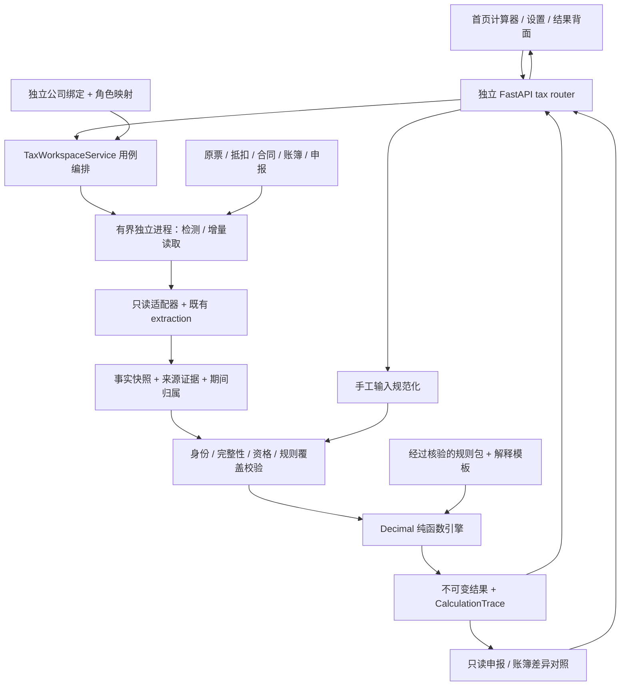

# 税务计算器与公司财税工作台设计

> 2026-09-11 · 设计提案，尚未接入运行产品。源码基准为本次核对的稳定 `main`，发布参照为 `v0.3.0-alpha.2-opt.1`；程序内版本仍为 `0.3.0-alpha.2`，不是 `v3.0`。精确开工身份见本次 CHANGELOG。
>
> 阅读顺序：本设计 → [算法、政策与验收样例](TAX_ALGORITHMS_AND_POLICY.md) → [政策来源、核验与政策中心](TAX_POLICY_SOURCES_AND_REVIEW.md) → [可点击原型](design/tax-calculator-prototype.html)。原型仅播放标明的合成案例，没有连接公司文件夹或生产计算 API。

## 1. 产品决策与现状

交付一个“随手算、能看懂、资料齐时自动算”的计算器。首页左侧保留小入口，展开后使用深灰机身、圆形按键、橙色运算键；每个税种有自己的输入、结果和解释背面。复杂税务处理在 Python 后端完成。

三个关联任务提供需求与复盘线索，不作为已集成代码或纳税事实。当前源码、Git、公开文档及保留草稿的只读核对结果如下：

| 范围 | 当前事实 | 本轮设计决定 |
|---|---|---|
| 最新稳定源码 | 本地 `main` 与远端 `main` 一致，包含 alpha.2 优化版 1 的集成 | 从此主线新建设计分支；不恢复整份历史工作区 |
| 旧计算器 MVP | 曾做过 VAT 换算、附加税费、印花税、Decimal、规则有效期、弹窗及源码验证；当前主线没有税务 API，草稿源码不在本工作树、stash 与 Git 历史中（定位核查见[价值评估与就绪度](TAX_WORKBENCH_VALUE_AND_READINESS.md)第 3.2 节） | 先定位草稿并只读核对可复用范围；不可得时按本规格重新实现，不假定可直接迁入 |
| 规则质量 | 旧规则包名含 `draft-review`，并有营业账簿按本收费、宽泛产权税目、历史依据等问题 | 算法测试通过不能替代政策核验；错误规则不得随恢复带入 |
| 资料夹导航 | `AppState._business_dossier_root()` 由当前 `watch_dir` 推断资料夹；扫描只是有界元数据导航 | 新计算器使用显式独立绑定，不能拿这份导航计数作为税额计算输入 |
| 发票与成本 | 已有源票解析、同票家族纠偏、票头/明细、成本三件套 | 复用只读解析与模型，不调用重建来取得计算输入 |
| 做账 | W8/W9 有本地 profile、证据、revision、validator、批次协议 | 可读有来源的事实；不把生成/审批/导出等同于已入账 |

原计划的“计算器 → 本地规则包 → 政策中心 → 影响提示”仍保留。按本次需求，把公司资料接入、月季勾稽加入政策中心之前；首个计算器切片仍可独立使用。

## 2. 三种结果语义

| 用户看到的状态 | 允许做什么 | 不可隐含的承诺 |
|---|---|---|
| 手工测算 | 文件夹为空时仍能四则运算、价税换算，按用户填写条件计算税种 | 手工税率/资格是测算假设，不是已核实企业事实 |
| 资料测算 | 从已绑定公司、已识别且已确认口径的文件自动归集，并展示缺项与来源 | 有进项发票不代表已抵扣；有销项发票不代表全部收入 |
| 已申报对照 | 将测算与申报表、完税凭证分栏比对 | 申报成功、税款支付成功均须独立证据，计算器不执行申报或付款 |

状态使用 `empty / draft / calculating / ready / needs_review / blocked / stale / failed / unsupported`。金额为未知时使用 `null`，不能显示 `0.00`；“已确认当期无该事项”才可作为有证据的零。计算就绪与资料完整分开记录，单个税种失败不能拖垮基础计算。

输出边界：不生成税收筹划或节税方案，不替用户在多个口径中选择“更省税”的一种，也不把测算结果表述为“应当缴纳”。风险提示只做事实对照（与自身历史、与已申报数据比较），不做“税负异常即有问题”的定性指控。计算器不执行申报、付款或账套写入，归档也只保存测算与依据。

## 3. 首页与计算器交互

### 3.1 入口、布局和动效

- 入口缩小为约 20px 图标、32×32 可见按钮，以透明留白保留至少 44×44 点击区；不常驻显示“计算器”文字，hover/焦点提示及 `aria-label` 提供名称。优先复用本仓库有 ISC 许可的 Lucide calculator，离线加载，不引入图标 CDN。
- 使用原生 `<dialog>`，展开前读取入口与最终弹窗边界，用 `transform + opacity` 从图标位置扩展；约 260ms，收起约 180ms。内容稍后淡入，避免数字被拉伸。动效可中断，快速连点、Escape、重新打开都以最终状态为准。
- 计算器单卡缩至约 292px，整体双栏弹窗约 660px；正面高度约 516—560px，按键 44—54px、间距 6px，根据可用高度收缩。常见可用视口高度至少 540px 时，全部 20 个按键直接可见；背面长解释绝不能撑高正面，结果区独立滚动。小屏先显示紧凑计算器，结果在下方；低高度横屏（宽至少 620px、高至少 360px）把显示/税率区与按键区并列。极小视口或软键盘占屏时保留可达性滚动兜底，不缩小到无法点击、不直接裁掉按键。
- 同时锁定 `html/body` 背景滚动；关闭归还焦点，保留本次会话草稿。`prefers-reduced-motion` 下直接切换或极短淡入，不做空间翻转。
- 前景使用独立作用域变量，默认外观可参考用户图片；适配现有浅色/深色/皮肤。`?no_skin=1` 按项目约束固定浅色恢复样式，业务 DOM、输入与规则保持相同。

设置增加“计算器入口位置”，两个选项互斥：

| 选项 | 行为 |
|---|---|
| 界面内悬浮（默认） | 默认在首页内容区左侧；可拖到当前视口内顺手的位置。限制在可见页面边界内，避开置顶栏；窗口尺寸、缩放或方向变化后重新夹紧位置，不能拖成屏外入口；提供“重置悬浮位置” |
| 首页置顶栏 | 固定在置顶栏“首页”按钮左侧，与首页按钮纵向居中对齐；使用整组模块导航之前的独立工具槽，不插入首页、成本、单据等模块之间。与导航栏一起置顶，不再同时显示悬浮入口；窄屏保留可见可点击入口 |

同一页面只保留一个入口，切换位置即时更新显示并独立保存为界面偏好；保存失败显示错误并恢复已保存位置。此操作不重置计算器输入、勾选和解释，也不读取公司目录或改变绑定；无需先填公司资料即可设置。

拟扩展现有 `GET/PUT /api/v1/preferences`：`tax_calculator_placement=floating|header`，默认 `floating`；可选 `tax_calculator_anchor={x,y}` 为有限且归一化到 `[0,1]` 的视口位置，`null` 恢复默认。只写现有 `runtime/local_state/preferences.json`，不随公司资料切换、不进入发布默认业务数据。拖动结束才保存位置，不在每帧请求后端。

悬浮是产品页面内的控件，不新建系统级置顶窗口。点击与拖动按明确距离阈值区分，拖动结束不误打开；键盘仍可打开，重置按钮提供不依赖拖动的恢复路径。展开与收起动效都取入口的实际位置，因此两种布局共用一套弹窗。

### 3.2 点税种与勾选税种

点击左下计算器菜单，菜单每行包含独立复选框、税种按钮和结果摘要。点击名称只切换当前编辑页，勾选只控制并列展示；两种动作不互相触发。使用有标签的原生复选框与按钮，不滥用仅支持单选的菜单语义。

首批菜单：基础计算、价税换算、增值税应纳测算、附加税费、印花税；企业所得税预缴在月季资料阶段开放。工资个税、消费税、房土两税等可扩展，但无规则与资料适配器时明确“暂未支持”，不能套一张通用百分比表。

每种模式保存独立输入。切换税种不重新扫描公司文件夹，也不清空已算结果。当前税种的大数字必须标明“票面税额 / 本期应纳测算 / 本期预缴测算 / 已申报 / 已缴”，不可统称“税额”。

价税换算的税率区保留 6%/9%/13% 快捷选项，新增“自定义”。点击后在同一行切换成百分数输入框与“预设”返回按钮，不新增一整行挤压键盘。输入单位明确为 `%`，支持 `0—100`、最多 4 位小数，例如输入 `1.5` 表示 `1.5%`；空白、负数、非数字、指数、超限或超精度时提示并阻止计算，不能偷偷回退 13%。

自定义始终是 `source_kind=user_assumption`；即使输入 13% 也不能自动标为官方适用规则。正式接口携带百分数十进制字符串（例如 `custom_rate_percent="1.5"`）和自定义模式判别，后端用 Decimal 归一化为 `0.015` 并复核范围/精度；百分数与比例字段不可同时提供。原型只演示输入校验、模式切换和旧结果失效，不执行自定义税额运算。切换预设/自定义、修改税率均令对应结果及解释待重算；自定义 0% 不等于税法上的免税/零税率资格。其他税种的法定税率及优惠由各自规则处理，自定义不能绕过资格校验。

### 3.3 并列展示与合计

并列展示包括每个已选税种的期间、口径、金额与状态。复选框是展示选择，不是税种认定或享受优惠的授权。

“所选应纳测算小计”由后端计算，仅收纳同一公司、币种、场景、规则包、资料快照及相容期间内的应纳叶子税项。价税换算的票面税额、留抵额、企业所得税年度累计额、已缴额不能混入。附加税合计与其三个子项按叶子 ID 去重；本期应纳和扣除预缴后的本期应补不得重复计入。

季视图可并排显示三个月增值税、季度所得税和季度印花税，均标出覆盖期间；年度累计所得税只是中间过程。月份不能为了凑合计而强制改为季度申报。部分已选结果缺资料或过期时，总计显示“未完整”，如提供已就绪小计必须列出未计入项，不能暗示完整应缴额。

修改金额、日期、公司、税种口径或规则后，受影响结果立即 `stale`。旧金额可淡化保留作对照，但退出小计。未变的独立手工场景可保留。仅按请求 generation 与后端 snapshot 身份相符的响应更新当前页面。

### 3.4 翻面解释

每页右上设带文字的“为什么这样算”翻转按钮；背面保留“返回计算”。约 320ms 的 Y 轴翻转只作用于内容卡片。不可见一面设置 `inert` 与 `aria-hidden`，翻转后焦点转到可见标题/返回按钮，读屏不同时读两面。

背面只显示本次运行生成的五段内容：①这次算什么；②实际输入从哪里来；③逐步代入；④适用条件；⑤为什么不是另一种常见算法。例：`113,000 ÷ 1.13 = 100,000`，再 `113,000 − 100,000 = 13,000`，解释“13% 针对不含税价”。

解释模板、步骤数值和正面结果共用同一个后端 `CalculationTrace`；不让 JS 重算，不运行时调用模型编写税法结论。反面不隐藏关键阻断，正面仍显示“缺上期留抵”等提示。解释失配应阻断该结果交付，不用通用说明掩盖。

## 4. 公司资料文件夹

### 4.1 默认与绑定

设置新增“计算器 → 公司资料文件夹”，初始 `null`。为空不尝试读取当前 `watch_dir`、最近目录、父目录或会计软件；纯计算可用。

点击“选择本地文件夹” → 系统原生文件夹选择器 → 显示“待保存目录” → 点击“检测资料”进行有界检测 → 确认角色映射与公司 → 保存并后台归集。检测不创建、移动或修改原目录；保存一次即授权以后读取该绑定中的已确认角色，普通新增文件无需重复确认。新公司、越界路径、新增未知角色或内容冲突需要重新确认。

原生选择器要求（本轮补充）：

- Windows/macOS 的 Tauri desktop 和 browser 模式均通过同源后端调用当前 owned host 的系统文件夹窗口；macOS 为 `NSOpenPanel`，Windows 为系统文件夹选择窗口。窗口标题固定为“选择公司业务资料夹”，只允许选择一个目录。
- 复用现有 `platform/windows.py::pick_directory` 与 Tauri `select_path` 的原生能力，新增固定用途枚举 `pick_tax_company_dir`，不调用会检查发票目录的 `AppState.pick_watch_dir()`，也不借用“保存监控目录”接口。Windows 非 Tauri 源码/BAT 入口沿用已有本地目录选择器适配；主线 macOS 由 Tauri 负责原生窗口。
- 原生窗口只返回选择结果。取消返回 `selected=false`，保留之前的绑定及待保存草稿；成功返回 `selected=true, requires_save=true`，只更新本次设置草稿，旧检测结果失效，重新检测通过前不能保存。
- 选择器打开期间按钮显示“正在选择…”并阻止重复拉起；宿主不可用、超时或权限失败提供可重试提示，保留原绑定/草稿。设置关闭、清空绑定或更新草稿后，较早选择请求的返回不得覆盖新状态。
- 原生通道继续要求固定 localhost Origin、owned lifecycle 和私有 token；token 不进入页面。系统窗口 120 秒、Python 125 秒的既有预算保持，页面不能使用更短超时提前判失败。不存在宿主时不得从 `file://` 原型绕过边界调用原生接口。
- 设置页可显示用户亲自选择的根路径供保存前核对；该根路径例外不扩展为向页面暴露任意子文件绝对路径。原生选择不是读取全目录、上传目录或自动保存，不用 `webkitdirectory`/文件上传控件代替本地根路径绑定。

独立 HTML 原型增加“选择本地文件夹”的流程演示，明确标为模拟，展示选择成功、取消、不可用及待保存后检测；真正系统窗口仍属于 D2 实现与平台验收。

同时只绑定一个活动税务公司资料夹，不增加第二个发票 monitor。绑定独立于 `TargetProfile`，首页换 `watch_dir` 不隐式改公司；二者不匹配时禁止勾选票据跨公司交接，并显示当前计算器公司。清空绑定会取消税务后台任务、丢弃活动敏感快照并恢复纯计算，不删除公司文件。

目录名仅是角色候选。既有“成本发票/开具发票/进项抵扣/银行流水”等名称可作别名，不要求重命名真实目录。角色确认后还要校验内容中的税号、主体、期间、表头和文件类型。

### 4.2 建议资料角色与按需要求

下面是推荐组织方式，不是必须照搬的目录模板；一个角色可映射多个受控子目录。

| 角色 / 建议目录 | 关键字段 | 支持能力 / 缺少时的行为 |
|---|---|---|
| 公司档案 | 税号、主体类型、纳税人资格及生效日、各税认定周期、所在地、征收方式、会计准则、优惠资格及证据 | 自动税额必须有；未知资格不默认一般/小规模，不默认小型微利 |
| 税费种认定 | 电子税务局税费种认定信息的税种、征收方式、申报期限（月/季）、税率或征收率、有效期起止 | **“该报哪些税”的第一判据**；可由用户导出或手工录入，不由目录内容反推；与票据不一致时列出差异并交用户确认 |
| 进项发票（成本发票） | 源票、公司购方、号码、日期、金额、用途、红冲状态 | 展示购进票面汇总；不能据此直接产生当期抵扣 |
| 销项发票（开具发票） | 源票、公司销方、号码、日期、税率、红冲与业务关联 | 展示销项票面汇总；须核对未开票收入与义务时间 |
| 进项抵扣 / 用途确认 | 逐票抵扣额、所属期、确认状态、转出/红字关联、海关及其他合法扣税凭证 | 决定实际可抵扣输入；扫描到文件但不支持模板时显示未读取 |
| 申报与完税 | 本期/上期主附表、留抵、预缴、减免、实际缴纳、回执、修正版本 | 结转、应纳/已申报/已缴对照；不能仅凭银行支出猜税款所属期 |
| 留存备查 | 优惠资格证明、合同与验收、工资社保表、资产台账、计算过程底稿 | 每个结论同时输出“这次结论需要留存什么”；资格未取证的优惠不进入自动结果 |
| 合同与结算 | 合同 ID、双方角色、税目、书立日、金额、列明 VAT、结算/变更、已纳印花税 | 印花税；同合同的多张发票不是多份应税合同 |
| 账簿与报表 | 科目余额、总账/明细账、利润表、已记账期间与导出时点 | 所得税和税会勾稽；未结账、试算不平或重复导出时阻断完整结论 |
| 期初与结转 | 上期留抵、存货数量/成本、以前年度亏损、年内累计已预缴 | 未知不等于零；结转值与申报/账簿证据关联 |
| 出入库 / 盘点 | 期初、到货、销售出库、退货、损耗、品目/规格/单位映射 | 已销成本与库存；发票日期不能替代出入库时点 |
| 银行与现金 | 结构化流水、回单、收付款对象、业务关联 | 资金勾稽、往来、完税核对；收款不是自动收入，付款不是自动费用 |
| 工资社保 / 费用报销 | 工资发放月、费用归属月、代扣个税、社保公积金、报销性质 | 薪酬与所得税支出；员工个税与公司承担税额分栏 |
| 固定资产 / 摊销 | 投用日期、原值、残值、年限、方法、税会差异 | 折旧与税前扣除；不将全部采购额当期费用化 |
| 纳税调整与优惠 | 可弥补亏损、优惠资格、纳税调整项目、员工/资产季度均值 | 所得税和六税两费资格；年内暂判与年度汇缴判定分开 |
| 既有 `凭证/` | W8/W9 profile、证据、批次及已确认执行状态 | 只读复用；生成、审批、导出不能作为成功记账证据 |

检测状态至少区分 `not_mapped / missing / empty / found / unsupported_format / unreadable / wrong_company / wrong_period / conflicting / ready`。文件数量和文件名只能帮助导航，不能冒充可用金额或资料完整度。

### 4.3 数据保管

- 本机设置只保存 nullable 绑定、角色映射、自动归集偏好；包内示例不含真实路径。根内映射保存相对路径，包外用户根可为绝对路径。
- 用户确认的公司资格、人工补录和关联决定建议保存在公司资料夹 `财税/档案.json`、`财税/已确认事实.json`；这是新增功能的拟议文件，必须首次显式保存才创建。使用 schema 校验、跨进程写锁、revision/CAS，损坏/未来版本不重置为空。
- 纳税人身份、优惠资格与税费种认定以**带生效期间的版本化事实**保存，不是布尔开关；历史期间必须回放当时的状态，不允许用今天的身份计算以前的属期。税会差异以调整项台账（性质、金额、归属期间、依据、可否转回）保存，支持跨年追踪可弥补亏损与折旧差异。
- 每个可交付结论必须同时给出该结论所需的留存备查清单，并区分已取得与仍缺项；资格未取证的优惠不进入自动结果，只能作为手工测算假设。
- 归集索引、派生金额、快照可在 `runtime/local_state/tax/` 缓存，均可删后重建；SQLite 只存任务/事件/设置和可重建索引，不新增发票主表。默认手工输入仅在本次会话内存。
- 用户显式“保存测算”才向 `财税/测算归档/` 写不可变结果、依据和来源指纹；历史结果不随规则更新覆写。读取权限不隐含写入权限。
- 不向网页返回内部绝对源路径；通过 opaque evidence ID 展示相对名称和页/行定位。敏感数据不进入公共日志、源码、截图或测试夹具。

## 5. 后端分层与依赖方向



依赖通过 `create_app()` 注入独立 tax services；不继续给庞大的 `AppState` 添加税种算法。Tauri 复用已有受控目录面板与生命周期，只增加公司目录选择用途的固定枚举；不把税务计算放进 Host RPC，也不重写核心。

拟议模块均为未来实现路径，当前未创建：

| 位置 | 单一职责 | 联动入口 |
|---|---|---|
| `domain/tax.py` | 请求、结果、期间、事实、证据、阻断契约 | `domain` 导出与 HTTP contract |
| `tax/registry.py`、`effective_dates.py` | 规则唯一匹配、有效期与核验覆盖 | 只迁入审查通过的旧能力 |
| `tax/calculators/` | 四则、价税、一般/小规模 VAT、附加、印花、所得税纯函数 | 无文件 IO、无网络、无动态 eval |
| `tax/engine.py`、`explanations.py` | 计算依赖图、舍入、trace、受控解释 | 所有消费者使用同一结果 |
| `tax/rules/` | 固定 JSON 规则、来源索引、解释模板 | package data、core build ID、allowlist |
| `tax_workspace/adapters/` | 发票、抵扣、申报、合同、账簿等模板读取 | 复用 extraction，避免解析器分叉 |
| `tax_workspace/facts.py`、`periods.py` | 事实归一、身份、义务/抵扣/记账期间 | 版本化适配器与来源图 |
| `tax_workspace/jobs.py`、`service.py` | 增量任务、快照、取消、事件 | 独立于 monitor；复用任务仓储 |
| `storage/tax_workspace.py` | 配置/人工事实严格仓储与缓存 | schema、锁、CAS、原子发布 |
| `api/tax.py` | 请求与服务映射 | `create_app` 注册 router |
| `web/templates/partials/tax_calculator.html` | dialog 与固定业务 DOM | 首页轻量 include |
| `web/static/js/tax-calculator.js`、`css/tax-calculator.css` | 展示、输入、动效、会话状态 | 不扩充 `page-index.js`；模板版本与静态契约联动 |

## 6. 事实契约与运行顺序

每个数值事实至少携带：`fact_id / company_id / value(decimal string or null) / currency / fact_kind / accounting_period / tax_obligation_period / deduction_period / settlement_period / source_refs / completeness / decision_revision`。这些日期不能合成一个 `invoice_date`。

来源引用包含不透明 ID、文件 SHA256、适配器版本、页/表/行定位、提取状态与人工确认 revision。20 位发票号只用于同票身份；红票与原蓝票建立关系而不是互相去重。解析冲突不采用“最后文件胜出”。需要税号而旧票头模型不足时，新增只读证据 DTO 并明确缺项，不用名称猜公司。

归集顺序：

1. 捕获 `binding_id + binding_revision + company_id + job_id`；保存/检测接口快速返回任务 ID。
2. 子进程按角色、扩展名、文件数/单文件大小/解包大小/总时限限制扫描，拒绝越界 symlink/reparse、宏执行、外链、活动 XML/PDF 内容。
3. 元数据未变可复用派生缓存；参与计算前绑定文件内容 SHA，读取前后复核元数据，文件正写入则暂缓。删除只使派生事实失效，不删来源。
4. 逐来源提取并去除同票多格式重复，保留来源内真实明细与每项冲突。
5. 校验公司、期间和资料范围完整性；合并显式人工决定，缺证据的猜测不得升级为事实。
6. 生成不可变 snapshot，再运行所选税种依赖图；VAT 的已核对计税节点可为附加提供测算依据，遵循法定“依法实际缴纳”定义，不把计算结果标作已经银行支付。
7. 原子发布匹配当前绑定的结果；旧任务完成不能覆盖新公司。SSE 仅发 ID/状态，页面再读取结果；`onerror` 显示断线，`onopen` 读取最新状态。

**三单匹配视图**：进项侧建立“发票—合同或订单—入库或验收—付款—用途确认”的一致性视图，销项侧建立“发票—合同—出库或验收—收款”视图。缺项显示为缺项，**不得**因缺一个环节自动判定不能抵扣或不能确认收入，判断权留给用户；但缺项必须与结论一起展示，不能只在提示里一笔带过。

**税会差异**：所得税相关结论必须从会计利润出发，逐项列明调整（纳税调整增加、纳税调整减少、免税收入、加计扣除、弥补亏损），每项绑定台账条目与依据；不可解释的差额必须阻断完整结论，不得用“其他”吸收。

**进项转出与分摊**：兼营简易计税、免税项目、集体福利与个人消费、非正常损失对应的进项分摊，首轮**不做自动计算**：只接受已确认金额，或返回 `needs_review` 并列出待确认事项。分摊口径的地区差异大，自动分摊的差错成本高于手工。

单进程 worker 槽、逐公司任务去重、取消与有限重试。事件 1 秒合并；用户开启后台归集后，以 60 秒元数据检查补漏，未变化不全量重解析。税务 worker 不抢占首屏、health 或发票启动同步。退出 backend 时结束本模块 worker，独立发票 monitor 的原语义保持。

不做无限 Safari 操作链。结构化导出适配优先；不支持模板时停在具体资料项，报告已读数量、缺字段和可选择的结构化补录路径。不能用“扫描中”掩盖卡死；超时必须可取消、可定位。

## 7. API 草案

下表是新增设计，不宣称当前 main 已注册。旧 MVP 的单税接口可以在恢复后兼容保留；新请求用明确版本和判别联合模型，不静默改变旧请求的含义。

| 接口 | 语义与关键限制 |
|---|---|
| `GET /api/v1/tax/rules` | 查询日期/地区/业务适用规则，返回覆盖、核验日期、包身份；无规则不回退“最新” |
| `POST /api/v1/tax/calculate` | 纯手工单场景计算，十进制字符串；不读取业务文件 |
| `POST /api/v1/tax/calculation-sets` | 同一场景多税种计算；服务端生成依赖、逐项状态及小计排除原因 |
| 现有 `GET/PUT /api/v1/preferences` 的拟议扩展 | 增加 `tax_calculator_placement` 与可选 `tax_calculator_anchor`；严格枚举/有限坐标校验，局部保存不改公司绑定或计算结果；现有路由不新增副本 |
| `GET /api/v1/tax/workspace` | 当前 nullable 绑定、角色就绪和资料更新状态，不触发深扫 |
| `POST /api/v1/tax/workspace/pick-directory` | 空请求体；经现有原生选择适配器拉起单目录窗口。取消返回 `{ok:true,selected:false}`；选中返回 `{ok:true,selected:true,requires_save:true,selected_path:"用户选择的根路径"}`，只交付草稿，不检测深层资料、不保存、不修改 `watch_dir`；同源/owned 校验、原生失败脱敏 503 与选择请求代次保护 |
| `POST /api/v1/tax/workspace/detect` | 对明确选择的候选根有界检测；返回预览 ID/hash，零业务写入 |
| `PUT /api/v1/tax/workspace` | 保存明确的根/角色，重验预览与配置 revision；`root=null` 清空 |
| `POST /api/v1/tax/workspace/refresh` | 异步增量归集，不重建普通/成本投影；返回 `202 + job_id` |
| `GET /api/v1/tax/jobs/{job_id}` | 有界进度、阶段、完成计数、失败原因；不得用估计文件数冒充精确百分比 |
| `POST /api/v1/tax/jobs/{job_id}/cancel` | 只取消同一绑定同一任务，旧 ID 不能取消新任务 |
| `GET /api/v1/tax/runs/{run_id}` | 不可变计算记录、步骤、证据、规则、完整性；返回记录所属公司/期间 |
| `POST /api/v1/tax/runs/{run_id}/archive` | 用户显式保存，重验 run 与源快照，输出独立财税归档 |
| `GET /api/v1/tax/filing-calendar` | 查询指定主体、税种与期间的申报期限与顺延；只读、离线可用，返回来源与核对日期，未核验期间明确标注 |
| `GET /api/v1/tax/runs/{run_id}/form-mapping` | 把一次运行的结果映射到适用表式与行次；绑定表式版本，表式变更后返回 `stale` 而不是继续给出旧行次 |

结果骨架：

```json
{
  "schema_version": 2,
  "run_id": "opaque-run-id",
  "mode": "manual",
  "company_id": null,
  "period": {"kind": "month", "start": "2026-05-01", "end": "2026-05-31"},
  "snapshot_id": null,
  "rule_bundle_hash": "<content-sha256>",
  "engine_version": "tax-v2",
  "results": [{
    "tax_type": "vat_price_split",
    "status": "ready",
    "amount_kind": "invoice_tax",
    "amount": "13000.00",
    "currency": "CNY",
    "source_kind": "user_assumption",
    "steps": [],
    "explanation": {"template_id": "vat-price-gross-v1", "blocks": []},
    "blockers": [],
    "evidence_refs": []
  }],
  "selected_payable_total": null,
  "excluded": [{"tax_type": "vat_price_split", "reason": "INVOICE_TAX_NOT_PAYABLE"}]
}
```

该 JSON 只说明结构，实施时 `steps/blocks` 必须为后端实际运行生成的完整值。所有 endpoint 校验严格 schema；错误沿用项目 `{ok:false,detail,error:{code}}`，新增 `TAX_EVIDENCE_MISSING / TAX_IDENTITY_CONFLICT / TAX_PERIOD_MISMATCH / TAX_SNAPSHOT_STALE / TAX_RULE_UNVERIFIED / TAX_SOURCE_CHANGED / TAX_JOB_SUPERSEDED`。输入错误 422、版本/快照冲突 409、过期作业 410、组件不可用 503；可计算集中的部分业务阻断在结果中逐项表达。

## 8. 从测算到申报：申报表映射、征期与备查

测算正确不等于申报正确。以下三条能力与算法同等重要，缺一条，计算器就只能停在草稿纸层面。

### 8.1 申报表映射

同一笔税额在不同申报表中的位置不同，且表式随政策版本调整，因此映射是可验证的交付物，不是文案：

- 每条映射绑定：税种、纳税人身份、表式名称与版本、行次、金额口径（本期/累计/应补/已缴）、适用期间。
- 表式改版后旧映射必须标记 `stale`，不得继续显示行次。
- 映射只回答“填在哪一行”，不代替申报系统校验；界面同时显示该行次的依据与本次金额来源。
- 缺少表式样例时只输出测算金额，不输出行次，并明确标注“未核验到申报表行次”。

### 8.2 征期与申报期限

- 申报期限、顺延与征期提醒分别来自年度申报期限安排、地方征期提醒与节假日安排，必须记录来源与核对日期。
- 税费种认定中的申报期限（按月/按季/按次）是这家公司的第一判据，优先于任何通用日历。
- 期限信息只作提醒，不构成“已申报”证据；是否逾期以税务机关系统为准。
- 无法核验时显示“未核验”，不显示推算日期。

### 8.3 留存备查

- 每个结论同时输出所需留存资料清单（资格证明、合同与验收、工资社保、资产台账、计算底稿等），并区分已取得与仍缺项。
- 清单来自该结论实际引用的规则与证据，不是通用模板；资格类优惠必须能指出对应证据文件。
- 归档保存测算、依据与来源指纹；历史归档不随规则更新覆写，以便日后解释“当时为什么这么算”。

### 8.4 与规则包的关系

表式版本、期限来源与留存清单模板都属于规则包内容，必须与税率一样经过复核签署，遵循[政策来源、核验与政策中心](TAX_POLICY_SOURCES_AND_REVIEW.md)的分级与签署要求。

## 9. 月度与季度实务落地

关联做账总结的主要事实属于采购、销售、抵扣、库存与季度结账，包含第二季度月账。不能改成第一季度实账，也不能沿用其中已过期的“当前系统缺什么”断言。本设计只将问题类型脱敏为以下可复现样例；真实公司、金额、文件与账套操作记录不进入仓库。

| 实务问题 | 设计响应 | 关键验收 |
|---|---|---|
| 购进票税额与申报抵扣不一致 | 票面、可抵扣、已确认抵扣、转出四栏，按抵扣所属月关联 | 跨月发票不进入错误月份，缺用途确认不自动抵扣 |
| 一季度/任一季度查看三个月 | 按各税认定周期计算，月度 VAT 顺序结转；季视图汇总三个独立应纳结果 | 后月进项不能倒抵前月已发生应纳税 |
| 同规格销售大于本期采购 | 先核期初库存、未到票入库、退货、单位映射 | 不把采购票数量差直接叫负库存/偷税 |
| 采购金额与所得税成本混用 | 从库存计价、实际销售结转及账簿取得已销成本 | 采购未售仍为资产；费用/工资/折旧单独归集 |
| 税种优惠被一键勾选 | VAT 身份、小型微利、六税两费、教育费免征分别判断 | 一般纳税人也可能满足小型微利；资格之间不互推 |
| 自动操作卡住且没有说明 | 有界只读任务、阶段状态、取消、结构化导出/补录替代 | 超时可见，已确认终态不自动重试写入 |

## 10. 分阶段开发与停止条件

| 阶段 | 可交付成果 | 最小验证与完成条件 |
|---|---|---|
| D0 规则与恢复审查 | 先定位旧 MVP 草稿并只读核对可复用范围；草稿不可得时按本规格重新实现，不假定可直接迁入；修正本设计列出的政策错误，确定公式/金额种类/解释合同 | 含税反算、政策日期、印花税资本增量、2026 起征点边界、优惠身份负向例全部通过；草稿规则不能标官方可用；预期值取自官方正文与独立手算 |
| D1 独立计算器 | 20px 图标、悬浮/首页置顶栏位置偏好、紧凑按键区、预设/自定义税率、单税种、勾选并列、翻面解释，资料夹为空可用 | Decimal/公式/API/静态契约；自定义范围/精度/假设标记/旧结果失效；20 键在标准短窗口完整可见，背面/结果不撑高正面；两种入口唯一性、即时切换/持久化失败恢复、拖动不误开与越界重置；桌面、375px、横屏、200% 字号、键盘、减少动态、当前皮肤与恢复入口；源码服务真实 HTML/静态字节/health 核对 |
| D2 公司绑定与事实 | 独立设置、原生单目录选择器、角色检测、结构化模板、进销票归集、抵扣/申报/期初事实、**税费种认定录入与票据差异对照**、就绪状态 | Windows/macOS Tauri desktop/browser 原生拉起及 Windows 源码适配；选择成功/取消/失败/超时/重复点击/迟到返回、待保存不切目录；空根不 IO、保存快、源文件不变、跨公司拒绝、改删/重复/缺模板、旧任务晚到、取消和损坏配置；一套合成公司资料闭环 |
| D3 月季税额 | 一般 VAT 月度留抵、附加、合同/资本印花税；所得税实际利润预缴及已缴对照；**申报表映射、征期提醒与留存备查清单**；税会差异调整项台账 | 本算法文档的逐月/跨季样例与第 10 节的跨期例、政策变更例，缺亏损/已预缴/成本/资格时阻断，累计额不重复相加；表式版本变化后映射必须 stale 而不是给出旧行次；保留清单来自实际引用的规则与证据；用经授权的真实账套导出另行只读核对 |
| D4 自动归集 | 显式开启后增量读取、来源失效、后台状态与历史归档 | 无变化不重解析、重启隔离、文件正写入、worker 超时、source SHA 改变后结果 stale；不更改 monitor 生命周期 |
| D5 规则包与政策中心 | 延续旧计划的 preview/apply/CAS/revert、官方单源政策缓存、影响提示；落实[政策来源与核验](TAX_POLICY_SOURCES_AND_REVIEW.md)的四层模型与签署流程 | JSON 不执行代码；只有 A 级官方原文可进规则包，B 级只产生提示，C/D 级只进线索箱；规则包变更必须经复核签署并发布新版本；版本/有效期/地区冲突全包拒绝；离线不阻断计算 |

每阶段独立分支、独立验收，前一阶段集成后再开展依赖它的功能。测试以机制为单位，不复制实现写自证测试；先聚焦，失败修最小机制并加相邻回归，最后按实际改动风险执行仓库要求的完整检查。税法预期值应来自法规/独立手算样例，不从被测实现自动生成。

发布单独决策，不绑定新的产品号；Web API capability、package data、build ID、源码快照、Swift 参考握手清单及 Tauri OpenAPI 路由验证在实现阶段同步。源码 UI 验证不等于双平台成品、Windows BAT、原生选择器、实体打印或申报成功。

## 11. 明确排后与补充建议

- 工资个税使用累计预扣模型，需要任职受雇、实际发放、累计扣除、已预扣与特殊情形；首轮不采用“本月工资 × 税率”。员工代扣与公司自身税款小计隔离。
- 消费税、出口退免、差额征税、混合用途长期资产、留抵退税、跨区建筑预缴、核定征收、汇总纳税、房土两税的特殊链先返回 `unsupported/needs_review`；扩展必须有对应算法和证据适配器。
- 加入“本次未计入什么”和“与上次相比哪里变化”，往往比单独的税负率更有用。行业税负率只能是分析线索，不是应当缴到的目标。
- 基础计算 `%` 定义为当前数值除以 100，`±` 仅切换当前操作数；后端有界表达式解析，显示完整表达式和运算优先级，不使用 `eval`。负数四则与有证据的红字税务调整分开验证。
- 规则核验记录必须由税务内容复核者确认适用范围、文号、条款、有效期、公式及解释；对无法核实的问题显示缺口。这是实现“解释只能对”的工程策略，不能用一个承诺代替质量门槛。
