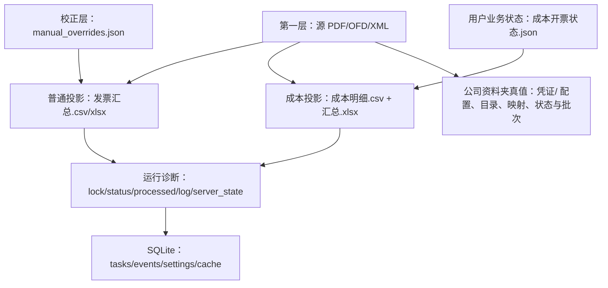

# InvoiceHub 数据结构与算法

## 2026-11-23 草稿品目类型与金额守恒

- 文件 schema 不变，复用 `成本开票状态.json.item_catalog` 的标准名链和 `goods/service/expense/fixed_asset`。生成入口按来源严格解析 v1（状态读取上限 20 MiB、品目最多 2000 个），缺失状态保持旧货物行为，坏结构/重复 JSON 键/未来版本不得当空表。目录身份及原字节只存在本次生成内存，不另存品目主数据或 SQLite 发票表。
- 采购先以 `(type, family)` 分组：goods 对标准名调用共享 `resolve_stock`，其余保留最终标准名与原始别名。非货物的精确销售方+原名/标准名映射、原 `inv-goods:<销售方>:<名称>` 习惯槽位必须指向同一当前可用非库存科目；缺失、歧义、库存对照或旧品类冲突留空编码、保留金额。不能把泛化钢材品类习惯套给服务。
- 200 元货物+30 元服务只借记库存 200，服务 30 单列，贷应付 230；确认科目和缺编码两种状态都保持借贷平衡与原票来源。只有 goods 数量进入销项、历史期初数量更正与月末一次加权；服务不报成待匹配库存品名。库存隐式命中已返回完整科目名时直接复用编码，避免拼出双重库存路径。
- 零税额进销项不写金额为零的税额分录或待认证转出，原票净额/价税合计不变；审核导出的正金额校验保持原规则。服务收入仍沿既有收入分录，不代表完整服务收入科目引擎或服务毛利记录已入账。

## 2026-11-22 首页行节点缓存

`page-index.state.invoiceRows` 只保存当前页（最多100行）的 DOM 与渲染签名，键为目标/位置键/源路径，签名包含可操作阶段与转义后的展示内容。先计算目标行、移除失效行，再补入或移动需要变化的节点，避免替换一行时连带移动未变化的焦点行。勾选状态独立同步 checkbox 属性，不进入内容签名；空态清空节点缓存。`refreshWarning` 只跟踪当前失败提示，完整读取恢复后清除并说明未保存目录，不影响草稿值。该 Map 不存储发票真值，不改变后端分页/选择金额/代际算法、文件格式或 SQLite schema。守护为经典首页真实浏览器回归和整表重绘负向检出。

## 2026-11-21 服务项目毛利与价格证据

- 原 `item_catalog.items[name].type` 增加 `service`，其余字段/格式不变。`canonical_reference_rows` 仍只让 goods 进入货物参考与库存，服务/费用/资产不滚动库存。公司归类读取双方原品名，在最终标准名称设置类型，保留别名/品目税率、移出货物参考时保留原已开快照；坏状态或未来版本不当空覆盖。归类有界2000名，不另存第二份品目主数据。
- 服务毛利：仅明确 service 销项按同公司、开票月份和非空项目与 `服务成本归集.json` 精确匹配，成本同组相加；项目复用人工优先/唯一备注。毛利=除税收入−明确人工成本，毛利率=毛利÷收入×100%，Decimal 50 位、金额到分/比例6位；零收入时毛利率null。无成本不等于零成本，只有明确零记录才计算；缺收入/金额、空或冲突项目、销项来源过期时利润null并给原因。费用/资产不猜成服务，服务成本不扣入货物四维合计。
- 实际加价率提示按同票（无号按源文件）、标准品名/规格/单位合并原收入与原月销售成本样本。正数量、正成本和收入且全部可用，至少3个，`(收入/成本−1)×100%` HALF_UP到0.01个百分点后全部相同才提示；未知/排除样本阻止全期间结论，红字或不可比较样本列待核对。提供样本数、未知数、金额与来源，不用结存单价反算历史毛利。
- 疑似同物异名：所选期间内原品名，规范规格完全相同（保留大小写及E）且单位相同，已归同一标准名不再提示；名称包含/相似度≥0.65或原库存品类相同才列人工候选。最多50组、20000次成对比较，截断显式披露，每名最多展示20个来源并给总数；不自动改名、改税率或改价。

## 2026-11-21 旧加价率迁移清单与对照

- `成本定价规则.json.pricing` 可选 `legacy_migrated`：排序去重的 40 位品目 key（≤5000）；为空时不写该字段，旧文件仍可读。列入的 key 不再在报价时把 v1 人工加价率当作优先级 45 的单行规则，原值仍在 GET 的 `legacy_markup_percent` 与 `legacy_state=migrated` 中可查。rules/preview 与 PUT 可带完整替换的列表；省略时沿用已保存列表，且该列表参与 preview_hash。
- GET V2 每个品目新增 `v1_reference`（v1 历史均价口径的成本、除税/含税参考单价、行加价率；v1 成本未知写 0 时返回 null）与 `legacy_state`，顶层新增 `legacy_migrated`、`customers`（销项购买方去重，≤2000）。
- 迁移对照：每品目以无客户、数量 1 的当前规则算 V2 价，`difference=V2 除税单价−v1 除税单价`，任一未知为 needs_review；旧加价率仍生效的行另给“不沿用”时的 V2 价。按报价接口同样的 500 行分批计算，不写盘。

## 2026-11-21 库存基线、留痕与分析数据

- 三份人工状态均在公司根目录，2 MiB 有界、拒绝重复键/未来 version/跨公司复制，确认后原子替换与读回，不归入投影或 SQLite 发票主存储。`库存科目对照.json={version:1,revision,company_id,ledger_hash,setup}`，`setup={mappings:{name:account_code},opening:null|{month,items:[{account_code,unit,quantity,amount}]},covered_months:[YYYY-MM],source}`。最多2000映射/期初行、1200月份；期初同科目唯一，单位必填，数量为有界带符号十进制字符串、金额最多2位小数；月份无0000年。来源必填（全空配置除外），绑定当前账套启用的末级库存科目及其语义 hash，品目别名在预览中展开。
- V2、进销存与凭证草稿共用 `resolve_stock`：明确对照优先，否则保留 `goods_family`，同一已映射科目归到同一品类全名，库存仍按科目品类+单位，规格不分摊。确认期初为发票预期滚动的统一起点，早前发票不重复计入，草稿不再用历史发票总量自动纠正该期初；库存滚动上限100年并覆盖无购销月份。
- 账面结存=确认期初+基线月至所选月的序时账借贷/数量变动，差额=账面−发票滚动。必须月末、每月同时有用户完整声明和实际读回行、来源完整、科目唯一映射/单位一致、无卖超/排除。无基线不是零基线；缺月、重复库存行、数量方向不明或单位冲突为 needs_review，不猜覆盖或去重。未匹配非零账面科目单列 unassigned。
- `成本报价记录.json={version:1,revision,company_id,records:{id:record}}`，最多200条及文件容量上限，不自动轮换/覆盖。record含 id/created_at/request_hash/content_hash/content；content冻结 kind、计划日期、原请求（含市场来源/日期）、结果、成本/规则修订、所选成本行、来源与口径。内容 hash 用于完整性校验，不代表签名；读历史同时校验结构。显式归档才写，同ID同请求返回旧回执，异内容409；源目录移走仍可读/导出原结果，导出不重算当前价格。
- `服务成本归集.json={version:1,revision,company_id,costs:{id:{month,project,amount,source}}}`，最多1000条，非负金额最多2位小数、项目可空≤60字、来源必填≤200字；不读取工资/社保推算，不自动分摊，不代表已入账。全量候选通过 preview_hash/记录与来源版本确认保存，原文件坏则保留拒写。
- 实际毛利收入取销项除税金额，销售成本取原 `cost_of_sales` 品类月结果；按累计数量比例四舍五入到分再作差，分摊到客户/项目，避免每行独立舍入丢分。各维成本总额必须等于品类月成本；零数量且非零成本、缺数量、卖超/排除/不完整来源使成本与毛利未知，不补零。项目复用人工归属优先于唯一备注项目，未归属保持空；非货物收入明确排除，人工服务成本按月份/项目单列，不扣入货物利润或冒充净利润。
- 实际分析拒未来月份，当前月截到今天并标 provisional；采购监控取截至该日最近两次采购日期（不限分析起月），同日多价不任选，票面税率建议仅用最近销项一致税率，与设置不同才提示。无自动行情/税率政策核验或自动改价；统一加价率/疑似同物异名与服务收入匹配尚待后续。
- 归档 XLSX 由冻结结果生成，所有金额和用户文字写为文本，未知为空；防公式前缀执行并保留超过Excel数值精度的十进制原文。规则试算归档不保存候选规则到当前规则文件，也不改 v1 已开快照/工作簿。

## 2026-11-20 第二批定价规则与输入依据

- 独立规则文件仍为 version=1。kind 增加 `tiered` / `market`；旧四类规范化结果不变。tiered 不含顶层 value，而含 `tier_basis=quantity|amount`、`tiers:[{from,kind,value,price_basis?}]`，1—50 档从零严格递增；档位区间 [from,next.from)，最后无上限。每档仅四种基础规则，禁止递归/市场档位；数量、金额精度沿用十进制字符串限制，未知字段不忽略。
- 阶梯是整行单价制，不按超额累进。amount 取请求行 tier_amount 的显式除税基准金额，不以最终报价、成本×数量或整单其它行金额反推；未提供即 needs_review。命中后继承外层税率、有效期、取整及最低毛利提示；固定价档位允许成本未知，毛利保持 null。
- market 的 value 为最低加价百分数。当前请求市场依据须具备 unit_price、price_basis、observed_on、valid_to、source；按计划日检查含首尾的有效期，来源非空且至多 200 字，日期反转/非法值拒绝。无需可信外部行情的假设；只反映用户明确输入，不抓取 URL，不归档至规则。
- 除税市场价与 cost×(1+value/100) 取最大；成本未知不出价。含税市场价胜出时沿用含税金额权威；取整及到分舍入后再次检查底线，不足则按权威口径向上到分，最低加价优先于尾数并写解释。minimum_margin_percent 依旧仅警告，不与底线混用。
- preview_hash 已绑定完整 lines、before/after，因此数量、金额阈值依据或市场来源/日期/单价变化必须重新试算。市场依据与单次报价不持久化，后续依据/试算归档见 COST-06；不改变库存算法、投影代际、SQLite、旧已开快照或 v1 金额。

## 2026-11-19 公司成本 V2 与独立定价规则

- `CostProjectionService.read_pricing_inputs(on)` 在一个完整代际内只读取明细、校验、品目、历史税务设置与旧行快照；日期晚于计划日的行不参与。非有限/超限数值拒绝并保留原投影，缺数量/金额/日期由库存算法列明排除；不执行 schema 修复或写回。
- `CompanyCostService` 两侧来源来自同一登记公司，按品目归一后复用 `build_inventory_check → cost_of_sales`；进项不可抵扣税按逐票月份身份计入，历史身份未知不套当前身份。库存为品类 + 单位，不按规格分摊期初/成本；每品目行的 closing_* 引用其品类，不能把各规格 closing_amount 相加。
- 正结存且无历史卖超、相关排除、来源过期或不完整时，结存单价=结存金额/数量（Decimal 50 位计算）；否则 null。历史均价与最近进价独立对照；同一最新日期多个不同价返回 null，不根据文件顺序任选。账套读回缺失按现有零期初提示，科目未映射明确标记，不代表连续账面库存。实际销项和手填快照分开，issued 优先 actual_issued，禁止相加。
- `成本定价规则.json` 独立于投影：`{version:1,revision:int,pricing:{company_id,rules:{id:rule}}}`。最多 1000 条，ID 为 1—64 位字母/数字/下划线/短横线；坏 schema、重复键、未来 version、跨公司复制拒绝。rule 必须有 `scope/kind/value`，其余可选：`customer/item_key/valid_from/valid_to/price_basis/output_tax_rate_percent/minimum_margin_percent/rounding/tax_method`。scope 为 company/item/customer/customer_item/line；customer 精确匹配（空白归一），item_key 为兼容 SHA1 参考行键，禁止保存已不存在/已移除的行。
- `kind` 四种：markup 成本×(1+value/100)、gross_margin 成本÷(1−value/100)、fixed_addition 成本+value、fixed_price 固定除税/含税价。值须非负十进制字符串（15 位整数/8 位小数），税率/目标毛利/最低毛利小于 100%；输出金额 ROUND_HALF_UP 到分，数量保留精度。未知成本只有固定价能给价，毛利仍 null；特殊计税仅 needs_review。最低毛利只警告不抬价。
- 优先级：临时单行 > 已保存 V2 line > v1 人工行 > customer_item > customer > item > company > 8% fallback（旧公司默认存在时用旧值）。旧人工行以保存时间、锁定或非默认率识别，生成的默认单元格不迁移成覆盖。有效期按计划日含首尾，同层同对象不允许重叠。
- rounding 为 `{increment,ending,mode,basis}`，步长至少 0.01、尾数小于步长，均精确到分；mode=ceil/floor/half_up，basis=net/gross。含税合同价/含税取整以已舍入含税总额为权威，再除以 (1+税率) 得到除税总额，税额=差额，避免单价往返多一分；展示除税单价×数量可与按含税总额反算有分差，amount_basis 明确权威口径。
- revision 为公司清单、目录身份、两侧投影/新鲜度、账套读回与独立规则的 SHA-256 依赖指纹；preview_hash 绑定公司/日期/客户/数量/规则和 before/after。保存同进程锁内重算、替换前复核、原子写入并读回；无变化不写盘，旧 revision 不重放。不新增 SQLite 发票主数据，不承诺外部编辑器跨进程 CAS。

## 2026-11-19 反馈任务与中转回执

本机 `runtime/local_state/feedback.sqlite3.feedback_jobs`：`id/fingerprint/receipt/state/number/created/relay`；独立服务器 `submissions`：`id/receipt_hash/payload_hash/state/number/created/client_hash`。均只存任务/回执，不存标题/正文或发票主数据。环境仅 version/platform/architecture/package_type，默认不发送；receipt 不进浏览器/API/log。

首次预留在 `BEGIN IMMEDIATE` 内先于网络提交；同 ID 不同内容拒绝、相同内容已成功返回原结果，有未知本机任务时不新发。sending 对外 unknown；终态 submitted（有正整数 Issue 编号）或 rejected，网络/崩溃/查不到等维持 unknown。中转晚到成功落盘，本机重启后继续查原中转。限流为来源 HMAC 每日换代、每小时最多 5、全局 UTC 日最多 50；配额在同一预留事务核对。完整约束与未覆盖见[反馈设计](../FEEDBACK_DESIGN.md)。

## 2026-11-19 明确工资表与工资计提

`申报数据.json.工资明细` 按严格 `YYYY-MM` 索引；每项为 `{schema_version:1, source, source_file, source_sha256, rows, totals}`。source_file 为公司根内相对路径，SHA-256 绑定原 `.xlsx/.xlsm`；rows 包含 `name / id_number / gross / deductions / net / social / fund / tax / other / expense_path`。金额存到分非负字符串，扣款分项未知为 null，不能补零；应发与实发必需，须明确扣款合计或完整四项扣款，逐行应发−扣款=实发，已知分项不得超过合计，完整分项须与合计相等。姓名/证件身份同月重复拒绝；汇总由明细复算，不信任前端合计。

只认明确表头及期间列/表内唯一年月标题，不从文件名猜月。公式不执行，要求另存仅值表；工作簿最多 30 sheet、每 sheet 6000 行/100 列、ZIP 2000 项/30 MiB 解包、每月 1—5000 人。合计行核对，小计不重复累加；一个工作簿内多 sheet 同月合并后仍查重，跨文件同月仅显式选择一个候选。候选 ID 绑定公司根/工资目录身份、相对文件、SHA 与月份，source_revision 绑定完整本次扫描 hash。

确认后按明确 expense_path 汇总应发工资，借费用/成本、贷 `应付职工薪酬/应付职工工资`；科目不存在列待补，不能审核通过。不从工资表生成实发支付、个税缴纳或社保个人代扣分录；社保仍沿用独立明确应缴记录，已读回入账月份跳过月末计提。坏嵌套工资结构会使工资/社保保存及 CLI 读取失败，不能按空对象覆盖；共享 JSON 最多 2 MiB。此数据不代表自动税务政策或正式记账。

## 2026-11-19 期初、原始缓存与完整代际

`做账草稿/账套读回/期初余额.json` v1 必须恰含 `version/month/accounts/parties`，month 为快照月月初。accounts 每行 `code/name/debit/credit`；parties 每行 `side/name/debit/credit`，side 为 payable/receivable。金额为非负最多两位小数字符串，借贷不能同时非零；科目编码、同方向归一单位唯一。科目余额借正贷负，应付余额取相反数、应收保持借正。2 MiB/10,000 行有界无链接读取；missing/unreadable/outside_coverage 不等于零。只累计覆盖月之后已提供序时账，不能推断完整连续账套。

往来快照之前发票/流水排除以免重复。确定性一对一/组合匹配只能使用流水发生日或之前开具的发票；预付仍影响往来余额，但不造未来票级关联。原型 stockRoll 的纯数量逐月对照；原型忽略普通票税金及卖超负库存金额，生产保留不可抵扣税金进成本、成本最多结转全部账面金额两项既有规则，并用独立 Decimal 重算验证差异。

公司完整 `taxpayer_periods` 加入成本依赖键，`purchase_taxpayer_type` 按每行开票月份选身份；小规模购入税金计成本，一般按票种/可抵扣证据。历史未覆盖使成本单价未知，库存该行单列待核对，不能套今天身份。当前销项率仍来自保存设置，不自动推定政策率。monitor 无源变化也检查 `cost-tax-dependency.json`，身份到期更新工作簿不重提取原票。

`parse-cache.sqlite3/raw` 仅存 key(kind+源路径)、五元元数据(dev/inode/size/mtime_ns/ctime_ns)、digest、parser version、原始 JSON、verified 时间与 `last_used`（旧表启动时自动 `ALTER TABLE` 兼容升级）。未变复用；变更或每日/显式 verify 重新 hash；full 强制 parse；坏库隔离重建、坏条目重取。同票纠偏和人工覆盖在复制原始结果之后执行，不污染 raw。删除退出新投影，不删除原票或人工 JSON。每次 `publish()` 后执行 `ENG-09` 容量治理：`ParseCache.prune` 清理已不存在文件的孤立键、按 `version_prefixes` 清理旧版本缓存行、按 `last_used` 执行 LRU 上限（默认 `max_rows=50000` / `max_bytes=256 MiB`），`prune_damaged_caches` 仅保留最新 2 份隔离坏库。

`projection-manifest.json` v1 记录 source、root_identity、generation、files SHA256、source_exported（缺省为 true；非监控公司目录只读读取发布时为 false，跳过向源目录复制成本导出副本且 `recover_exports` 不回填源目录）、parser_versions（`summary`/`cost` 分别绑定 `PARSER_VERSION`/`COST_PARSER_VERSION`，供启动/监控与非监控新鲜度检测识别规则升级；旧版无清单或版本过期的目录触发一次增量重算，稳态周期仍不重解析）、last_complete_at、scan_complete、coverage。完整扫描/生成/源与人工版本复核后，仅原子替换 manifest；`projection-generations/<generation>/` 保存完整普通 CSV/XLSX 与成本 CSV/XLSX/状态（可缺首次状态）。source 按解析后的规范路径存储/比较，兼容旧清单的系统别名，不同根仍拒绝；目录设备/inode 保护保持独立。单次读取绑定同一 manifest，缺失/损坏不回退混合副本。固定文件只作导出，`projection-export-receipt.json` 证明已成功的导出版本；中断后未知手改拒绝覆盖。人工保存按变化类别复制未变投影后发布新代际（保留原 `parser_versions`）。`publish()` 后自动执行 `prune_generations`（默认保留 ≤5 代且 ≤512 MiB，保护当前 manifest、`export-receipt` 与 `pin_generation` 活跃读句柄；manifest 损坏时跳过；先重命名为 `.pruning-*` 再删除以支持崩溃续清并清理超期 `.candidate-*`）。原始缓存可丢弃；人工字段、期初与已开快照不可按缓存清理。

SourceProfile 与 TargetProfile 独立：source_id/entry_id 为不透明 32 位 hex；profile 含协议/主机/根/已确认指纹/预算/显式公司角色绑定/revision/epoch，snapshot 含完整条目清单与已下载副本索引。连接、同步和快照状态分开，重启 running 变 interrupted/unknown。每源单任务、全局 2，30 秒无进展超时，取消/断连 epoch 拒绝迟到提交。磁盘提交先于内存快照/汇总指针。

目录读取按完整子树统计 `scope.files/bytes/readable_files`；可读扩展名与受限 renderer 共用 PDF、OFD、XML 与图片集合，计数不受分页/关键词影响，不代表文件内容一定有效。不支持格式仍有元信息；失败/未完成清单不能视为空子树。

服务器私有目录 `server-sources/<source_id>/objects/<sha256>/<原始文件名>` 只收完整校验副本；单文件 64 MiB，默认 1 GiB 原始副本预算。summary-generations 的 view.json 保存该来源完整只读票面/成本投影，不进入公司模块。标准 SFTP v3 仅 size/mtime 弱版本加客户端 hash，无可靠 cursor/稳定远端 file ID，不承诺远端原子快照。两次完整枚举之间任何可见版本变化拒绝发布；失败不是空目录或删除。`ENG-09` 容量治理在 `obtain()` / 预算变更 / 同步提交时自动按 `last_used_at` LRU 淘汰未固定对象（活跃预览 lease 通过 `pinned_objects` 保护，全部被固定无法腾出预算时显式报 `cache_full`）、清理孤立对象、超期 `.part` 与 `.pruning-*`，并修剪过旧 `summary-generations`；`_public()` 暴露 `cache_usage`。

`OCR-01` 运行态存储（`extraction/ocr_client.py`、`services/ocr.py`）：非秘密配置写入 `runtime/ocr-settings.json`（默认 `provider_mode="disabled"`，含 `endpoint_url`/`timeout_seconds`/`cloud_consent_acknowledged`/`enabled_companies`），Access Token 单独隔离保存在 `runtime/.ocr-secrets.json`（`0o600`），不写入仓库内配置或公开导出包；内容哈希缓存写入 `runtime/ocr-cache.sqlite3`（按 `sha256:provider:endpoint_hash` 键与 `last_used` LRU 有界淘汰）。扫描件发票识别经 `extract_validated_invoice_fields` 复用 PDF 规则并校验发票号、合法税率集合与 `不含税 + 税额 == 价税合计`，冲突字段留空；公司社保截图仅在启用自建 OCR 或该企业显式开启云端授权时经 `payroll_reader_for_company` 调用。

## 2026-11-19 社保确认与手工留抵链

社保确认仅接受精确且非零年份的 `YYYY-MM`；金额为非负十进制字符串 / 整数，最多两位小数且小于 10^16，拒绝布尔、浮点、指数与非有限数；人数为非负整数，费率范围 0—100%，允许百分数字符串。单方不适用可空，但每个险种至少一方应缴须已知，不将无法解析的值保存成零。核对不成立仍按原规则显示、保留用户确认的原数，不自动凑平。

`申报数据.json` 仍保留全部其它键，旧的仅含单位 / 个人合计的社保记录兼容；已有 `社保明细` 必须是按有效月份索引的对象，合计必须为合法非负数，若含险种明细则逐行验证。读入有界且拒绝链接，写前 SHA 和目录身份复核，原子替换复用 `company_files`，与草稿共用进程内写锁；坏状态不退回空对象。

VAT 计算记录连续前期是否未解：有 assessment 但无法产出 closing_credit 时标为未解，连续后续 assessment 退出小计并返回 `TAX_CARRY_UNRESOLVED`。查询从连续段起点重放此状态，修正前期后重新算出快照 / trace；缺少 assessment 的断档终止该连续段，不能据此补零或推定抵扣。仅为显式手工算术保护，不解锁政策自动计算。

## 2026-11-17 P3 数据与算法

`银行版式.json.layouts[指纹]` 增可选 `account_fixed`（旧档案缺省空字符串），非空为 1—64 位字母/数字/短横线，trim 后保留前导零；有账号列须全行非空且唯一，并与固定账号一致。档案不再可分享。简单“合计/总计/本期合计”整表双金额页脚独立核对；多个小计、单金额页脚或不符拒绝。源读取为同一有界字节快照，CSV/XLSX/PDF共用，CLI/页面共用枚举上限（2000文件/2秒），拒绝部分目录。识别缓存含公司/根/目录 dev/ino、文件 mtime/size/ctime/dev/ino 与档案字节哈希；最多4096项，pending 不缓存。

结构编辑只在已有凭证内部进行。删除行须属于本凭证且不能重复；新增负行号整请求唯一、不得提交来源/数量/学习槽位。先在内存重建分录并复用导出校验，再原子替换；其它表不改，来源/链接仅保留在凭证首行。新增行只继承样式，原“通过”须重审。含公式或合并审核表拒绝结构变更，避免 openpyxl 错改跨表引用；普通单元格编辑仍可用。前端输入时的 BigInt 分值合计只作即时显示，保存/审核以 Decimal 后端为准。

B8.1 的 VAT basis.amount=null：四项手工输入仅为税额，未提供应税销售额，不能把净税额填入计税依据；抵减过程保留在 steps/解释中，rate.value=null。其余税种依据/税率未知。附加税/印花税候选带来源和 needs_review，reviewer/verified_at/coverage_through=null；候选纯算术只供独立样例审查，实时 API 不调用。完整税费合计排除企业所得税，但缺任何税种就保持 null，missing 给出月/税种，与同一 snapshot_id 绑定；未知不补零。

## 2026-11-17 P2 数据与计算

`银行版式.json` 为公司根 v1 `{version,revision,layouts:{header_fingerprint:{columns,mapping,direction,layout_hash}}}`；不保存原始交易样例。表头精确指纹只在同公司复用。输入支持 UTF-8/GB18030 CSV、单表 XLSX、每页唯一可还原表格的文字 PDF；20 MiB、20000 行、60 列、100 页，至少两笔交易。双收支、金额+方向、带符号金额均独立尝试顺逆序 × 两种站位，只接受一个全部成立假设；脏行不跳过。账号须每行非空且全文件唯一。首笔期初倒推不是独立证明，页面明示须核对原件；OFD/OCR/复杂表格未实现。

`税费记录.json` 为公司根 v1 `{version,revision,months:{YYYY-MM:{vat|city|education|local_education|stamp|income:{declared,paid,source,assessment}}}}`。Decimal 字符串最多两位，未知 null、确认零与未申报分开；非空金额必须给来源。与旧 `做账草稿/申报数据.json` 无自动复制。身份取 taxpayer_periods 的当期版本，快照包含全部记录与身份。

唯一可运行的手工场景 `vat-general-manual-balance-v1`：普通一般计税净额 = 销项 − 已确认进项 + 进项转出 − 已核对期初留抵，应纳测算=max(净额,0)，期末留抵=max(-净额,0)。身份不支持、输入缺失、连续前期留抵不符均 needs_review/null；检查与查询窗口无关。逐月正额相加，禁止按季净额抵销前月应纳。trace_id、snapshot_id、steps 与解释由同一次 Decimal 运算产生；前端仅显示。

没有已复核政策包、表式版本/行次、征期或优惠结论，rule_bundle/form_mapping/filing_deadline 均 null。其余税种只保存记录；它们的已申报/已缴不进入增值税 totals。完整自动税务引擎仍按 D0—D5 推进。

## 2026-11-17 工作区 P1 数据口径

B1 统计复用 `selection_family_key/selection_money_value`：各家族合法金额唯一时 Decimal 累加；多个不同金额视为冲突，完全缺失/非法单列，不以 0 填入。记录总数和识别状态仍逐记录；金额家族计数与记录数量不混用。

B2 检测哈希覆盖根、六类映射及逐层 dev/inode 身份；文件计数只用于展示，不授权写入，最多遍历两万条目/两秒，跳过链接与 junction。runtime `local_state/company-registrations/<plan_hash>.json` 与排他 `.started` 记录意图、创建进度及登记结果；同计划不同请求身份拒绝，未知结果不重放。创建前校验 CAS、名称、身份、数量上限；每步复核目录身份，不回滚删除已建目录。

B4 月份统计直接读取审核表并复用导出校验与同签名出现次数规则；approved 为审核通过数，blocked 为校验有问题数，exported 为历史已导出签名数，三者可重叠。多审核表顶层按表汇总，重叠期间不表示可合并导出，当前选表决定操作范围。预览复用正式导出的整月阻断、重复跳过、连续编号及列映射，Decimal 样例序列化为字符串。`做账草稿/导出记录/<request_id>.json` 只存执行回执，先 fsync 意图再写正式产物；崩溃留下 unknown，不根据文件缺失推断失败。预览不创建回执，不改导出历史/学习习惯。

B6 有效纳税人身份只读覆盖，不写回 `tax_profile`；历史 month 查询读取对应期间，未设置时回退该公司状态或一般纳税人 13%。实际 v1 投影继续按当月身份、原品目表和已开快照算法；历史成本重算不在本轮。销项缓存的 expected source 加入读取 fingerprint，映射变化后的旧来源不参与工作簿或 API。已开数量、品目表仍位于该公司成本目录的状态 JSON，工作区缓存不成为业务主存储。


## 2026-11-16 项目展示与比较解释（WS-03 / WS-04）

- `project_fields` 是汇总与经典列表共同优先级：非空人工值 > 唯一备注 > 空；多备注标 conflict，损坏人工文件标 unavailable 并拒写，不能悄悄回退覆盖。列表只复制分页行追加字段，号码缺失时与账簿同样采用文件名中的 20 位号码家族。
- `attach_details` 消费现有库存 / 往来 totals、品类 / 往来单位、抵扣期间与匹配 ID，不另建金额引擎；每行 detail 可独立查看，跨期记录在 steps 披露，前端只用可见 record_ids 过滤。
- 回单复用 `discover` 与 `match_receipts`；只在 source manifest 内按 basename + SHA 唯一定位 PDF，重名同内容来源不给预览。HMAC 绑定公司、根及映射目录 dev/inode、回单 ID / SHA / 页、源路径链与文件 dev/inode/size/mtime/ctime。创建复核 SHA，逐页前后与续租复核身份，链接 / junction 拒绝。每个服务最多八个作业，renderer 保留页数、像素与字节上限。
- 请求期 `CachedFolderReader` 签名为 `(mtime_ns,size,ctime_ns,dev,ino)`；新增 / 删除 / 等大小还原 mtime 的替换均失效，解析前后签名不一致不发布也不缓存，银行 / 抵扣读者共用此保护。无任何源文件或投影写入。

## 2026-11-14 工作区视图缓存（WS-01 第五阶段）

模块缓存只存在前端内存：`visits`、局部 `refresh` 计数、显式交接目的地及每模块滚动位置；经典页面以附着 DOM 的 iframe 保留其控制器、对象、筛选和未保存草稿。刷新只替换当前浏览上下文与 view token，不重放业务写入；首页仍只替换当前标签。外壳 / 公司异步快照采用请求代次，旧返回不能覆盖新目录身份。

Vue 临时识别继续消费既有 session/item 数据，来源和字段真值仍在下方服务协议，不新增数据库 schema 或票据主存储。运行 session 与当前展示 session 可不同，按各自 id 复核，只有展示来源失效才清空对应结果；隐藏清空未经复核的展示并停止定时器，队列 / 设置草稿保留。复制先复核来源再生成业务列 TSV；操作列不参与。预览只保存当前 PNG blob / XML 文本，切换、隐藏或卸载释放并使旧代次失效。

## 2026-10-09 平台结果与构建身份

Windows回收在PreDeleteItem保护后，再检查PostDeleteItem返回的实际回收站目标；成功HRESULT不足以单独证明可恢复。构建指纹继续纳入真实src/web及既定输入，只排除不参与组包的editable `.egg-info`，和既有字节码/cache排除规则一致；源码变化仍改变core build ID。图标生成显式选择BASIC字形布局，避免可选Raqm导致平台差异。

## 2026-10-09 勾选来源与删除执行日志

`selection_cost_breakdown` 在现有发票号优先、源路径回退的匹配上，给每条命中成本行记录所选家族来源；按项目+明细税率分组时并集来源，按 invoice_key 去重。来源记录与金额行去重分离，因此多个格式不会重复增加金额，未命中的票不会挂到其他税率项目。搜索项目/规格/单位/票号/文件名与税率取交集，不重新计算顶部票头合计。

`runtime/local_state/invoice-trash/<job_id>.json` 只保存确认计划、target、相对展示名、私有路径、设备/inode/size/mtime_ns/ctime_ns签名及执行状态；同名源路径去重，不按同票家族扩展删除。`.jsonl` 追加逐文件 intent/outcome 并 fsync，避免大批删除每项重写整份计划造成平方级开销；结束再原子保存结果。读取 running 日志逐项重放有效行，损坏末行不作为成功证据，重启不自动执行。不是发票主数据或源内容备份。

删除的全量预检与逐项预检均拒绝目录外文件、符号链接/junction、非PDF/OFD/XML及变化来源；与 monitor 共用同步写锁，忙时在原生动作前失败。平台层 macOS 使用 NSFileManager trashItemAtURL，Windows 使用 IFileOperation + RECYCLEONDELETE/ADDUNDORECORD/EARLYFAILURE，PreDeleteItem 缺失可回收标志即返回失败；禁止 unlink/永久删除降级。合成 macOS 实测完成移入、核对、恢复；Windows COM ABI/回调测试不能替代实际系统验收。

预览客户端完整队列仅含选中元数据，每次只向后端创建当前1个源文件作业；迟到 metadata/content 分别用请求代次拦截。现有服务作业数/字节/页数/15分钟idle限制保持，跨100项窗口仍可前后翻阅或序号跳转。


## 2026-10-09 临时识别会话缓存

临时原文件预览复用 `FilePreviewService` 的内存 PNG/安全文本及页数、字节、15分钟闲置上限；与首页共用同一个有界渲染池，临时来源授权不依赖活动 watch_dir。最多8个身份到 job 的内存映射，失效可重建；草稿首次预览记录 SHA-256，之后读取验证内容，并延长仍在访问的选择有效期。历史预览按原 session/item 身份授权，任何成员失效即禁止整个线程预览，不新增持久票面副本。

`runtime/local_state/temporary-recognition/session-<uuid>.json` 是从用户明确选择的 PDF/OFD/XML 重建的独立缓存，不参与普通汇总、成本三件套或 SQLite 发票主存储。会话含 id、title、created_at、status、completed 和有序 items；item 内部保存源路径、设备/inode/size/mtime_ns 签名及解析后 SHA-256，公开结果剔除 source_path。项目内路径相对 root 保存，外部文件路径保持绝对。

选择 id 内存保存30分钟，最多500个；单文件32 MiB，每批默认20/最大50；历史最多200条，达到上限需用户逐条删除记录。settings.json 仅保存 batch_limit、auto_open。识别采用单独进程逐份解析并发布进度；worker 自带300秒截止计时，父进程管道 EOF 时立即退出；读取时检查失败/超时并收束，backend正常退出同样收束；重启把 running 改为 interrupted，不把半成品误记为完成。ready 行表示已处理，review 行表示未提取到有效票头，用户仍需核对字段。

查看先检查每个原路径及签名，已提取项再比对 SHA-256；任一来源失效即不返回此线程任何缓存明细。解析前后检查来源；删除会话仅删缓存 JSON。识别顺序等于提交 ids 的顺序，不扫描父目录、不切换 watch_dir、不写源文件或正式投影。


## 2026-10-09 完整代际与临时批次

- `ReadViews` 的 SQLite 表为 `metadata(name PRIMARY KEY,value JSON)` 与 `rows(name,position,value JSON,PRIMARY KEY(name,position))`。每档案 workspace 独立，WAL/NORMAL；显式读取事务保证元数据与页面行属于同一次提交。成本 `cost:details/project/reference/checks` 在同一事务原子替换，共享随机 `revision`；指纹含目录、target、加价率与成本 CSV/XLSX/状态 JSON/普通汇总的 size、mtime_ns、ctime_ns。
- 完整成本快照生成仍持 profile 同步写锁。浏览读取非阻塞尝试该锁；忙时读取上次完整代际并禁止编辑，空缓存时读临时明细。初次建立完整缓存仍需执行一次原聚合，后续未变文件不重复聚合。旧完整结果在更新期间保留，不与临时结果拼接。
- `partial:invoices/costs` 每轮重置 generation/revision、pid、state、processed/total/count；首条可用行立即发布，后续按 0.5 秒或 100 行追加。每轮只有最新临时批次。普通汇总临时数据在同票更正和正式投影完成前仅供查看；成本临时数据仅开放明细，项目汇总/参考/校验等待完整代际。失败、被终止或只完成解析但尚未生成正式投影均不可视为可编辑完整结果。
- 首页最终列表按 CSV、手改状态和档案指纹复用构造结果；全量筛选/排序/统计后取当前页，位置键不改成页内编号。未传 page 的旧消费者仍只读完整投影，全选明确请求完整筛选结果。
- `InboundDetails` 按成本 CSV 路径及文件签名缓存分组，选票只展开对应号码；完整一致副本折叠和冲突阻断沿用 documents 规则。出库只缓存目标文件名所需的号码/日期，源文件签名变化即失效，预览前后再次比对；正式导出仍实时解析并要求完整目录索引。

## 开发工具检查点模型

[交接协议](../AGENT_HANDOFF.md) 使用 v2 状态（含 references），兼容原字节 v1 事件；首事件完整，后续 put/edit/drop 增量通过哈希链重建状态。CURRENT 是有预算的摘要，全文仍在 journal，INDEX 是定位投影；无语义变化不提交，只更新本任务视图，日志缓存仅在单次命令内有效。所有 project 共用私有根目录写锁，实例数据只在仓库外，不进入发票或 SQLite 主数据。

功能约束按需读取：[提取与分类](rules/INVOICE_EXTRACTION.md)、[成本](rules/COST_ANALYSIS.md)、[做账](rules/BOOKKEEPING.md)、[税务设计](rules/TAX_WORKBENCH.md)。先按 [任务快速索引](AGENT_TASK_MAP.md#quick-lookup) 定位全部命中项，再读取规则全文及对应实现章节；AGENTS.md 保留全局必读规则。

## 税务计算模型提案（2026-09-11，未实施）

[税务算法与政策规格](../TAX_ALGORITHMS_AND_POLICY.md)定义后端 Decimal、公式与舍入节点、独立事实期间、票面/应纳/已缴语义、逐月留抵、季度累计预缴和解释 trace；[工作台设计](../TAX_WORKBENCH_DESIGN.md)定义来源 hash、公司绑定与可重建缓存。两份文件是拟议设计，不新增当前模型、SQLite schema 或业务真值文件。

实施重点：未知不为零；发票税额不是完整应缴税额；附加计税依据遵循法定定义而不是任意银行支付总额；2026 小规模起征点与教育费免征比较符分开；合同/资本印花税不能按票数/本数计算。解释须与同次运行结果绑定，不从浏览器或模型另算。

拟议界面偏好 `tax_calculator_placement` 只允许 `floating/header`，缺省为 `floating`；`tax_calculator_anchor` 可空或为 `[0,1]` 内有限归一化坐标，窗口变化后按当前视口/导航栏边界重新夹紧。它们进入现有 `runtime/local_state/preferences.json`，不进入公司事实或税额指纹，不因换公司而改写；原型只保存会话内状态。

自定义税率草案以 `custom_rate_percent` 表达百分数字符串，支持 0—100、最多四位小数，后端 Decimal 除以 100 后进入既有比例公式；与比例输入字段互斥，来源固定为 `user_assumption`。未填或非法值保持未知/输入错误，不回退 13%；0% 只表示用户假设，不代表免税或法定零税率。原型的整数精度比较仅校验输入，不计算税额。

2026-09-08 本附录与开发架构总入口统一以 `main` 的 PR #20 合并提交为产品实现及后续发行源码基线，精确身份见 [分支记录](../BRANCH_STATUS.md)；下文旧分支名只记录来源，不能再作为并行真值。源码 CI 不替代平台成品验收。

2026-09-08 监控状态采用独立 `state_dir/.invoice_monitor_status.lock` 保护短读写，状态更新仍在完整 sync 锁内按 sync -> status 顺序执行；状态读取不取 sync 锁。锁文件不是运行真值，PID 与 `.invoice_monitor.lock` 的判定保持不变。

2026-09-07 单据缓存 scope 为缓存版本、TargetProfile ID、开具目录、成本 CSV 路径的 SHA256。逐文件键为路径及大小/mtime_ns/ctime_ns，只缓存派生 InvoiceRecord。spawn worker 完成解析后提交 SQLite WAL/NORMAL，恢复核对签名，变化/失败项重解析，完整扫描后删失效缓存行。入库选项绑定成本 CSV 签名，读取前后不一致则失败，不写成本真值。出库快照绑定 job_id，未完成不得作为完整结果；预览仍实时核对目录/号码。60 秒后下一次列表读取会重核目录，预览本身不触发定时全量检查。进程重启先重新核对，暂停保留已完成工作；断电不保证最近缓存进度。

2026-09-07 搜索算法：列表 keyword 先 strip/casefold，再对 search_scope 指定的各字段独立做子串匹配；invoice 为 seller/invoice_number，filename 为 source_file，all 为三者。不能拼接字段后匹配，避免跨字段虚假命中。默认 API all 保持兼容，首页显式 invoice。统计仍从最终 filtered 列表派生，不改源记录或投影。

2026-09-07 桌面整合增加运行态 `local_state/app_icon_state.json` 的 `icon/updated_at`，只允许 `website/orange/teal/violet`，缺失或非法状态回退默认白底 hi.，旧显式选择有效。`preferences.json.allow_print_popups` 为布尔值，默认 true；与启动方式一样由 host 启动时读取。每个目标的 `sync_progress.json` 记录同步阶段/计数/比例/任务身份，API 只返回当前活动目标的进度；该状态不改变发票主存储和普通/成本投影算法口径。

> 公共权威基线：经过审计的单一脱敏根提交；旧私有提交、Tag、包和验证材料不属于公开图。
> 当前发行边界：候选树、Git 对象和托管面验证已通过，公开图只含脱敏根及其后代。`v0.3` Tauri 只增加壳/安装协议，不重写业务数据链。
> 校验规则：精确的当前本地与 GitHub HEAD 以实时 Git 引用和双向差异为准。
> 阅读目标：理解数据为什么这样组织、算法保护什么业务事实，以及失败时为什么宁可留空或待核对。

## 1. 先建立真值层级

独立官网的 `website/demo-data.js` 位于业务真值体系外：记录是固定合成样本，金额以整数分保存；按演示 family 去重并排除不可见选择，缺失金额保持空，行级加价率仅更新当前页面参考值，CSV/TSV 明确标记合成数据。明细独立按项目、明细税率、规格、单位分组，不用票头金额补缺；打印候选只接受同家族 PDF，任一家族缺 PDF 时整批无候选，页面仅播放出纸动画。概念税额换算接受 0 至 999999999.99 的两位小数和固定候选税率，以 BigInt 计算分位及四舍五入，未税加税额始终等于含税。该演示不解析发票、不导入生产模型、不读写任何业务投影，不能用作生产算法、金额准确率或实际账套验收证据。

InvoiceHub 不是“把发票导入数据库”的系统。它是以文件为事实、以投影方便查询和操作的本地工具。



| 层级 | 数据 | 能否重建 | 规则 |
|---|---|---|---|
| 业务事实 | 源 PDF/OFD/XML | 否，必须保护 | 删除同步绝不删除；字段提取以正文/结构证据为准 |
| 人工校正 | `manual_overrides.json`、允许的 Excel 三字段手改 | 不应无声丢失 | 只覆盖销售方、开票金额、发票号码；重建后重新应用 |
| 用户业务状态 | `成本开票状态.json` | 不能仅从源票恢复 | 保存已开数量、行级加价和已开金额快照；工作簿仅作兼容兜底 |
| 做账业务状态 | 公司资料夹 `凭证/` 下的配置、目录、映射、状态、批次和日志 | 否，必须保护 | 严格 schema、跨进程写锁、revision/CAS；异常时保留原文件并停止写入 |
| 可重建投影 | 普通 CSV/XLSX、成本明细 CSV、成本汇总 XLSX | 是 | 缺失、源变化或 schema 过期时重建 |
| 运行状态 | PID、lock、processed、monitor/server status、日志、偏好 | 部分可恢复 | 多个文件各有用途，不能把诊断快照当唯一进程真值 |
| SQLite | task/event；预留 settings/cache 仓储 | 可按用途恢复 | 不存发票主数据 |

“源发票是事实”不等于自动识别永远正确。人工校正是显式覆盖层，不改源文件；下次重建先重新提取，再把覆盖层应用到投影。

## 2. Python 数据结构为什么这样选

| 结构 | 当前使用位置 | 适用原因 | 维护提醒 |
|---|---|---|---|
| Pydantic `BaseModel` | `InvoiceRecord`、`TargetProfile`、成本快照、任务/事件 | 定义跨层稳定字段，可校验并序列化给 API | 字段变化会影响 API、CSV/XLSX、JS 和测试 |
| `@dataclass(frozen=True)` | `AppConfig`、`Layout`、`ClassificationResult`、`SourceChangeSet`、皮肤包 | 内部确定性值对象，构造后不应被随意改写 | 适合内部算法，不自动成为 HTTP 契约 |
| 普通 `dict` | CSV 行、JSON、API payload、提取候选 | 字段来自中文表头或兼容旧结构，形状可能分阶段补齐 | 访问时清洗类型；不要假设外部 JSON 一定完整 |
| `set` | 发票家族金额集合、路径 token、候选分类、变化集合 | 去重并快速判断 0/1/多值冲突 | 输出前排序，避免非确定性页面/测试结果 |
| `defaultdict(list/int)` | 同票分组、成本维度分组、表格列单元格、重复计数 | 减少分组算法中的样板分支 | 分组键就是业务口径，改键必须写回文档和测试 |
| `Decimal` | 金额、数量、税、均价、加价率 | 避免二进制浮点累积误差，支持明确舍入 | 计算过程保留 Decimal，API 边界才转 float/字符串 |
| `queue.Queue` | monitor Watchdog 事件 | 线程安全地把观察器回调交给 daemon 主循环 | 事件只作触发，最终变化仍由文件签名确认 |
| `sqlite3.Row` | SQLiteRepository 查询 | 可按列名读取，降低列顺序耦合 | JSON 列读出后仍要 `json.loads` 和缺省处理 |
| `RLock` | `AppState` 重建、目录切换、重命名、关闭状态 | 同线程可能进入共享用例，且重建不能交错破坏投影 | 不要在锁内加入无界网络等待或用户交互 |

## 3. 领域模型

### 3.1 路径与运行模型

- `TargetProfile`：`id/watch_dir/workspace_dir/state_dir/localappdata_dir`。它把单活动目录的业务数据与运行档案隔离。
- `RuntimePaths`：项目级 `runtime_dir`、SQLite、server PID/state/stdout/stderr、浏览器和预检日志。
- `AppConfig`：内部 dataclass，保存 root、配置文件、host/port、watch/outbound/runtime、默认加价率和发布能力。
- `Layout`：内部 dataclass，把运行配置解析成确定路径。

### 3.2 发票与成本模型

- `InvoiceRecord`：源文件身份、两维分类、发票号/日期/购销方、价税三项、税率、重复状态和更新时间。
- `CostSyncStatus`：源票、已解析、已校验、缺失、待处理、未解析、待核对数量，以及 `empty/fresh/pending/not_generated/needs_review`。
- `InvoiceReferenceRow`：开票参考完整计算结果。中文别名字段对应业务分组键，其余字段保存数量、均价、加价、已开/未开与快照金额。
- `CostAnalysisSnapshot`：`GET /api/v1/cost-analysis` 的稳定响应，包括三条输出路径、四类可见数据、校验、统计和同步状态。
- `TaskStatus`、`EventEnvelope`：任务和 SSE/诊断事件契约。

做账模型使用稳定 `posting_key = SHA256(company_id + event_type + anchor_business_key)` 识别业务事件；科目、日期、规则、证据和完整分录进入 `proposal_revision_hash`，不能进入 posting key。这样规则变化只产生同一事件的新 revision，不会制造第二个可执行事件。审批和导出均复用 `VoucherExecutabilityValidator` 的结构化 `blockers[]`。

Pydantic 模型不是数据库表。它们主要是跨模块和 API 契约；源发票主数据仍不进入 SQLite。

## 4. 文件格式与位置

### 4.1 普通汇总

位置：`TargetProfile.workspace_dir/发票汇总.csv` 与 `发票汇总.xlsx`。

固定列顺序：

```text
文件名, 文件路径, 发票类型, 特定业务类型, 类型识别状态, 类型识别说明,
发票号码, 开票时间, 销售方, 购买方, 开票金额, 税率, 除税价, 税金,
重复发票, 手改状态
```

CSV 使用 UTF-8 BOM 方便 Excel/WPS；XLSX 的活动 sheet 为“发票汇总”。`summary_schema_needs_refresh()` 同时检查 CSV 和 XLSX 表头，旧 schema 不能只修一份。

### 4.2 成本三件套

三者固定在当前 `watch_dir`：

1. `成本发票明细.csv`：每一条票面明细占一行，不能因页面合并显示而省略票头字段。
2. `成本发票汇总.xlsx`：五个 sheet，依次为“发票明细 / 销售方汇总 / 项目规格汇总 / 开票参考 / 发票校验”。
3. `成本开票状态.json`：开票参考行状态、行级加价、锁定标记和已开参考金额快照。

成本明细固定字段：

```text
销售方, 购买方, 发票号码, 开票日期, 备注项目名称, 内部项目名称,
规格型号, 单位, 数量, 单价(除税), 平均单价(含税), 金额(除税),
税率, 税金, 价税合计, 发票代码(**内文字), 源文件
```

### 4.3 TargetProfile 状态

| 文件 | 位置 | 内容/真值角色 |
|---|---|---|
| `.invoice_monitor.lock` | `state_dir` | daemon PID、目标和启动信息；与 PID 存活共同构成 monitor 真值 |
| `monitor_status.json` | `state_dir` | ready、observer、最近同步/事件/心跳；是诊断快照 |
| `processed_files.json` | `state_dir` | 源路径到 `mtime_ns/size` 和上次票头摘要的映射 |
| `manual_overrides.json` | `state_dir` | 路径身份到三项允许手改字段的映射 |
| `.invoice_stop` | `workspace_dir` | daemon 协作停止标志 |
| `文件变化监控日志.txt` | `workspace_dir` | STARTUP/EVENT/PERIODIC/MANUAL/NOTIFY 业务动作 |
| `bridge_stdout.log/stderr.log` | `state_dir` | daemon 子进程标准输出诊断 |

### 4.4 项目级运行态

- `server.pid`：正式启动器记录的包装进程 PID；关闭时必须按请求快照比对后再删。
- `server_state.json`：localhost 的 `ready/stopping/stopped` 诊断，不代表 monitor 存活。
- `invoice_hub.db`：任务与事件主消费者所在数据库。
- `local_state/preferences.json`：页面偏好和系统关闭方式。
- `local_state/documents/defaults.json`：入/出库单手填默认值。
- `local_state/skins`：导入皮肤和启用状态。
- `local_state/support_packages`：脱敏诊断支持包。
- `local_state/companies.json`：多公司工作区的公司清单（WS-07），结构见 §4.8；不是发票主数据，也不改变活动 `watch_dir`。

macOS 将这组可写运行态映射到用户的 Application Support，而不是 `.app/Contents`；TargetProfile 和投影语义不变。Windows 正式 core 仍使用包内运行态布局。平台差异只影响根位置，不改变各文件的真值角色。

Tauri `.invoicehub-monitor-recovery.json` 是 host-local recovery marker schema，不是发票、投影、SQLite 主数据、更新候选或安装授权。L10-D 将 marker root 固定为严格 backend identity 的 `runtime_dir`，只有 updater-enabled、released owned lifecycle 才能打开平台 store；启动恢复在 gate release 与 host manage 后发生，只有 monitor `running && ready` 才清 marker。失败保留 marker 和诊断 backend，不把异常当成无恢复义务。Unix store 使用 descriptor-pinned/no-follow primitive、目录 `flock` whole-operation serialization、锁内 stale re-read 与最终目录 sync；Windows store 使用 opened-handle-relative/no-reparse 操作。Windows 最小交叉编译仍只是 source 证据，不代表 runtime。

Lifecycle lease 是 host 运行态授权快照，不是可持久化业务状态：字段固定为 generation、phase、health PID、owned PID、process PID、startup-gate 与 state scope；authority 共享 `BackendHost` 现有 Arc，不复制真值。Updater runtime 也是纯内存状态机：`disabled -> inactive -> activating -> ready -> commit_reserved -> commit_executing -> relaunch_prepared`，失败终态为 `failed` 或 `commit_lost`。完整 `Update` 与内部 `artifact_id` 只存在 host 内存；artifact ID 对 version/target/download URL/signature 做域分隔、长度前缀 SHA-256，Web 不持久化或接收它。`VerifiedUpdate` 只能由 Tauri `Update::download` 完成内置签名验证后 promotion，raw bytes 不得进入 installer。`UpdateCoordinator` 编排 verify -> pause -> install -> relaunch 并保留 restore attempt；响应闩锁在 coordinator 之外保证 HTTP flush 先于任何 transaction effect。

### 4.5 业务资料夹与做账真值

业务资料夹是当前公司资料的导航边界，不替代 `watch_dir`。当活动扫描目录位于公司资料夹子目录时，`/api/v1/business-dossier` 可以暴露成本发票、银行流水、进项抵扣、开具发票和成本产物等受控入口；open API 仍要求目标位于当前业务资料夹或 `watch_dir` 内。它的元数据统计不是发票业务扫描：一次 `os.scandir` 深度遍历最多检查 4,000 个目录项或 1.25 秒，跳过隐藏项和符号链接，并在同一遍中得出快捷子目录与统计，避免为每个链接重复递归。达到边界或遇到不可读目录时返回 `scan.complete=false`，此时 `stats` 和目录 `file_count` 都只是可诊断的下界，不能用于业务汇总或做账判断。

公司资料夹 `凭证/` 下的核心文件包括：

| 文件/目录 | 真值角色 |
|---|---|
| `账套配置.json` | company、ledger environment、稳定 identity 和目录 SHA 绑定 |
| `科目表.json`、`辅助核算档案.json` | 可执行性校验使用的当前目录事实 |
| `科目映射.json` | resolver 规则、来源和资源 revision；保存前必须零写预览 |
| `凭证生成状态.json` | posting key、proposal revision、决定、审批、批次和单调 revision |
| `批次/<batch_id>/manifest.json` | 不可变授权边界，绑定 facts、目录、行号、签名和 XLSX SHA256 |
| `批次/<batch_id>/凭证导入.xlsx` | 与 manifest 精确绑定的导入文件 |
| `日志/` | 诊断和迁移证据，不作为状态替代品 |

状态 v1 到 v2 和映射 v1 到 v2 都是 preview/apply 两阶段迁移。apply 必须在同一写锁内重验源 SHA、preview hash、source revision、profile/目录/映射绑定、待重确认数、命令身份和备份 SHA；不得在启动时自动迁移。

`config/app.local.json` 可能含包外业务绝对路径。文档和发布包只能说明字段结构，不复制本机值；core 构建必须生成脱敏默认配置。

### 4.7 参考凭证草稿与捷锐导入（2026-10-10）

输入：同一公司资料夹的银行流水目录、`成本发票明细.csv`（按发票号合并为发票，本公司为销售方即销项、为购买方即进项）、`做账草稿/申报数据.json`，以及 `凭证/科目表.json`、`辅助核算档案.json`、`科目映射.json`（只读）。

| 文件（`做账草稿/`，私有） | 结构与语义 |
|---|---|
| `申报数据.json` | `月度增值税.{YYYY-MM}.{状态, 应纳增值税, 城市维护建设税, 教育费附加, 地方教育附加, 来源}`、`季度税费.{YYYY-Qn}.{印花税, 企业所得税}`、`已抵扣进项发票.{发票号: 抵扣月份}`、`勾选清单已登记月份[]`、`抵扣依据.{月份: 来源或推断说明}`；首次运行从缴税回单预填已缴月份 |
| `凭证草稿_<起>_<止>.xlsx` | 说明；凭证审核（一行一条分录：审核、月份、凭证号、日期、摘要、科目编码、科目名称、借贷金额、数量、单位、供应商、对账单、回单/发票、待处理、置信度、依据、来源、隐藏槽位；原件列为超链接；页面“凭证草稿”（WS-05）只改已有行的摘要、科目编码与科目名称、借贷、供应商和审核列，以及整张凭证的月份 / 凭证号 / 日期（移月时取目标月已占用号的最大值 + 1，按本次保存的先后依次分配），带文件 SHA-256 revision 原子写回；记入期人工调整存 `做账草稿/记入期调整.json`（`{version, revision, invoices: {发票号: {month, reason, updated_at}}}`），生成参数存 `做账草稿/草稿生成参数.json`（表名 → 起止月、月末、读回文件）；页面重新生成同期表前完整备份到 `做账草稿/历史/凭证草稿_<起>_<止>_<时间>.xlsx`，新旧凭证按来源配对，导出签名不变的沿用审核，内容变了的只沿用摘要）；银行对账（月份、日期、收/支、金额、对方、用途、凭证号、状态、凭证摘要/说明、对账单、回单）；月度核对（对账单期初/收入/支出/期末、账套已入账收支、本次凭证收支、收支差额、结论、借贷合计、销项/进项/应纳增值税、发票测算应纳、申报与发票差异）；待补科目 |
| `账套读回/序时账_<月>.txt` | 人工从捷锐“序时账”复制的已入账分录（私有），供 `--booked` 对账与补记；公司工作区进销存在请求时只读，用其库存商品分录累计期初（§4.8） |
| `捷锐导入_<月>_<时间>.xlsx` | 列与官方模板一致（含数量、计量单位）；凭证字默认“记”，凭证号从该月草稿最小号起连续（未读回账套的月份即 001） |
| `做账习惯.json` | `slots.{槽位: {code, name, supplier, updated_at}}`，来自已导出凭证的最终科目 |
| `已导出凭证.json` | `vouchers.{签名: {month, draft_no, file, exported_at}}`，签名 = 日期 + 排序后的（科目、借、贷、供应商） |

生成顺序与规则：

1. 销项发票：借应收账款，贷主营业务收入、销项税额。
2. 进项发票：按品类汇总借库存商品（映射规则优先，其次 `库存商品/<品类>`）、燃油借管理费用—交通费并贷预付账款、电梯借固定资产（低置信度）；进项税额按 `_input_policy` 记进项税额或待认证进项税额；贷应付账款并带供应商辅助核算。
3. 待认证进项在第一个未申报月份末转入进项税额。
4. 银行流水：手续费按月汇总；利息贷财务费用—利息费用；缴税按回单税费明细拆到应交税费各明细，社保记应付社会保险费；供应商预付和付款都记应付账款（沿用账套习惯）；客户回款记应收账款；自然人、劳务公司往来记其他应付款对应明细。
5. 月末：应纳增值税（申报数或测算 = 销项 − 本月进项，不低于 0）结转未交增值税，附加税费计提；季末印花税、企业所得税（有申报数时）计提。
6a. 销售成本：单价 =（期初金额 + 本月购入金额）÷（期初数量 + 本月购入数量）；成本 = 销售数量 × 单价，卖光取全部余额；期末滚动为下月期初。“库存核对”表列出期初/购入/销售/成本/期末数量与金额、加权单价与缺口说明。
6. 已入账月份（`--booked`）：跳过 1、2、3、5，只对银行流水执行 `match_booked`（一对一 → 摘要点名对方的合计组合），未匹配流水按第 4 步生成补记凭证，编号 = 该月账套最大凭证号 + 序号。
7. 月度核对：收入差额 = 账套已入账银行借方 + 本次凭证银行借方 − 对账单收入；支出同理；两者均为 0 才“一致”。申报与发票差异 = 申报应纳增值税 −（发票销项 − 本表进项），仅已申报月份计算。
6. 同一凭证内同方向、同科目、同供应商的分录合并；按日期与类型排序后每月从 001 编号。

科目定位：`Ledger.find("一级/二级/…")` 按名称逐级匹配，`*` 表示唯一的末级下级；`find_child_containing` 在往来科目下按户名唯一包含匹配。槽位键形如 `bank:supplier:<户名>`、`inv-goods:<销售方>:<品类>`、`tax:<税费种>`，习惯中有可用科目时优先于规则。

### 4.6 银行流水底稿（2026-10-02）

`src/invoice_hub/bank/` 把银行对账单与电子回单翻译成标准记录，再派生校验、匹配、建议分录和两份底稿。源 PDF 是事实，底稿全部可重建；它不写 `凭证/`，也不是可执行凭证。

| 标准记录 | 关键字段与语义 |
|---|---|
| `BankStatement` | 账号、户名、开户行、期间、承前页余额、对账期末余额、逐页页脚合计、来源文件 SHA256 |
| `StatementRow` | 记账日、交易类型、摘要（续行无空格拼接）、`inflow/outflow`（企业视角：银行“借方”=流出）、余额、流水号、对方户名/开户行（对账单备注列可能截断） |
| `BankReceipt` | 回单类型、日期、金额、付款人/收款人（名称/账号/开户行）、用途/附言、费用名称、交易流水号、回单编号、验证码、缴税回单的税费明细 `TaxLine(税费种, 所属期, 金额)` |
| `CheckIssue` | 级别（错误/警告/提示）、代码、说明、对账单与行号 |

算法要点：

1. **版式识别**：按 PDF 文本特征识别（中国银行对账单含 `Vou. No./Trans. No./Details`，回单含“交易流水号：/回单编号：”），未知版式列为未识别。对账单按 `|` 切 13 段，列数异常即报错；回单按 16 号标题分段，同一行内“标签：”右侧、下一个标签之前的片段为值，左对齐的下一行片段视为折行。
2. **勾稽**：逐行 `上一余额 + 收入 − 支出 = 本行余额`；末行余额 = 对账期末余额；每页收支合计 = 页脚借/贷方合计；同账户相邻期间无断档无重叠且上期期末 = 本期期初；可选账面余额（账套银行存款）与下一期间期初比对；`(日期, 流水号, 金额, 余额, 方向)` 重复即疑似重复导出。
3. **回单匹配**：先“流水号（回单流水号短横线前部分）+ 金额”唯一命中，再“日期 + 金额 + 方向”唯一命中；多候选列为待人工指定，剩余回单列为未使用。
4. **建议分录**：顺序为手续费/利息 → 缴税（按回单税费明细拆到应交税费各明细，社保费拆到应付职工薪酬并要求工资表）→ 油卡 → 自然人/关联方 → 客户 → 供应商（含“预付”记预付账款）→ 非客户来款/其他支出。角色优先取私有 `往来单位.json`，其次发票明细（本公司为销售方则对方是客户、为购买方则对方是供应商）与关键词。每条带置信度、依据、需补资料和复核标记（缺回单、≥50 万大额、自然人资金等）。
5. **脱敏**：自由文本按用途词白名单保留；户名用私有 32 字节密钥的 HMAC-SHA256 前 6 位生成稳定化名（自然人/单位+行业词），公共机构映射为“国家金库/税务局/银行收费专用账户”；账号留尾号 4 位；回单编号、验证码、客户号、业务编号、凭证号、税号、税票号、流水号替换为 `类型#HMAC`；源文件名换成序号。金额与日期保留。
6. **泄漏扫描**：构建脱敏表时登记全部敏感值（含本公司字号、自由文本中 ≥8 位且含 ≥6 位数字的编号）；对全部输出字符串扫描，ASCII 字母数字按完整词边界匹配、中文按子串匹配，任一命中即拒绝写出脱敏目录，且本次不写任何底稿。

输出（默认公司资料夹 `银行流水整理/`）：

| 文件 | 可见性 | 内容 |
|---|---|---|
| `银行流水底稿.xlsx/.json` | 私有 | 说明、流水明细、建议分录、校验结果、缴税明细、往来汇总、月度汇总、对账单、来源文件；JSON 带 `schema=invoicehub.bank_workpaper/v1` |
| `往来单位.json` | 私有 | `{version, entries: {户名: {role, source, note}}}`；自动只补新增户名，人工修改的条目不覆盖 |
| `.脱敏密钥`、`脱敏对照表.json` | 私有 | HMAC 密钥（权限 600）与化名→真名对照，用于把 AI 输出还原为真名 |
| `脱敏/银行流水底稿.xlsx/.json`、`脱敏/脱敏报告.json` | 可外发 | 同结构脱敏表、脱敏策略与扫描结论；不含密钥和对照表 |

### 4.8 公司清单（WS-07）

`runtime/local_state/companies.json` 由 `CompanyRegistryService` 独占写入（共享 AppState RLock + 原子替换）：

```json
{"schema_version": 1, "revision": 3, "companies": [{
  "id": "co_<12 位 hex>", "name": "甲公司", "root_dir": "./客户/甲公司 或 包外绝对路径",
  "subdirs": {"cost_invoice_dir": "成本发票", "issued_invoice_dir": "开具发票", "bank_flow_dir": "银行流水",
              "input_deduction_dir": "进项抵扣", "payroll_social_dir": "工资社保", "expense_reimbursement_dir": "费用报销"},
  "taxpayer_periods": [{"effective_from": "2024-01", "taxpayer_type": "small_scale"}],
  "created_at": "UTC", "updated_at": "UTC"}]}
```

- `revision` 每次实际写入加一；写请求必须携带当前值，不一致返回 `COMPANY_REVISION_CONFLICT`。值未变化的 PATCH 不写文件。
- `root_dir` 按 `serialize_config_path` 保存：项目根内为相对路径，包外为绝对路径。根目录之间按解析后、不区分大小写的路径比较，不允许重复或互相嵌套，避免后续聚合把同一文件计入两家公司。
- `subdirs` 是相对根目录的 POSIX 路径；拒绝绝对路径、盘符、`~`、空段、`.`/`..` 和 Windows 保留字符，六类之间不得相同或嵌套。登记时未给出的键按“标准名存在 → 根目录直接子目录中唯一命中提示词（同一文件夹命中多类则不用） → 标准名（待创建）”推断，此后映射固定保存，不随目录变化重新猜测。
- `taxpayer_periods` 按月份升序、月份唯一；某月身份取 `effective_from <= 该月` 的最后一项（`targets/companies.py::taxpayer_type_for`），早于首项或为空时为“未设置”，不默认一般纳税人。成本开票参考以它为准，见 §9.3。
- 读取到非 JSON、`schema_version != 1`、revision/列表结构错误或缺少 `id/name/root_dir/subdirs/taxpayer_periods` 的条目时返回 `COMPANY_REGISTRY_CORRUPT`，保留原文件并拒绝写入。
- 子目录补建的 `plan_hash = SHA256(company_id, registry revision, 根路径键, [key, 路径键, action]..., directory_identities)`；`directory_identities` 对根和每级前缀保存 lstat 状态及设备 / inode，不含文件内容或目录 mtime（新增普通源文件不会误伤计划）。apply 在同一锁内重算并比对，逐层 mkdir 前复核现有 / 本次已建父路径身份，共享上级只建一次；链接 / junction（即使指向根内）与父路径文件阻断，同名替换使旧计划失效。执行中变化保留已建目录并列入 `failed`，不触碰既有文件；OS syscall 级并发及 Windows / 网络盘语义仍须平台实测。

按公司只读目录（WS-07 第 2 步，`services/company_views.py`）：

- 每个子目录的投影身份就是它作为 `watch_dir` 时的 `target_profile_for(config, 子目录)`，因此曾经监控过该目录留下的 `runtime/targets/<id>/workspace/发票汇总.csv` 与目录内 `成本发票明细.csv` 会被找到。`target_profile_for` 是纯函数，读取不建任何目录。
- 是否过期：读 `state/processed_files.json`（坏文件不修复、不备份，直接判 `unknown`），再以 `os.scandir` 不跟随目录链接、递归列出 PDF/OFD/XML（跳过 `~$`，与 `supported_invoice_files` 同口径），按 `mtime_ns + size` 比对，路径键与 monitor 一致。新增或改动任一 → `stale`；列表完整且无差异 → `fresh`；超过 20,000 个目录项或 2 秒即停止，此时删除数不计、无差异也只能判 `unknown`；没有汇总 CSV → `never_built`。活动目录直接报 `monitored`，不比对。
- 前端列表状态：`date_sort` 与标签参数交给后端全量排序 / 筛选后分页；勾选保留首页身份，`snapshot.revision` 改变或监控身份改变时清除。列表与全选的请求代际防止迟到结果覆盖新状态；原票队列逐源文件保留，100 项名称窗口与 12 页缩略图只限制渲染，不截断队列。XML 正文在读取响应体后再次核对代际，关闭即取消读取。
- 发票列表：非活动目录用绑定该 profile 的临时 `InvoiceListService` 调用只读的 `list_invoices`（不带 `page`，避免读取渐进缓存），再在外层分页；活动目录交给 `state.invoices`。

WS-02 新建工作区（`company_setup.py`）沿用 schema v1 公司清单；独立的 `runtime/local_state/company-setups/<job_id>.json` 为执行记录，不是发票存储。计划绑定清单 revision、清洗后的输入、目标根与父目录设备 / inode 身份、六类相对路径；根不存在且不与已登记公司 / watch_dir 重叠。确认重算 plan_hash，5 分钟超时拒绝；持久化 `.started` 排他标记后逐步 fsync 意图 / 观察，再登记。`creating/registering` 或只有执行标记而无终态时只读呈现 unknown；已创建目录按相对路径与身份记录，父路径 / 链接变化停止；部分失败不回滚删除。目录映射是数据来源身份，前端读结果与选择须按稳定映射键失效，未保存人工草稿另行保留。

公司发票账簿（WS-07 第 3 步的发票部分，`services/company_ledger.py::build_invoice_ledger`）：

```text
输入   进项 = 成本发票目录上次投影的首页行（已套用手改字段）；销项 = 开具发票目录同上
家族   selection_family_key：发票号 → 文件名 20 位号码 → 源文件路径（与首页勾选合计同一规则）
期间   先按开票日期取月份；有 start/end 时，范围外的家族只计入 out_of_range，不计入、不列为“不计入”
金额   每个家族取 价税合计、不含税、税额 的唯一合法值（selection_money_value）
       任一字段在格式间有两个不同值 → amount_conflict
       税额缺失且税率为 免税/不征税/免征/0% 且 不含税 = 价税合计 → 税额 = 0
       仍有缺失 → amount_unrecognized；|不含税 + 税额 − 价税合计| > 0.01 → amount_inconsistent
       以上三类列入 excluded，不计入任何合计
日期   各格式月份不一致或无法识别 → undated；无范围时计入合计，有范围时只单独报告
合计   Decimal 累加，输出时 ROUND_HALF_UP 到分；红字票为负数，直接冲减
差额   face_difference = 销项 − 进项（不含税、税额分别计）；票面口径，不是利润或应纳税额
校验   对每个方向和字段：各期之和（无范围时加 undated）= 合计；
       已识别金额张数 + excluded + out_of_range = 家族数。全部在后端计算并随结果返回
提示   进项购买方 / 销项销售方超过一个名称（NFKC、去空白、大小写折叠后比较）、两者无交集、
       同一发票号同时出现在进项与销项、格式间日期不一致；来源目录过期/未汇总/不可用
```

公司账簿的银行流水（WS-07 第 3 步银行部分，`services/company_bank.py`）：

```text
来源   公司清单 bank_flow_dir 下的 PDF：有界列出（2,000 个文件 / 2 秒，跳过 . 开头、不跟随链接），
       列不全即整体不汇总（state=unreadable），不汇总一部分月份
解析   bank.workpaper.discover(parse_receipts=False)：首页识别版式，只解析对账单；回单只计数
缓存   内存中按目录保存 {路径: (mtime_ns, size)} → 解析结果，签名完全一致才复用；最多 8 个目录
月度   每份对账单按记账日分月（含对账单期间内无交易的月份）：期初 = 该月首行前余额，
       期末 = 该月末行余额，无交易月份期初 = 期末；同账户月份重叠时先到的对账单为准
范围   无 start/end 时为各账户首末月；有范围时范围内没有对账单的月份记为 missing_months
分期   按月/季/年汇总 inflow、outflow、rows；期初取期间首月、期末取期间末月；
       期间内任一月缺对账单 → 期初/期末为 null（不补 0），该期校验不成立
校验   每账户每期：期初 + 收入 − 支出 = 期末 且无缺月；对账单自检（逐行余额、页脚合计、
       期间断档/重叠、重复行，即 bank.checks）任一“错误”→ bank_statement_checks 不成立
合并   periods[] 按期汇总各账户收支；只有所有账户该期都成立时才给合并期初/期末
口径   银行口径：收付款不等于收入或成本；与发票账簿并列返回，不参与发票守恒校验
```

抵扣核对（WS-07 第 4 步，`services/company_deduction.py`，成本发票 ⇄ 进项抵扣）：

```text
清单   进项抵扣目录下全部 .xlsx（有界列出，跳过 . 与 ~$，签名缓存），电子税务局“用途确认信息”导出：
       “发票”表；首行“发票清单”；第 2 行 纳税人识别号 / 税款所属期(YYYYMM) / 纳税人名称；第 3 行表头，
       必须含 序号、勾选状态、数电发票号码、发票代码、发票号码、开票日期、销售方纳税人名称、金额、税额、有效抵扣税额；
       数据行到“合计”行为止；金额是 Excel 数字，经 str → Decimal 到分
       只有标题一格 → 空清单（当期没有勾选），文件里没有所属期，不按文件夹名推断
       其它情况（缺表、缺所属期、缺列、行无号码、打不开）→ unrecognized，不猜
命名   清单文件按共同父目录下的相对路径显示（每月导出都叫 用途确认信息.xlsx）
发票   成本发票目录上次投影的首页行，按首页勾选合计的家族规则去重；只认“number:”家族（有发票号码）
匹配   号码 = 数电发票号码，否则 发票号码；只有 勾选状态 = 已勾选 的行算勾选
       对上：timing = 开票月 = 所属期 → current；开票月 < 所属期 → carried（前期开票本期勾选）；
             开票月 > 所属期 → after_period；开票月未识别 → unknown；|清单税额 − 发票税额| ≤ 0.01 才 tax_ok
       清单有、目录无 → list_only；未勾选行 → not_selected
       目录有、清单无：专票列出并给出所属期 ≥ 开票月的已有清单（有则“未勾选”，无则“还没有清单”）；
                      普票不能抵扣，只计数；票种未识别的列出
       同一号码在多份清单（不同所属期或同期两份）已勾选 → duplicates，首个所属期计为对上
范围   start/end 限定清单所属期与“目录有、清单无”的开票月；范围外清单只列出，不参与匹配
校验   每份清单：逐行 金额/税额/有效抵扣税额 之和 = 合计行（±0.01）；
       每个所属期：对上 + 目录无 + 未勾选 + 重复 = 清单行数；没有重复勾选；已勾选发票税额一致
口径   已勾选不等于已申报，以申报表为准；不读写做账草稿
```

进销存（WS-07 第 4 步，`services/company_inventory.py`，成本发票 ⇄ 开具发票）：

```text
输入   两个目录上次成本投影的 成本发票明细.csv 明细行（每个发票家族一份）与成本发票的“发票校验”表，
       经 CostProjectionService.read_only_inputs 读取（不刷新 schema、不重写工作簿）；
       品目表与纳税人类型取成本发票目录（公司清单的身份优先，effective_tax_profile）；
       公司资料夹 做账草稿/账套读回/序时账_*.txt（load_booked）与科目表（read_book_inputs，只读）：
       最新的 做账草稿/账套读回/科目表_*.json 快照，没有快照才用 凭证/科目表.json（与生成面板默认一致）；
       没有序时账也读科目表，用于 account_code 与电梯是否库存
归并   canonical_reference_rows：名称 → 品目表标准名称，规格统一全半角并去空白，非货物（费用/固定资产）剔除；
       品类 = goods_family(标准名称) + 单位（2026-11-11 用户决定，与账套库存商品明细、做账草稿一致）；
       purchase_family_treatment(品类, 科目表) ≠ stock 的行（燃油记费用；科目表库存商品下没有电梯明细时电梯记固定资产）
       进销项两侧都列入 excluded（原因写明记费用 / 固定资产），不进任何品类（2026-11-17，BUG-05，与做账草稿同一函数）；
       规格细分键 = 标准名称 + 规格 + 单位，只汇总购入数量/金额与销售数量，不分摊期初与成本
计入   开票日期、数量（≠0）、单位必须识别；进项还要金额；否则列入 excluded 不计入
进货额 金额(除税) + 不可抵扣税金：小规模全部计入；一般纳税人按 input_tax_index（专票、旅客运输普票可抵扣，
       其它普票计入，类型待核对按不含税并提示）；不可抵扣而税金缺失 → excluded
期初   期初月份 M0 = start，未给则为最早发票月份。序时账有 M0 之前的月份且科目表能唯一定位“库存商品”时，
       期初 = stock_opening(序时账, 库存商品, M0)（借方加、贷方减的数量与金额），按科目名称 goods_family 与单位放到品类；
       分录无单位时只在该品类发票只有一个单位时采用，否则列入 opening.unassigned；M0 之前的发票已含在账套期初里，不再计入。
       否则期初 = 0，从最早发票月份滚动（opening.source=zero，error 说明原因）
月度   从起算月到最晚发票月份逐月调用 bank.vouchers.cost_of_sales（与做账库存同一函数），以品类为库存单元：
       单价 =（期初金额 + 本月购入金额）÷（期初数量 + 本月购入数量），销售成本 = 销售数量 × 单价，
       卖光结转全部余额，卖超照算并写说明（不替人补数），期末滚为下月期初
范围   start/end 只筛选显示的月份；0 起算时库存仍从最早月份滚动，范围首月的期初是滚动结果
校验   进项计入数量 = 各品类购入数量之和；销项计入数量 = 各品类销售数量之和；
       每个品类每月 期初 + 购入 − 销售 = 期末（数量与金额）；每个品类各规格购入数量、购入金额、销售数量之和 = 品类合计
提示   opening_ledger（读回月份、文件数与“建账期初未计入”）/ opening_zero（含原因）；before_opening；opening_unassigned；
       non_stock（各品类行数与进项不含税合计）；mixed_units；销项品类在进项与期初中都找不到；卖超；进项类型待核对
```

比较明细与并排记录（WS-04，三种关系共用）：`records.a/b` 只含所选期间内的记录（进销存按发票合并明细行，金额为计入的货物行不含税合计；往来含全部期内流水，包括非发票流水与户名不唯一的；抵扣为期内与对上的发票及清单行）；类目的 `record_ids` 与之同一 id 空间，页面只按 id 过滤，不重算。`steps` 用后端实际参与计算的数值生成：进销存逐月为“期初 / 购入 → 可供销售 → 加权单价 → 销售成本（未舍入单价，即 `金额 × 销售数量 ÷ 数量` 后舍入）或卖光 / 卖超 → 期末”；往来单位为“期初 + 本期发票 − 本期收付 = 期末”；抵扣所属期为“清单行数 = 对上 + 目录无 + 未勾选 [+ 重复]”与有效抵扣税额之和。

通用凭证模型（BK-01，`bank/export_profiles.py`）：`Entry` = 凭证头（日期、凭证字、按月重编的三位凭证号、附件数、制单人）+ 分录（行号、摘要、科目编码、科目全名、借、贷、数量、单位）+ 辅助核算列表（类别、编码、名称）；配置 `Profile` 声明列序与每列取值。品牌中立的 18 列 `generic`（`通用凭证表（标准）`，状态 `standard`，文件名前缀 `通用凭证导出`）为默认导出格式，并经 `read_generic_entries()` 支持无损往返读取；捷锐：金额 / 数量写文本、供应商写名称（继续作为品牌适配项，金样输出不变）；柠檬云：35 列、凭证号“记-N”、借贷本币写数值（无则 0）、数量按借贷方向写入借方数量或贷方数量；用友 T3/U8：首行 `填制凭证,V800`，逗号分隔、GBK，业务号为去掉前导 0 的凭证号，空数值写 0，摘要中的英文逗号换成中文逗号。

工资社保（WS-05，`services/company_payroll.py`）：`申报数据.json` 的 `社保明细.{YYYY-MM}` = `{单位部分, 个人部分, 来源, 险种明细[{insurance, total, unit{count, wage, base, rate, due}, personal{...}}]}`；单位部分 / 个人部分为确认时各险种应缴费额之和（Decimal 到分），草稿计提只用这两个数。费率以小数存（16% → 0.16），显示时还原百分数；`--` 为空。核对：|单位应缴 + 个人应缴 − 合计| ≤ 0.01；单人时 |基数 × 费率（四舍五入到分）− 应缴| ≤ 0.01，多人时不核对费率。

属期文件夹核对（WS-05，`services/source_move.py`）：文件期间只取内容（抵扣清单税款所属期 YYYYMM；对账单起止日期同月才算单一属期），文件夹名解析为（年或空, 月）只作对照，带年份时年月都相同、只有月份时月份相同即“相符”；建议目标优先取已有的同属期文件夹，否则新建 `YYYY-MM`。移动计划与逐文件日志为运行态，不是业务数据。

同号检查（WS-04，`services/company_same_number.py`）：只用于没有勾稽关系的两个发票目录（可跨两家公司）。每边按 `selection_family_key` 合并（发票号码 → 文件名 20 位号码 → 源文件），有号码的按号码取交集；方向按目录（开具发票 = 本公司开出，成本发票 / 费用报销 = 本公司取得），两家公司且一方开出、一方取得为 `pair`，其余同号为 `duplicate`；价税合计取各格式唯一合法金额（不一致为冲突、只按号码参与），两边金额或销售方（`normalize_party`）不同单独标出；不按金额、日期或户名关联。

往来核对（WS-07 第 4 步，`services/company_settlement.py`，成本发票 / 开具发票 ⇄ 银行流水）：

```text
方向   应付：成本发票的销售方 ⇄ 对账单支出；应收：开具发票的购买方 ⇄ 对账单收入；反方向流水（退款）计入余额
发票   上次投影首页行按家族去重，金额须识别且守恒（账簿同一规则），日期与对方名称须识别，否则 excluded
户名   对账单“备注”列户名 NFKC/去空白/大小写折叠后与发票对方相等，或为 ≥4 字的截断前缀且只命中一家 → 归属；
       命中多家 → ambiguous_flows；本公司（公司清单名称、发票上本方名称、对账单户名）→ own_account；
       其余 → non_invoice_flows（手续费、税费、工资、借款等）
匹配   0. 红字发票冲销同一单位金额正好相反的蓝字发票（同额多张按开票先后），找不到原票的只冲减余额
       1. 一笔流水 = 一张同额发票（同额多张按开票先后）
       2. 一笔流水 = 唯一一组 2—3 张发票合计相等（每单位最多取前 40 张未对上的票）；多于一组 → 不对应并提示
       3. 剩余流水为“未逐笔对应”（部分收付、预付或退款），不分摊到发票
范围   只用截至 end 的数据；start 之前的发票与流水进入期初，期初按 0 起算（从最早月份起，标注）
校验   各单位期末合计 = 截至期末全部发票 − 全部收付（从原始清单复算）；
       本期流水：对上 + 未逐笔对应 + 非发票 + 户名不唯一 = 对账单笔数；
       本期发票：已对上 + 红冲抵销 + 未对上 + 未找到原票的红字 = 张数；对账单自检无错误
```

公司项目汇总（WS-03，`services/company_projects.py`）：

```text
项目   发票号码 → 两个目录 成本发票明细.csv 的“备注项目名称”（成本投影从 PDF 文本或 XML <Remark> 提取“项目名称：xxx”）；
       先经重命名映射 aliases 解析，同一张票只有一个解析后名称才采用，多个名称 → conflict，列入未归属
人工   公司资料夹根目录 项目归属.json：{version: 1, revision, invoices: {发票号码: {project, unassigned?, updated_at}}, aliases?: {原名: 目标名}}；
       优先级：人工显式 unassigned=true（移出未归属） / 人工非空 project > aliases 映射后的备注名称；
       空字符串清除人工条目并恢复备注；aliases 保持单跳无环（keys ∩ values == ∅），重命名同步重写人工值、折叠历史别名并可选同步 服务成本归集.json；
       写入带 revision 与锁（PRICING_LOCK -> _projects._lock），损坏文件拒绝覆盖；重新汇总不读写它，源发票只读
消费者 公司项目汇总、监控及非监控成本/开具目录发票列表、经典首页项目列、成本 V2 毛利/服务毛利均共用 project_fields(..., aliases)
归集   与发票账簿同一家族、同一金额规则、同一期间过滤；未归属单列，不分摊
校验   各项目 + 未归属 的张数与价税合计 = build_invoice_ledger 的合计（每个方向）
口径   票面口径，差额不是项目利润
```

发票标签（WS-06，`services/invoice_tags.py`）：

```text
定义   runtime/local_state/invoice_tags.json：{version: 1, revision, tags: [{id: tag_xxxxxxxx, name, color: #rrggbb, meaning}]}，本机级
标记   公司资料夹根目录 发票标签.json：{version: 1, revision, invoices: {发票号码: [标签 id]}, updated_at}
读取   目录发票列表复制首页行后附加 tags（按定义顺序，忽略已删除的标签 id）；tag 参数在分页前筛选
删除   删除定义时逐个已登记且可用的公司资料夹移除该标签的标记，不可用的列入 purge_failed（读取时仍会隐藏）
边界   不写源发票、CSV 或任何投影字段，不影响金额、状态与勾选合计；损坏文件拒绝读写
```

## 5. SQLite schema 与真实使用情况

连接启用 WAL 和 foreign keys，并把 `row_factory` 设为 `sqlite3.Row`。

```sql
CREATE TABLE IF NOT EXISTS settings (
  key TEXT PRIMARY KEY,
  value TEXT NOT NULL,
  updated_at TEXT NOT NULL
);

CREATE TABLE IF NOT EXISTS tasks (
  task_id TEXT PRIMARY KEY,
  task_type TEXT NOT NULL,
  status TEXT NOT NULL,
  detail_json TEXT NOT NULL,
  requested_at TEXT NOT NULL,
  completed_at TEXT
);

CREATE TABLE IF NOT EXISTS events (
  seq INTEGER PRIMARY KEY AUTOINCREMENT,
  event_type TEXT NOT NULL,
  task_id TEXT,
  payload_json TEXT NOT NULL,
  error_json TEXT NOT NULL,
  created_at TEXT NOT NULL
);

CREATE TABLE IF NOT EXISTS cache (
  key TEXT PRIMARY KEY,
  payload_json TEXT NOT NULL,
  updated_at TEXT NOT NULL
);
```

| 表 | 当前仓储能力 | 当前主要消费者 | 结论 |
|---|---|---|---|
| `tasks` | create/update/get | 手动重建、发票重命名、任务查询 API | 已投入使用 |
| `events` | append/list-after/bounds | monitor、AppState、SSE、诊断 | 已投入使用 |
| `settings` | get/set 和 JSON 包装 | 当前没有主要业务调用者 | 仓储已实现，不能宣称设置已迁入 SQLite |
| `cache` | 只有表结构，仓储没有主要读写 API | 无 | 预留能力，不是发票缓存真值 |

事务由 `session()` 上下文在正常返回时 commit，最后总会 close。当前没有跨表外键；`events.task_id` 是关联信息但没有数据库级 foreign key。SQLite 任何时候都不能新增发票主表来替代源文件，除非产品边界和 `AGENTS.md` 先正式变更。

## 6. 路径身份与变化检测

### 6.1 `target_id`

输入是活动 `watch_dir`，输出是 16 个十六进制字符：

```text
canonical = resolve(watch_dir) 或 abspath fallback
key       = canonical.casefold()
target_id = SHA1(UTF8(key))[0:16]
```

`casefold()` 让 Windows 大小写差异不产生两份档案。截断是目录命名便利，不是安全令牌，也不能用来验证用户权限。

边界：相对路径先按项目根解析；项目内路径写回配置时序列化为 `./...`，包外路径保留绝对形式。关联测试：`tests/test_paths.py`、设置目录 API 测试。

### 6.2 文件签名与集合差

每个源文件签名只含 `mtime_ns + size`，不是内容哈希：

```text
previous = processed_files.json 的路径映射
current  = 当前递归扫描的 PDF/OFD/XML 路径映射

added   = current.keys - previous.keys
deleted = previous.keys - current.keys
updated = intersection 中 mtime_ns 或 size 不同的路径
```

这样 60 秒周期检查不必重读全部发票正文。代价是极端情况下“内容改变但 mtime 和 size 完全相同”不会被识别；手动强制重建可绕过。Watchdog 事件也不直接决定修改结果，只触发同一签名检查，避免重复/临时事件导致无谓全量解析。

关联测试：`test_monitor_sync_rebuilds_outputs_and_processed_state`、坏 processed 恢复、daemon 文件事件测试。

## 7. 票头提取与准确性算法

### 7.1 合法金额和邻近标签

金额清洗先去逗号和货币符号，再找数字候选，并拒绝：

- 没有小数点/逗号/货币证据的 8 到 20 位纯数字；这通常是发票号或对象号。
- 整数部分超过 12 位或绝对值达到 `1,000,000,000,000`。
- 不能构造有限 `Decimal` 的文本。

纯文本提取不会扫描“全文最大数字”。普通标签 fallback 按页逐行查找，只接受标签同行的合法金额，或下一非空逻辑行中的独立 `¥/￥` 货币值；不再使用可跨越票头、汇总与明细区域的 160 字符窗口。严格模式下，同行整数候选还必须有小数、千分位或紧邻货币符号。

```text
for each trusted label occurrence:
    inspect the same logical line after the label
    if a valid amount exists: return value
    inspect only the next non-empty logical line
    if it contains exactly one standalone currency amount: return value
return empty
```

失败策略是空值，不用文件名补金额。测试覆盖发票号污染、号码片段污染、同行/紧邻真实金额和跨逻辑区域拒绝。

跨平台 Windows 发布验收所用的合成 PDF 因为只能使用内置 Latin 字体，带有一对精确的 `InvoiceHub synthetic release fixture` / `Synthetic data only; not a real invoice` 标记；只有这对标记同时存在时，提取器才允许其专用英文标签。普通英文业务文本即使包含 `Invoice number`、`Buyer`、`Seller` 或 `Total amount` 也不会产生发票号、主体、金额、日期或税率字段。这样测试夹具可验证 PDF 链路，却不会把非中国税票的通用商业单据扩展为生产识别面。

### 7.2 PDF 页内唯一金额三元组与主体序列解耦

某些 PDF 文本顺序不是视觉顺序，汇总金额可能先于发票号码，购销方之后又可能出现重复单价和明细金额。PDF 文本提取使用 `\f` 保留页边界，`_extract_pdf_amount_triple()` 按以下证据链工作：

1. 每页独立查找 `价税合计`、显式 `（小写）` 或独占一行（含逐字分行）的 `合计` 行锚点，不跨 `\f` 页分隔符。成品油、电费等版式先印“合计 ¥除税 ¥税额”再印价税合计，只从价税合计起找看不到前两项；`金额合计`、备注里的 `合计电费：` 等嵌入词不算锚点（2026-11-17，BUG-04）。
2. 每个锚点只检查后续最多 2000 字符、48 个逻辑行，并限制最多 24 个候选，防止组合爆炸和远区污染。
3. 只收带 `¥/￥` 且通过合法金额格式校验的值；保持票面文本顺序枚举 `除税额 < 税额 < 总额`。
4. 仅保留满足 `abs(除税额 + 税额 - 总额) <= 0.02` 的组合，总额必须是第三个真实票面候选，不能由程序相加伪造。
5. 按候选位置去重后必须恰好一个三元组；多个可行组合、算术不一致、候选过多、跨页、无货币符号或无锚点都返回空证据，再尝试明确标签 fallback。

`_extract_einvoice_value_sequence()` 只负责主体：先锁定独占一行的 20 位发票号，后四行确认日期，再在 18 行内找两个可靠购买方/销售方。它不再扫描或返回金额，尤其不能把销售方后的两个普通小数映射为除税额和税额。证据优先级是结构化 XML/OFD 字段、PDF 唯一算术三元组、明确标签同行/紧邻货币值、空值；成本坐标明细只做独立校验，不反向覆盖票头，人工覆盖仍在投影阶段最后应用。

全部明细为 `不征税/免税` 的票没有税额列，三元组不存在。`_extract_pdf_untaxed_pair()` 只在同页没有任何百分比税率、有 `不征税/免税` 字样、合计行与价税合计之后各恰好一个货币值且两者相等时，取除税额 = 价税合计、税额 0.00；多一个金额、出现税率或数值不等都放弃。

购销方标签逐字分行（`购/买/方/信/息` 后紧跟 `名称:`）时，`_extract_split_label_parties()` 要求两个标签各自紧跟自己的 `名称` 行且两名不同，否则两边都不取；先列两个标签再列名称的版式不会配错。名称仍经过 `_clean_company_candidate` 过滤。

测试覆盖既有集中值顺序、汇总三元组位于身份字段之前、重复明细金额、零税、负数红票、两个普通小数拒绝、算术不一致、多个可行组合、无货币符号和跨页拒绝。

### 7.3 OFD `CustomTag -> ObjectRef -> TextObject`

OFD 本质上是 ZIP。结构化路径为：

```text
Content.xml: TextObject(ID) -> TextCode 文本
CustomTag.xml: 业务字段路径 -> 一个或多个 ObjectRef(ID)
join: 字段路径 -> TextObject 文本序列
```

票头和成本明细都优先走该映射。`ObjectRef` 可能有多个，成本明细会按行数对齐分段值；只有结构化映射不可用，票头才回退 OFD 全文/坐标分类。临时解压不得落入 `watch_dir`，当前实现主要以内存 ZIP 读取避免污染。

坐标补空（BUG-04 的 OFD 部分）：成品油、电费等版式在 `CustomTag.xml` 里可能缺购销方或除税额、税额。`_fill_from_ofd_layout()` 用 `Content.xml` 的 TextObject 坐标只补空字段。坐标只在本页有效；没有解析模板引用时，只接受单页且同一文档中至多一个模板，否则保留原提取结果。

```text
购销方  "名称：" 标签与同一行（y 差 ≤ 1.5）右侧 30 以内的值配对，按左侧最近的“购/销”标记定方向；
        必须恰好一个购买方、一个销售方且两名不同，否则都不补
金额    恰好一个“合计”行标签与一个“（小写）”标签；按标签纵向带取值（总额带从标签起始 x 起），
        合计行两个值相加 = 小写总额（±0.02）→ 除税额 / 税额；
        合计行一个值 = 总额、页内无百分比税率且有不征税/免税字样 → 税额 0.00
覆盖    结构化字段已有的值不改；结构化已有金额与坐标结果不一致时，金额整组不补（不混用两种来源）
```

测试：OFD 结构化票头、OFD CustomTag 成本明细、OFD 明确分类字段；坐标补空用合成 OFD（`_write_layout_ofd`）覆盖只补空、不覆盖不混用、税率存在 / 行不全拒绝、只有一方不补，以及跨页数据不能合成一组购销方或金额。

### 7.4 两维分类和同票纠偏

分类器分别收集发票大类候选和特定业务候选：

```text
major candidates    = title + explicit structured type fields
business candidates = explicit labels + structured business fields + title wrapper

if candidate count > 1: value = empty, status = conflict
elif candidate count == 1: value = only candidate
else: value = empty or documented standard default
```

未知业务标签会清空业务类型并进入 `needs_review`。公司名、项目名和商品名不属于业务标签上下文；`XT` 只在显式业务字段中精确匹配。

同票按 20 位号码家族分组。购销方可靠性优先级是 XML、OFD、PDF；空值或明显脏值可被更可靠候选纠正。分类只用唯一非空家族值补空；不同非空值形成冲突说明，不覆盖各来源原值。人工覆盖是在投影阶段后置应用，因此不会被同票纠偏覆盖。

测试：`tests/test_invoice_classification.py` 和 `test_same_invoice_family_*` 系列。

## 8. 成本明细坐标与候选算法

### 8.1 PDF 表头、动态列边界和基线聚类

输入是 PDF word box：`x0/y0/x1/y1/text`。算法不是使用固定横坐标：

1. 标准化表头别名，识别项目、规格、单位、数量、单价、金额、税率、税额及“忽略列”。
2. 以每个已识别表头为锚，在 `y0 ± 6` 的窗口尝试拼接最多四段文字。
3. 候选必须同时有 `item_name + amount + tax_rate + tax_amount`；按识别列数最多、位置更靠上选择可靠表头。
4. 按相邻表头中心点中点生成动态列边界。
5. 明细 word 按纵向中心、容差 3 聚成基线；按 word 横向中心落入列。
6. `价税合计/合计` 行作为停止边界；建筑发生地、证件号等专属列标记为 ignored。
7. 项目名称跨行可在 18 像素内合并；金额/税额先出现时暂存，8 像素内与随后项目行归并。

```text
if reliable_header_missing:
    return no rows + explicit review issue
for baseline in detail_area:
    cells = assign_by_dynamic_columns(baseline)
    if starts_new_item: finish previous; attach near pending values
    else if near current item: merge continuation/value cells
finish last row
```

边界原则：无可靠表头时绝不猜明细。金额和税额都缺失且数量也缺失的伪行会被丢弃。测试覆盖标准、建筑、旅客、货运、不动产、税额基线提前和无表头拒绝。

### 8.2 明细校验与同票候选评分

每个格式候选都计算：

```text
amount_ok = 所有明细金额存在 AND abs(sum(detail.amount) - header.amount) <= 0.02
tax_ok    = 所有明细税额存在 AND abs(sum(detail.tax) - header.tax) <= 0.02
score     = int(amount_ok) + int(tax_ok)  # 0..2
```

同一家族依次分析 XML/OFD/PDF，但最终选择键是：校验分数、是否有行、是否非失败/跳过、格式优先级。也就是说，结构化格式不是无条件胜出；一个金额税额都失败的 XML 不能压过校验通过的 PDF。完全并列时才按 XML > OFD > PDF。

未选中的尝试仍用于诊断；最佳候选未通过时，说明中附同票候选摘要。测试：`test_same_family_prefers_candidate_passing_amount_and_tax`、并列格式优先测试、结构化 XML 优先测试。

## 9. 成本均价和开票参考

### 9.1 库存加权均价与采购算术均价

对同一分组的明细行：

```text
库存平均单价(除税) = sum(金额(除税)) / sum(数量)
库存平均单价(含税) = sum(金额(除税) + 税金) / sum(数量)

每行采购含税单价 = (行金额(除税) + 行税金) / 行数量
采购参考平均单价(含税) = sum(每行采购含税单价) / 有效行数
```

第一组回答“当前库存每单位实际承载多少总成本”，必须按数量加权。第二组回答“不同采购行的典型报价是多少”，每条采购行权重相同。任一必需行缺金额/税/正数量时相关均价返回空，不能把坏行默认为 0。

### 9.2 开票参考分组键

业务键由四个字段组成，不含销售方和发票号：

```text
values = normalize_space([
  发票代码(**内文字), 内部项目名称, 规格型号, 单位
])
reference_key = SHA1(UTF8(join(values, "\x1f"))).hexdigest()
```

状态读取同时接受 SHA1、旧 `|` 明文键和规范化明文键；保存时迁移到 SHA1 并移除同一行别名。这样旧项目状态可继续使用，又避免分隔符碰撞成为新主键。

### 9.3 行级加价、公司税务设置与快照

公司税务设置存于 `watch_dir/成本开票状态.json` 顶层 `tax_profile`（纳税人类型 `general|small_scale`、销项税率 `t`）；缺失或不可读时 `general`、`t = 0.13`，与 2026-11-05 之前的结果一致。

有效纳税人类型（2026-11-10 起以公司清单为准）：`effective_tax_profile(状态文件 tax_profile, company_taxpayer_for(config, watch_dir, 当月))`。清单中包含 `watch_dir` 的公司在当月有登记时，类型取清单值、`taxpayer_source = company_registry`；否则沿用状态文件（`cost_settings`）或默认（`default`）。销项税率 `t` 始终取状态文件或默认值，清单不替用户在 3% 与 1% 之间选择；小规模配非常用税率时沿用原有 `warning`。有效类型只在计算时套用，不写回状态文件。API 进程、monitor daemon（每次同步现查）、后台首轮同步子进程（父进程查好后作为参数传入）与手动重建都用同一查找；`build_cost_analysis_outputs` 在解析完成、写工作簿前才取值。`CostProjectionService.read_fingerprint` 含有效类型，清单变化会使分页读缓存换代。

成本单价 `P` 按数量加权，但把不可抵扣的进项税计入成本：

```text
不可抵扣(行) = 小规模纳税人
             或（一般纳税人 且 该行源文件在“发票校验”中 类型识别状态 = ok、
                 发票大类 = 增值税普通发票、特定业务类型 ≠ 旅客运输）
P = sum(金额(除税) + (不可抵扣 ? 税金 : 0)) / sum(数量)
```

类型未确认（非 ok 或大类不明）按可抵扣处理并在“成本口径”标注“N 张发票类型待核对”。任一行金额/数量非法，或需计入的税金非法时，`P` 为空。`average_unit_price` 与项目规格汇总的库存均价仍是纯不含税口径，不受税务设置影响。

设数量为 `Q`，行级加价率为 `m`：

```text
参考除税单价 = P * (1 + m)
参考除税金额 = P * Q * (1 + m)
参考税金     = 参考除税金额 * t
参考价税合计 = 参考除税金额 + 参考税金
参考含税单价 = P * (1 + m) * (1 + t)
```

工作簿（`_invoice_reference_summary`）、API 读取（`_build_reference_rows`）、状态保存（`save_reference_status`）与 `page-costs.js` 草稿联动使用同一公式。税务设置输入：类型只能是两种之一，税率为 `[0,100)` 的百分数，否则 `400`。

`8%` 只是没有行状态时的 fallback。用户输入百分数会除以 100；负值、非有限数和非数字拒绝。已开数量必须在 `[0,Q]`。

保存状态时：

```text
ratio = invoiced_quantity / Q
if 已开数量改变 or 旧快照缺失:
    locked_part = current_total * ratio
else:
    locked_part = old_locked_part
uninvoiced_part = max(0, current_total - locked_part)
```

因此后续同键新增成本明细会增大当前总量和未开部分，但已开参考金额、税金和价税合计保持当次快照。只改加价率或税务设置也不会重算已有已开快照。若 JSON 缺状态，系统可从既有工作簿“开票参考”sheet 恢复兼容字段。

测试：快照锁定、汇总增长、行级加价、旧 SHA1/旧字段/工作簿恢复、非法数量与 API 400。

### 9.3.1 品目表归一（COST-02）

```text
标准名称 = resolve(item_catalog, 内部项目名称)   # 沿“标准名称”链走到终点，环则停在已访问处；类型 / 税率取终点设置
规格     = NFKC(规格型号) 去掉全部空白        # 不改大小写，不去 E 后缀
类型 ≠ 货物 → 不进开票参考
reference_key = SHA1(发票代码, 标准名称, 规格, 单位)；_member_key = 归一前的 SHA1
```

已保存状态查找（`merged_status_item`）：本键已保存且 `member_keys` 与当前成员一致 → 直接用；否则合计成员各自的单组状态，并把仍保存在已拆分大组里的状态按 `成员数量 / quantity_total` 分摊；已开数量非零或加价率不一致时带 `merge_note`。保存品目表时按此结果把状态一次性写到新键（带 `member_keys`、`quantity_total`），移除被并入的成员键；销项汇总在快照时按同一品目表重新归组，不重读文件。

### 9.3.2 开票参考移除

```text
invoice_id(行) = "invoice:" + 发票号码（8–20 位）| "source:" + 源文件名
归一时：invoice_id ∈ reference_exclusions.invoices → 丢弃该明细行（整张发票，所有品目）
        归一后 reference_key ∈ reference_exclusions.keys → 丢弃
销项归组：被移除的 reference_key 一并丢弃（不再算作未对上）；移除来源发票不影响销项
```

已保存的已开状态、成本明细 CSV 与工作簿明细 sheet 不受影响；清空清单即恢复。

### 9.4 销项比对（COST-03）

手动“重新汇总”在成本分析之后读取开具发票目录：

```text
文件 → 发票号（文件签名未变则用缓存）→ 同号多格式取校验最好的一份明细（_select_cost_analysis）
采用条件：本目录进项购买方集合为空，或 销售方 ∈ 购买方集合（名称做 NFKC + 去空白）
按 reference_key(发票代码, 内部项目名称, 规格型号, 单位) 汇总 数量 / 金额(除税) / 税金 / 张数（红字为负，直接相加）
```

每个开票参考行（`Q` 数量合计、`I` 保存的已开数量、`P` 成本单价）：

```text
销项数量 S、销项除税单价 = 金额 / S（S > 0）
实际加价率 = 销项除税单价 / P − 1（P > 0）
比对 = 无销项（S = 0）| 一致（|I − S| ≤ 0.0005）| 销项多 S − I | 手填多 I − S；S > Q 时追加“销项超过进项 S − Q”
建议已开数量 = clamp(S, 0, Q)，只作页面草稿
```

统一加价率提示：已对上的品目 ≥ 3 且实际加价率四舍五入到 0.01% 后只有一个值。页面计数（按保存的已开数量、全部行）：数量一致 = 比对“一致”；待更新 = 销项多 + 手填多；销项超过进项 = S > Q + 0.0005；无销项 = S = 0。

缓存：`workspace/cost_outbound_files.json`（文件签名 → 票头元数据；发票号 → 成员签名与明细）和 `workspace/cost_outbound_summary.json`（汇总，进入成本读取指纹）。开具目录或缓存版本变化时整体重建。

## 10. 人民币大写算法

`rmb_uppercase()` 先按 `ROUND_HALF_UP` 取到分，再拆整数、角、分。整数按四位一组：

```text
groups = integer repeatedly divmod 10000
group units = ["", "万", "亿", "兆"]
each group uses [仟, 佰, 拾, 个]
between zero group or short lower group insert one "零"
```

四位组内部只在非零数字之间补一个“零”。大写金额不再添加“人民币”前缀，预览和导出统一输出“零元...”或“零元整”；负数前加“负”。模板合计小写保持 Decimal 单元格和金额格式。

单据 `document_layout()` 读取包内模板并展开分组列宽，页面通过 `<colgroup>` 使用同一列宽比例，补足入库 11 行、出库 10 行。出库表头 A:B / C:E / F:H 三组与预览一致。插行保留并移动合并范围、行高和页尾样式；按文本宽度估算行高以容纳换行，合计行至少 36pt、页尾至少 28pt。打印范围包含最后真实页尾，宽度一页、高度自动分页，并重复标题/表头。该估算不替代 Excel/WPS 实际字体排版验收。

入库只读当前成本 CSV。同发票号的不同源文件只有完整明细内容一致时才折叠副本，使用多重集合保留单一来源内重复的真实明细行；不同来源的明细冲突必须阻断预览和导出，不得拼接累加。原 CSV 不重写，不生成或修复成本产物。

测试：`test_rmb_uppercase_keeps_expected_zero_positions`、入/出库导出合计测试。

## 11. 两阶段文件重命名事务

目标格式由已经解析并校验的 `日期_销售方&购买方_金额元.扩展名` 构成。算法先强制重建，避免使用陈旧汇总，然后：

```text
1. 为每个源文件生成目标；无可靠日期/购销方/金额则 skip
2. 按规范化目标路径分组；多个源指向同名目标全部 skip
3. 迭代排除被非计划源占用的已有目标
4. 第一阶段：所有源 -> 唯一隐藏临时名
5. 第二阶段：所有临时名 -> 最终目标名
6. 迁移 manual_overrides 路径身份
7. 重新汇总并写 task/event
```

为什么不能直接逐个改名：A 的目标可能正是 B 的源名，直接改会因顺序产生覆盖或失败。两阶段先释放所有原名。任一阶段失败都按逆序回滚；回滚本身失败会进入详细错误，不能宣称成功。重命名后重建失败时文件已经改名，接口明确返回“重命名完成但重建失败”，便于人工恢复。

测试：手改字段迁移与重建、重复目标名跳过；真实业务目录重命名仍需单独用户验收。

## 12. 原子替换、ZIP 和路径边界

### 12.1 原子文件替换

JSON/CSV 先写同目录 `.tmp`，再 `os.replace(tmp,target)`；单据工作簿写带 PID 的临时 `.xlsx` 后替换。好处是读者通常只看到旧完整文件或新完整文件，不看到半写正文。

边界：同目录替换减少跨卷问题，但 Windows 上目标被 Excel 占用可能抛 `PermissionError`；调用者必须返回“文件被占用”而不是删除目标。进程在 replace 前崩溃可能留下临时文件，后续维护只能精确清理确认过的临时项。

### 12.2 皮肤 ZIP 安全验证

`website-dark` 是只读内置 CSS 外观，沿用 `skin_state.json.enabled_skin_id`；默认值仍为空且 API `default_skin_id=null`。White/Dark 没有第二份浏览器偏好或发票数据字段；恢复入口只影响当前页面，不清除保存的皮肤。桌面图标另由 `scripts/dev/generate_desktop_icon.py` 使用包内字体确定性光栅化，母版为 1024 RGBA，Tauri PNG 固定 512、8-bit RGBA，平台容器保留多尺寸。

验证顺序刻意在写盘前完成：

1. 请求体、单文件、解压总量和文件数量上限。
2. 过滤常见打包垃圾，允许一个共同外包目录。
3. 拒绝绝对路径、Windows 盘符/协议样式、空段、`.`、`..`、重复路径。
4. 拒绝符号链接、加密条目、脚本/可执行/HTML/JS 和未知扩展名。
5. 校验 `skin.json` 必填字段、id 正则、CSS entry 和内置 id 冲突。
6. CSS 拒绝 `@import`、外链 scheme、`data:`、`javascript:`、反斜线和包内缺失资源。
7. 通过后才写 `runtime/local_state/skins`；内置皮肤始终只读。

安全测试在 `test_skin_import_rejects_unsafe_zip_content` 及相邻导入/替换测试。

### 12.3 单据导出路径包含校验

服务端不接受客户端提交任意输出路径。目标始终由发票号、日期和受控根计算，再验证：

```text
resolved_target == resolved_root
OR resolved_target.is_relative_to(resolved_root)
```

入库根是 `watch_dir/入库单`，出库根是 `outbound_invoice_dir/出库单`。打开文件和打开目录重复执行同一校验；前端隐藏字段不能绕过。测试：`test_open_document_api_does_not_accept_arbitrary_path` 和出库目录范围测试。

### 12.4 确定性构建清单

`deterministic_build_id()` 对声明的共享 core 输入按仓库相对路径排序，依次散列路径、内容长度和内容，并忽略 `.DS_Store`、`.pyc` 与 `__pycache__`。当前输入覆盖共享 `src`、`web`、随包捷锐 runner、`docs/jierui` facts 和 `pyproject.toml`；本机配置、运行态、发票和平台构建缓存不进入散列。Windows 与 macOS 必须以同一 RC_SHA 计算出相同 core build ID。

`invoice-hub-build.json` 记录 core build ID、API 契约、`w9-ledger-review-v1`、完整 capabilities、source commit 和 built_at。`invoice-hub-package.json` 再绑定产品版本、平台、架构、包类型、package ID、Python 版本、依赖锁 SHA、更新通道/地址/白名单与 core build；它的 `source_commit` 必须与 build manifest 完全相同，且 package ID 必须由平台/架构/包类型唯一推导，不能只靠格式正确。`python/invoice-hub-runtime.json` 或 Mac runtime 中的同名清单绑定运行时树 SHA、解释器路径、平台/架构/Python 和 smoke modules。三者任一缺失、值漂移或使用非 40 位 clean source commit，正式启动/验证必须 fail closed，不能把 development fallback 当作发布身份。

CycloneDX 1.6 SBOM 由平台哈希锁确定性生成，组件版本和 lock SHA 必须匹配 package/runtime manifest。逐文件 SHA 清单用于验证包解压后的内容完整性；它和 SBOM 都是发行证据，不是签名、公证或 Sparkle EdDSA 的替代物。

### 12.5 源文件预览与批量打印短期作业

OFD 从 `OFD.xml/DocRoot → Document.xml/Pages` 读取真实页数，仅接受单文档容器，不枚举内嵌图片充当页面。原票 ZIP 上限 64 MiB，最多 2048 项、单成员 32 MiB、解包合计 128 MiB、XML 8 MiB；以 `ZipInfo.orig_filename` 校验原始成员名，拒绝危险路径、NUL、大小写重复、符号链接、加密、文件/目录冲突及 DTD/实体，不能先使用经过平台归一化的 `filename`。Java 21 worker 只接收有界临时副本及页号，150 DPI、3000 万像素/页、PNG 32 MiB、堆 384 MiB；预检查页面/模板的非显式 CGTransform 字形，渲染告警阻断部分失败。后端原 PNG job、源文件签名、TTL 和缓存限制继续有效；临时解包不是持久预览缓存。

`component.json` 包含 Java/平台、锁定源码指纹、逐文件 SHA 和独立 SBOM；源码指纹绑定 Python 核心，防止旧组件误配新适配器。组件首次访问完整核对哈希，后续按 root、清单与全部成员的路径/inode/类型/大小/mtime/ctime 快照复用；变化或校验失败即失效，不缓存失败结果，首次核对也要求前后快照一致。部署读取 `sys.prefix/components/ofd-preview`，源码开发读取仓库 `runtime/components/ofd-preview`；带发布身份时不退回源码运行态或 PATH Java。字体映射只影响预览，不能更改普通/成本字段；嵌入字体优先，Mac 缺少常见 Windows 宋体/仿宋时尝试系统 Songti，具体兼容样式仍须视觉验收。

预览与打印不是新的发票投影，也不是 SQLite 表。它们是 AppState 进程内的短期 job，均有最大作业数、选中记录数、页数、单页像素和总缓存字节上限；目录切换时清空，过期后返回明确的过期错误。print 保持从创建时起算的 15 分钟 TTL；preview 的 15 分钟改为闲置超时，成功的内容/打开访问与专用 keep-alive 均会滑动续租。弹窗关闭后前端停止续租，因此无人使用的票面仍会自动释放。

- preview 先复核 `invoice_key + source_path`，再按用户选择顺序保存 `FilePreviewEntry`；PDF/OFD/图片以 PNG 分页缓存，XML 作为受限文本读取。SVG 仅在拒绝 DTD、实体、脚本、外链、外部 `url()` 和事件属性后才允许渲染。前端保留打开弹窗时的勾选快照，只在 job `404/410` 时自动重建并恢复同名展示路径/文件序号和页码；`409 source_changed` 不属于可透明恢复错误。
- print 先按同票家族收敛，选择当前 `watch_dir` 内可访问的 PDF；只把渲染后的页面和页序元数据放入 `InvoicePrintJob`，不写发票字段、路径或图片到 SQLite、CSV/XLSX/JSON 投影。
- 打开预览文件或位置时重新验证 job 文件仍位于当前 `watch_dir`，不能相信客户端提交路径。所有票面响应和打印 HTML 都使用 `Cache-Control: private, no-store`。

打印作业的固定限制和浏览器排版约束：

- 单次最多 100 条勾选记录、200 个 PDF 页面；150 DPI RGB PNG，单页最多 3000 万像素。
- 单作业最多 128 MiB，进程缓存最多 256 MiB、最多 8 个作业；print 从创建起 15 分钟过期，切换活动 `watch_dir` 时立即清空。
- 原 PDF 每页都保留，页面方向由 PDF 页宽高决定；所有源都成功才发布作业，避免一批中静默漏掉失败票。
- 首次打印必须等待全部 PNG 完成 `load`、`decode()` 和两次 `requestAnimationFrame`；网络加载事件本身不能证明打印合成层已有非空票面。
- 命名 `@page` 只声明方向，纸型沿用打印机或用户选择；票面盒按实际页框 `100% × 100%` 排版，不使用固定 A4 或打印态 `100vw/100vh`，分页只在第二张及后续真实票面前使用 `break-before`。
- OFD/XML 只有在同一 20 位号码家族存在当前目录 PDF 时才能回退；`window.print()` 和 `beforeprint/afterprint` 只能描述对话框生命周期，不能证明用户最终打印或设备成功。

### 12.6 更新元数据、缓存与升级标记

从 `v0.3` 起，`latest.json` 的 schema 记录通道、最新版本、UTC 发布时间、最低 API 契约、发行说明、对应源码和受影响平台的签名安装产物。源码记录 `source_commit/core_build_id`；每份产物绑定 HTTPS URL、正整数大小、SHA-256、精确 package ID、同一 `source_commit` 与同一 core build ID。更新元数据由同一对象生成，禁止人工维护漂移副本。

公开 Feed 的身份不是命令行手填值。`v0.3` finalizer 从实际资产、签名证据、收据和源码归档重算身份，再从指定 Git checkout 的固定 release Tag commit 用 `git archive` 重建受控树并逐项比较 source commit、tree SHA、文件数与 core build，绝不读取 checkout 工作树。Tauri updater 验签、下载、安装和重启必须由 host 负责，并在安装前安全停止 monitor；Host RPC token 只由 host 传给直接启动的 Python backend，绝不进入网页、Tauri command/event、API 响应、日志或 descendant 环境，且只接受固定 localhost origin 的枚举命令。任何平台资产、源码归档、Tag 和收据的版本、source commit、core build、package ID、大小、SHA 或签名冲突都不得生成 Feed。

更新服务只接受编译进包内的 HTTPS Feed 和主机白名单，重定向后再次校验；连接预算 3 秒、端到端预算 5 秒、响应上限 256KB。缓存位于 `runtime/local_state/update-cache.json`，保存 ETag、上次有效 feed/result 和最近尝试时间；离线、无效或未来最低契约失败只更新错误状态，不清除最后有效元数据，也不获得成功结果的 24 小时 TTL。Tauri host approval 例外地必须取得不带 `If-None-Match` 的 fresh allowlisted Feed `200` body 并在同一 session 重验；缓存、ETag、`304`、离线或错误不能形成 approval。

`preferences.json` 保持 `startup_surface=browser|desktop` 与 `auto_check_updates=bool`。`v0.3` Tauri 新安装默认 desktop，导入的显式偏好保持原值并在下次启动生效，browser 模式隐藏主窗口、只打开一次默认浏览器并常驻托盘。安装协调标记只用于跨 host 重启的 monitor 协调，不保存发票、解析结果或安装授权。Updater 已采用 public response -> private fixed-enum commit 两阶段协议；`CommitLost` 表示响应/worker/latch 的提交权丢失且无更新副作用，`Failed` 表示 startup restore 或 transaction 未闭合并保留诊断/marker。Windows `Update::install()` 的进程退出与 macOS `request_restart` 由独立平台适配器收束，不能把同一状态转移假设套到双平台。

## 13. 失败策略总表

| 场景 | 当前策略 | 禁止策略 |
|---|---|---|
| 票头金额证据不足 | 留空、合计标缺失 | 抓全文最大数或用文件名编号 |
| 分类未知/冲突 | 留空并 `needs_review/conflict` | 选第一个候选掩盖冲突 |
| PDF 无可靠成本表头 | 无明细并进入发票校验 | 按固定位置或行号硬猜 |
| 同票多格式差异 | 评分选候选，保留尝试诊断 | 多格式全部计入库存 |
| 周期扫描无变化 | heartbeat，不重解析 | 每 60 秒全量重建 |
| processed JSON 损坏 | 备份后从汇总/源快照重建 | 直接把坏状态当无变化 |
| monitor stale lock | 仅 PID 不存活时隔离清理 | 只凭 lock 存在认定运行 |
| WebUI 关闭时 monitor 停止失败 | 保留 WebUI并返回失败 | 无复核直接结束进程 |
| Excel/单据被占用 | 明确提示并保留原文件 | 强删或覆盖打开中的文件 |
| 皮肤包异常 | 写盘前拒绝 | 解压后再清理危险文件 |
| 做账状态 JSON schema/版本异常 | 保留原文件、写诊断、停止后续写入 | 当空状态覆盖或启动时自动迁移 |
| 做账授权证据漂移 | 使审批/导出授权失效并返回 blockers | 沿用旧 revision、旧 SHA 或客户端批准状态 |
| macOS health/manifest 不一致 | 拒绝连接并显示预期/实际诊断 | 只凭 `health.ok=true` 接入 |
| 更新 Feed 离线/超时 | 显示离线，保留最后有效 ETag/feed，本地业务继续 | 阻塞启动、清空可用缓存或无限等待 |
| 更新 URL/重定向不在白名单 | `UPDATE_HOST_REJECTED`，不下载 | 接受客户端覆盖 URL 或任意跳转 |
| Windows 请求 desktop surface | 读时归一为 browser，写时 422 | 保存一个当前包无法实现的启动方式 |
| Sparkle 安装前 monitor 停止失败 | 延后 relaunch 并保留诊断；取消/失败恢复 | 带着旧 monitor 替换 core 或静默丢失监控 |
| 预览 job 闲置过期/后端重启/容量回收 | 弹窗打开时续租；`404/410` 自动以原勾选快照重建并保留文件/页码；仍失败再显示重试 | 无限循环重建、绕过源签名/目录边界或将票面持久化 |
| 预览目录切换或源文件变化 | 清除/拒绝旧 job，要求用当前列表重新选择 | 通过 keep-alive 或自动重建继续展示过期身份 |
| 打印 job 过期 | 明确要求重新选择；清除内存作业 | 使用旧 job 或将票面写入持久投影 |
| macOS 打印 popup origin/路径不匹配 | 拒绝导航或 bridge 消息 | 让子窗口继承目录/后端控制 bridge |
| owned 后端退出超时 | 保留 process/PID/ownership 真值，等待确认退出 | 超时后无条件删 PID 或降级 external |

## 14. 修改算法时的最低联动

- 票头/分类：`parsers.py`、`classification.py`、summary、API/详情/一致性、成本元数据、分类与汇总测试。
- 成本结构/公式：`cost_analysis.py` 与 `costs.py` 双向核对，成本 CSV/XLSX/API/页面/状态 JSON 和全部成本测试。
- 路径/运行态：`targets/paths.py`、Windows 脚本、monitor、release、路径/监控/发布测试。
- 状态与事件：SQLite schema/仓储、AppState/monitor 生产者、SSE、前端重连与 API 契约。
- 单据：预览、模板、动态行、服务端路径限制、页面导出分支和 `test_documents.py`。
- 做账：公司资料夹仓储、validator、proposal revision、映射/迁移、批次 manifest、API/页面和全部 bookkeeping/runner 测试。
- 业务资料夹：根目录推导、受控打开范围、首页入口和 API 契约；不得改变发票扫描源。
- 构建握手/macOS：build manifest、health、Swift required capabilities、脚本 verify、路径/所有权状态机和 Swift/Python 契约测试。
- 发布/更新：版本单一真值、平台依赖锁、三类 manifest、SBOM、Feed/appcast parity、About API/页面、Windows 旁路迁移、Sparkle monitor 恢复和双平台手册。

完整导航见 [Agent 任务地图](AGENT_TASK_MAP.md)，接口关系见 [接口与运行流程](INTERFACES_AND_FLOWS.md)，平台边界见[平台架构](PLATFORM_ARCHITECTURE.md)，建议源码注释点见 [注释与设计原因地图](COMMENT_RATIONALE_MAP.md)。


返回 [开发架构总入口](../DEVELOPMENT_ARCHITECTURE.md)。

## 2026-11-16 设计提案与原型（非生产能力）

未来逐文件缓存、来源身份与完整代际方案见[设计](../SERVER_CONNECTION_AND_CACHE_DESIGN.md) §5—7，尚未落地。SQLite 仅作可重建缓存，手改覆盖独立保存；弱元数据签名的同大小同时间替换需内容核验，扫描不完整不得计算删除，远程成本投影路径例外须先评审。


## 服务器跨模块缓存与增量游标提案（2026-11-16）

[设计 §11—12](../SERVER_CONNECTION_AND_CACHE_DESIGN.md)补充 SourceBinding 按来源/公司/目录/绑定版本隔离，各领域读取同一完整 generation；未归属不计入公司，人工覆盖不是可丢弃缓存。连续授权变更日志可跳过重连枚举，新增/修改更新同一文件身份，显式 tombstone 才移出投影；游标与完整代际共同提交，断档/失效回到轻量完整核对。标准 SMB/SFTP 无可靠续接时仍可能 O(N) 元数据核对，未变正文不再解析。仅设计，当前无新增生产 schema 或业务算法。

右侧原型的目录选择只在已连接根内切换读取范围，统计含该目录及子目录；路径匹配按完整段边界，不用相邻字符串前缀混合目录。目录选择不改 source_id/根或已发布缓存代际，切换/重新打开不触发正文解析。空目录/不支持内容、筛选无匹配与尚无缓存分别提示；当前没有跨模块业务接入。
